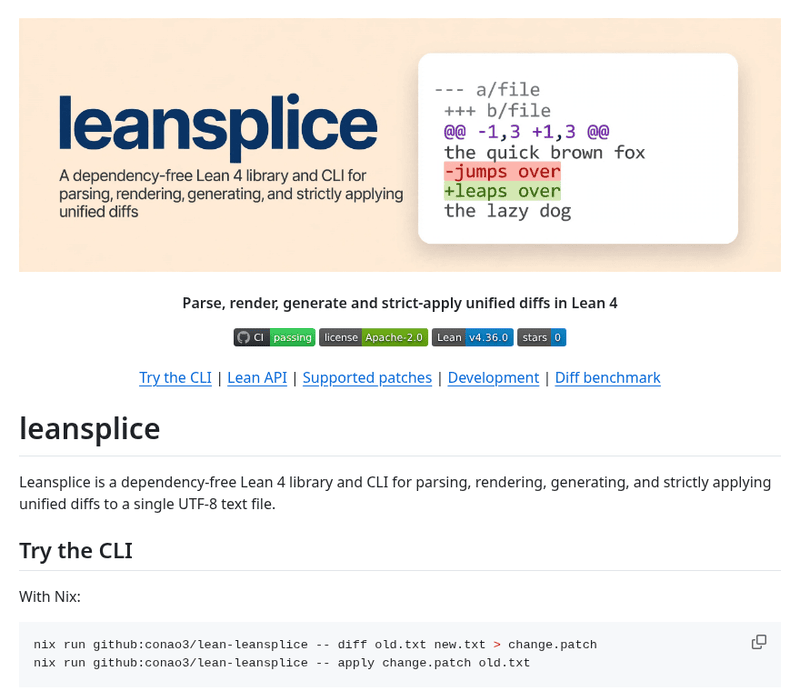

Title: 書かれた行番号どおりにだけパッチを当てるLean 4のunified diffライブラリleanspliceを作った
Date: 2026-11-27 23:07
Updated: 2026-11-27 23:07
Draft: true
Tags: lean diff git differential-testing release lean-leansplice


Lean 4でunified diffを生成し、パッチに書かれた行番号どおりにだけ適用するライブラリとCLIのleanspliceを作りました。
`git apply` は行がずれたファイルでもhunkの位置を探して当てますが、leanspliceは行番号と中身が合わないパッチでは当てた結果を出力せずにエラーで終わります。

リポジトリは [conao3/lean-leansplice](https://github.com/conao3/lean-leansplice) で、ライセンスはApache-2.0です。
Lean 4.36.0の標準ライブラリだけで書いています。

この記事はmainブランチのcommit [b4fa6cb](https://github.com/conao3/lean-leansplice/commit/b4fa6cb1026dc1d7b9bdc849a627a2d7833330c0) をもとにしています。

<div class="github-card" data-repo="conao3/lean-leansplice"><a href="https://github.com/conao3/lean-leansplice"><span class="github-card-name"><svg class="github-card-mark" viewBox="0 0 16 16" aria-hidden="true"><path d="M6.766 11.328c-2.063-.25-3.516-1.734-3.516-3.656 0-.781.281-1.625.75-2.188-.203-.515-.172-1.609.063-2.062.625-.078 1.468.25 1.968.703.594-.187 1.219-.281 1.985-.281.765 0 1.39.094 1.953.265.484-.437 1.344-.765 1.969-.687.218.422.25 1.515.046 2.047.5.593.766 1.39.766 2.203 0 1.922-1.453 3.375-3.547 3.64.531.344.89 1.094.89 1.954v1.625c0 .468.391.734.86.547C13.781 14.359 16 11.53 16 8.03 16 3.61 12.406 0 7.984 0 3.563 0 0 3.61 0 8.031a7.88 7.88 0 0 0 5.172 7.422c.422.156.828-.125.828-.547v-1.25c-.219.094-.5.156-.75.156-1.031 0-1.64-.562-2.078-1.609-.172-.422-.36-.672-.719-.719-.187-.015-.25-.093-.25-.187 0-.188.313-.328.625-.328.453 0 .844.281 1.25.86.313.452.64.655 1.031.655s.641-.14 1-.5c.266-.265.47-.5.657-.656"/></svg><span>conao3/<strong>lean-leansplice</strong></span></span><span class="github-card-description">Unified diff parse, render, strict apply and diff generation for Lean 4</span><span class="github-card-footer"><span class="github-card-language"><span class="github-card-language-color"></span>Lean</span><span class="github-card-star"><svg viewBox="0 0 16 16" aria-hidden="true"><path d="M8 .25a.75.75 0 0 1 .673.418l1.882 3.815 4.21.612a.75.75 0 0 1 .416 1.279l-3.046 2.97.719 4.192a.751.751 0 0 1-1.088.791L8 12.347l-3.766 1.98a.75.75 0 0 1-1.088-.79l.72-4.194L.818 6.374a.75.75 0 0 1 .416-1.28l4.21-.611L7.327.668A.75.75 0 0 1 8 .25Z"/></svg><span>Star</span><span class="github-card-star-count" hidden></span></span></span></a></div>


# CLIでdiffを作って当てる

CLIはNixで動かせて、READMEの冒頭にも `nix run` の例を載せています。



`nix shell` でleanspliceを `PATH` に入れて2つのファイルからパッチを作ります。

```console
$ nix shell github:conao3/lean-leansplice
$ printf 'apple\nbanana\ncherry\n' > old.txt
$ printf 'apple\nblueberry\ncherry\n' > new.txt
$ leansplice diff old.txt new.txt > change.patch
$ cat change.patch
--- a/file
+++ b/file
@@ -1,3 +1,3 @@
 apple
-banana
+blueberry
 cherry
```

`diff` はファイルの名前にかかわらずラベルを `a/file` と `b/file` にして、変更の前後に3行ずつ文脈を付けます。
`apply` はパッチと元のファイルを受け取って当てた結果を標準出力に書き、元のファイルは書き換えません。

```console
$ leansplice apply change.patch old.txt
apple
blueberry
cherry
```


# 行がずれたパッチは当てない

1から10までの行の `6` を `six` に変えるパッチを作り、先頭に `0` の行を足したファイルに当ててみます。

```console
$ seq 1 10 > a.txt
$ sed 's/^6$/six/' a.txt > b.txt
$ leansplice diff a.txt b.txt > six.patch
$ cat six.patch
--- a/file
+++ b/file
@@ -3,7 +3,7 @@
 3
 4
 5
-6
+six
 7
 8
 9
$ { echo 0; cat a.txt; } > file
$ leansplice apply six.patch file; echo $?
leansplice: hunk 1: source line 3 does not match
1
```

パッチのhunkでは3行目が `3` になっていますが、ファイルの3行目は `2` なのでleanspliceは終了コード1で終わります。
同じパッチを `git apply` に渡すと1行下でhunkを見つけて当てます。

```console
$ git apply -v six.patch
Checking patch file...
Hunk #1 succeeded at 4 (offset 1 line).
Applied patch file cleanly.
```

leanspliceの [apply](https://github.com/conao3/lean-leansplice/blob/b4fa6cb1026dc1d7b9bdc849a627a2d7833330c0/Leansplice.lean#L210-L255) はhunkの古い側と新しい側の行番号、文脈と削除の行の中身、それぞれの行末に改行があるかを確かめ、1つでも合わなければエラーを返します。
leanspliceはパッチに書かれた位置でだけhunkを照合するので、同じ行の並びがファイルの別の位置にあってもそこには当てません。


# Leanのライブラリとして使う

Lakeのプロジェクトから使うときは `lakefile.toml` にleanspliceを足して、Leanのバージョンをleanspliceと同じ4.36.0にします。

```toml
[[require]]
name = "leansplice"
git = "https://github.com/conao3/lean-leansplice.git"
rev = "main"
```

`Leansplice.diff` でパッチを作って `render` で文字列にし、 `parse` で読み戻してから `apply` で当てます。

```lean
import Leansplice

def patchText := Leansplice.render (Leansplice.diff "old\n" "new\n")

def result : Except Leansplice.Error String := do
  let patch ← Leansplice.parse patchText
  Leansplice.apply patch "old\n"

#eval result -- Except.ok "new\n"
```

`lake build` を実行すると `#eval` の結果として `Except.ok "new\n"` が出ます。
ライブラリはファイルを読み書きせずに文字列を受け取り、結果の文字列か `Leansplice.Error` を返します。

`diff` は近い変更を1つのhunkにまとめ、省略できる引数 `oldFile` 、 `newFile` 、 `context` を渡すとラベルと文脈の行数を変えられます。


# 扱えるパッチ

leanspliceが扱うのは1つのテキストファイルに対するパッチで、次の形を読めます。

-   `---` と `+++` のヘッダーとunifiedのhunk。前にGitの `diff --git` などの行が付いていても読む。
-   ファイル名の後にタブで続くタイムスタンプ。読むときに外す。
-   行数が1のときに数を省いた `@@ -1 +1 @@` のような範囲。
-   Gitの `\ No newline at end of file` の印と行の中のCR。
-   `/dev/null` を相手にするGitの作成と削除のパッチ。空のテキストに当てる、または空のテキストを作る。

バイナリや複数のファイル、名前の変更、モードの変更だけのパッチは範囲の外で、hunkの位置を探して当てる機能と3-way mergeも持っていません。


# Gitと両方向に確かめる

`make check` は `lake build` と `lake test` に続けて [scripts/git-differential.sh](https://github.com/conao3/lean-leansplice/blob/b4fa6cb1026dc1d7b9bdc849a627a2d7833330c0/scripts/git-differential.sh) を実行します。
このスクリプトは `git diff --no-index` が作ったパッチをleanspliceで当てる向きと、leanspliceが作ったパッチを `git apply` で当てる向きの両方で、結果を期待するファイルと `cmp` で比べます。

```console
$ nix develop --command make check 2>&1 | grep -E '^(Leansplice|Git|CLI)'
Leansplice golden and round-trip tests passed.
Git interoperability: replacement
Git interoperability: both-no-final-lf
Git interoperability: add-final-lf
Git interoperability: remove-final-lf
Git interoperability: unterminated-context
Git interoperability: blank-and-unicode
Git interoperability: crlf
Git interoperability: multiple-hunks
Git interoperability: empty-source
Git interoperability: empty-target
Git interoperability: creation and deletion headers
CLI reports stdout failure: diff
CLI reports stdout failure: apply
```

比べる組は1行の置き換えや末尾の改行の有無の変化、空行とUnicodeの文字、CRLF、複数のhunk、空のファイルからの作成と空のファイルへの削除などです。

テストの [Tests.lean](https://github.com/conao3/lean-leansplice/blob/b4fa6cb1026dc1d7b9bdc849a627a2d7833330c0/Tests.lean) は関数の結果を期待する値と比べ、乱数で作った80組のテキストでは `diff` のパッチを `render` と `parse` で往復させてから当てて、新しいテキストになることを確かめています。
leanspliceの動作は、このテストとGitとの差分テストで確かめています。


# diffの作り方

`diff` が使う [editScript](https://github.com/conao3/lean-leansplice/blob/b4fa6cb1026dc1d7b9bdc849a627a2d7833330c0/Leansplice.lean#L351-L387) は2つのテキストの先頭と末尾で一致する行を除いて、残った行についてMyersのアルゴリズムで最短の編集スクリプトを探します。
追加と削除が合わせて64行を超えると探索をやめ、同じ行の出現を前から順に対にして、両側で順序の保たれる最も長い対の並びを残します。

64行を超えたときの方法は同じ行が何度も現れるテキストで比較を繰り返さずに済みますが、最短の編集スクリプトより大きいパッチを作ることがあります。
テストではどちらの方法で作ったパッチも `apply` で元のテキストに当てると新しいテキストになることを確かめています。

IssueやPRは大歓迎です。

