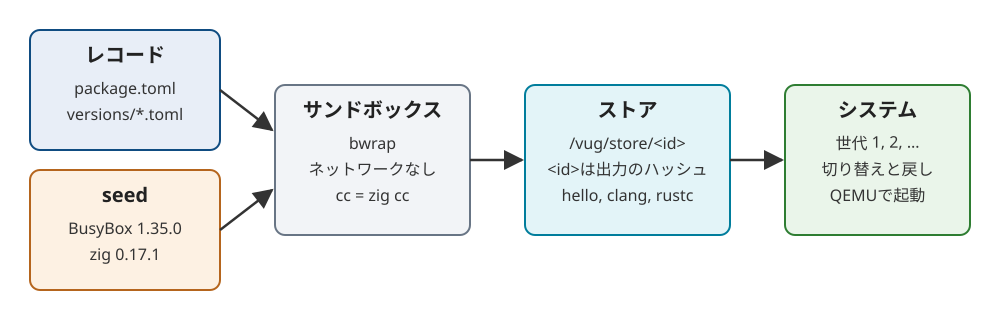

Title: BusyBoxとzigの2つのバイナリから、TOMLのレコードだけでLinuxを組み立てるパッケージマネージャーvugを作った
Date: 2026-11-27 23:11
Updated: 2026-11-27 23:11
Draft: true
Tags: rust package-management linux zig lean lean-leanfran release rust-vug vug-packages


宣言的なパッケージマネージャーのvugをRustで作りました。
パッケージとサービスとシステムをデータだけのTOMLのレコードで書くと、BusyBoxとzigの2つのバイナリから始まるサンドボックスでビルドして、QEMUで起動するLinuxのシステムまで組み立てます。

ビルドの出力は中身のハッシュを名前にしたストアのディレクトリに置きます。
システムはストアのパスを集めた世代なので、切り替えたり前の世代に戻したりできます。

レコードは [conao3/vug-packages](https://github.com/conao3/vug-packages) に置いていて、この記事を書いた時点で1,295件のパッケージがあります。

リポジトリは [conao3/rust-vug](https://github.com/conao3/rust-vug) で、ライセンスは [Apache-2.0](https://github.com/conao3/rust-vug/blob/7026623/LICENSE) です。
vug-packagesのライセンスは [MIT](https://github.com/conao3/vug-packages/blob/004fd8f/LICENSE) で、この記事ではvug 0.2.28とvug-packagesの [004fd8f](https://github.com/conao3/vug-packages/commit/004fd8f) を使いました。

<div class="github-card" data-repo="conao3/rust-vug"><a href="https://github.com/conao3/rust-vug"><span class="github-card-name"><svg class="github-card-mark" viewBox="0 0 16 16" aria-hidden="true"><path d="M6.766 11.328c-2.063-.25-3.516-1.734-3.516-3.656 0-.781.281-1.625.75-2.188-.203-.515-.172-1.609.063-2.062.625-.078 1.468.25 1.968.703.594-.187 1.219-.281 1.985-.281.765 0 1.39.094 1.953.265.484-.437 1.344-.765 1.969-.687.218.422.25 1.515.046 2.047.5.593.766 1.39.766 2.203 0 1.922-1.453 3.375-3.547 3.64.531.344.89 1.094.89 1.954v1.625c0 .468.391.734.86.547C13.781 14.359 16 11.53 16 8.03 16 3.61 12.406 0 7.984 0 3.563 0 0 3.61 0 8.031a7.88 7.88 0 0 0 5.172 7.422c.422.156.828-.125.828-.547v-1.25c-.219.094-.5.156-.75.156-1.031 0-1.64-.562-2.078-1.609-.172-.422-.36-.672-.719-.719-.187-.015-.25-.093-.25-.187 0-.188.313-.328.625-.328.453 0 .844.281 1.25.86.313.452.64.655 1.031.655s.641-.14 1-.5c.266-.265.47-.5.657-.656"/></svg><span>conao3/<strong>rust-vug</strong></span></span><span class="github-card-description">A package manager and system builder with declarative TOML package records, a content-addressed store, and sandboxed builds</span><span class="github-card-footer"><span class="github-card-language"><span class="github-card-language-color" style="background-color: #dea584"></span>Rust</span><span class="github-card-star"><svg viewBox="0 0 16 16" aria-hidden="true"><path d="M8 .25a.75.75 0 0 1 .673.418l1.882 3.815 4.21.612a.75.75 0 0 1 .416 1.279l-3.046 2.97.719 4.192a.751.751 0 0 1-1.088.791L8 12.347l-3.766 1.98a.75.75 0 0 1-1.088-.79l.72-4.194L.818 6.374a.75.75 0 0 1 .416-1.28l4.21-.611L7.327.668A.75.75 0 0 1 8 .25Z"/></svg><span>Star</span><span class="github-card-star-count" hidden></span></span></span></a></div>

<div class="github-card" data-repo="conao3/vug-packages"><a href="https://github.com/conao3/vug-packages"><span class="github-card-name"><svg class="github-card-mark" viewBox="0 0 16 16" aria-hidden="true"><path d="M6.766 11.328c-2.063-.25-3.516-1.734-3.516-3.656 0-.781.281-1.625.75-2.188-.203-.515-.172-1.609.063-2.062.625-.078 1.468.25 1.968.703.594-.187 1.219-.281 1.985-.281.765 0 1.39.094 1.953.265.484-.437 1.344-.765 1.969-.687.218.422.25 1.515.046 2.047.5.593.766 1.39.766 2.203 0 1.922-1.453 3.375-3.547 3.64.531.344.89 1.094.89 1.954v1.625c0 .468.391.734.86.547C13.781 14.359 16 11.53 16 8.03 16 3.61 12.406 0 7.984 0 3.563 0 0 3.61 0 8.031a7.88 7.88 0 0 0 5.172 7.422c.422.156.828-.125.828-.547v-1.25c-.219.094-.5.156-.75.156-1.031 0-1.64-.562-2.078-1.609-.172-.422-.36-.672-.719-.719-.187-.015-.25-.093-.25-.187 0-.188.313-.328.625-.328.453 0 .844.281 1.25.86.313.452.64.655 1.031.655s.641-.14 1-.5c.266-.265.47-.5.657-.656"/></svg><span>conao3/<strong>vug-packages</strong></span></span><span class="github-card-description">Package records for vug</span><span class="github-card-footer"><span></span><span class="github-card-star"><svg viewBox="0 0 16 16" aria-hidden="true"><path d="M8 .25a.75.75 0 0 1 .673.418l1.882 3.815 4.21.612a.75.75 0 0 1 .416 1.279l-3.046 2.97.719 4.192a.751.751 0 0 1-1.088.791L8 12.347l-3.766 1.98a.75.75 0 0 1-1.088-.79l.72-4.194L.818 6.374a.75.75 0 0 1 .416-1.28l4.21-.611L7.327.668A.75.75 0 0 1 8 .25Z"/></svg><span>Star</span><span class="github-card-star-count" hidden></span></span></span></a></div>


# vugでできること

-   パッケージとサービスとシステムを、データだけのTOMLのレコードで書く。
-   BusyBoxとzigから始まるサンドボックスでパッケージをビルドし、出力を中身のハッシュの名前でストアに置く。
-   ストアにあるパッケージのプログラムを、 `/vug/store` を見せた環境で動かす。
-   システムのレコードから、QEMUで起動するディスクイメージを作る。
-   動いているマシンの上で次のシステムをビルドして切り替え、前の世代に戻す。
-   ビルドの出力を署名つきのバイナリキャッシュに書き出し、別のマシンでビルドの代わりに取り込む。


# パッケージをTOMLで書く

パッケージのレコードは `packages/<名前の先頭2文字>/<名前>/` に置き、 `package.toml` とバージョンごとに1つの `versions/<バージョン>.toml` からなります。
GNU Helloのバージョン2.12.2のレコードは次のとおりです。

```toml
version = "2.12.2"

[source]
url = "https://ftp.gnu.org/gnu/hello/hello-2.12.2.tar.gz"
sha256 = "5a9a996dc292cc24dcf411cee87e92f6aae5b8d13bd9c6819b4c7a9dce0818ab"

[build]
kind = "autotools"
configure-flags = [
  "--disable-nls",
]

[dependencies]
build = [
  "make",
]
run = []

[check]
enabled = true
skip = []
```

レコードが持つのはソースのURLとSHA-256とビルドの種類と依存のデータだけです。
vugが `autotools` や `cmake` や `cargo` のようなビルドの種類ごとにビルドの手順を持っていて、レコードには種類とフラグを書きます。

`vug record check-tree` はリポジトリのすべてのレコードを検査します。

```sh
$ vug record check-tree --root .
{
  "Errors": [],
  "Packages": 1295,
  "Systems": 5,
  "Versions": 1328
}
```


# BusyBoxとzigから始まるサンドボックスでビルドする



vugのビルドはseedと呼ぶ2つのバイナリから始まり、vug-packagesでは `seed.toml` にその2つを書いています。

```toml
[busybox]
url = "https://busybox.net/downloads/binaries/1.35.0-x86_64-linux-musl/busybox"
sha256 = "6e123e7f3202a8c1e9b1f94d8941580a25135382b99e8d3e34fb858bba311348"

[zig]
url = "https://ziglang.org/download/0.17.1/zig-x86_64-linux-0.17.1.tar.xz"
sha256 = "3581863e3cbcfd0fce0efc682ce7e9e93da96668a977791d356a26d2a7e9b17a"
```

seedのBusyBoxが `sh` や `tar` や `sed` になり、 `cc` と `c++` は `zig cc` と `zig c++` を呼ぶので、makeやperlやpython、LLVMやLinuxのカーネルもこのseedからビルドします。

RustとGoのコンパイラは上流が配っているバイナリを展開したものです。
この記事を書いた時点で99件のパッケージはNixのバイナリキャッシュから出力を取り込むレコードです。

ビルドは `bwrap --unshare-all` でネットワークとホストのファイルシステムから切り離して動かし、見えるのはseedと宣言した依存とソースだけです。

出力は `/vug/store/<id>` に置きます。
`<id>` は出力のファイルの木をBLAKE3でハッシュした値から作るので、パッケージの名前とバージョンはパスに入りません。

出力をストアに置いて世代を切り替える作りはNixやGuixと似ていますが、 [既定のNix](https://nix.dev/manual/nix/2.28/glossary#gloss-input-addressed-store-object) と [Guix](https://guix.gnu.org/manual/en/html_node/Features.html) はストアのパスをビルドの入力から決めて、vugは [出力の中身のハッシュ](https://github.com/conao3/rust-vug/blob/7026623/docs/build.md#store-paths) から決めます。

出力は自分のパスを含むことがあるので、ビルドでは [同じ長さの仮のパス](https://github.com/conao3/rust-vug/blob/7026623/docs/build.md#self-references) に出力を入れて、ハッシュを計算してから仮のパスを本当のパスに書き換えます。

```sh
$ vug package build-package --root . --name hello --output text
/vug/store/mrhlynr4ckz4frus7zgii7cj4374xedx
$ vug package run-package --root . --name hello --program bin/hello
Hello, world!
```

`build-package` はストアに出力が無ければビルドして、ストアのパスを返します。
`run-package` はストアを `/vug/store` にマウントした名前空間でプログラムを動かすので、ストアの共有ライブラリを使うプログラムも動きます。

vug-packagesにはclangを含むLLVMや、vug自身のレコードもあります。

```sh
$ vug package run-package --root . --name llvm:tools --program bin/clang --arguments --version
clang version 23.1.6
Target: x86_64-unknown-linux-musl
Thread model: posix
InstalledDir: /vug/store/5sbeidlvsehmdgmsvswgq56pnvi7aetf/bin
$ vug package run-package --root . --name vug --program bin/vug --arguments --version
vug 0.2.28
```

`llvm:tools` はLLVMのパッケージの出力のうち、補助ツールを指しています。


# システムを組み立ててQEMUで起動する

システムのレコードはカーネル、パッケージ、 `/etc` の下のファイル、ユーザーを並べます。
vug-packagesの `systems/minimal.toml` は、起動するといくつかのコマンドのバージョンを表示してbashを動かすシステムです。

```toml
name = "minimal"
kernel = "linux"
init = "{pkg:bash}/bin/bash /etc/vug-init"
sh = "{pkg:bash}/bin/bash"
packages = [
  "bash",
  "coreutils",
  "findutils",
  "grep",
  "procps",
  "sed",
  "util-linux",
]

[[file]]
path = "/etc/vug-init"
mode = "755"
content = """
#!/bin/bash
export PATH=/bin
mount -t sysfs sys /sys
echo "vug system: $(cat /etc/hostname)"
bash --version | head -n 1
ls --version | head -n 1
mount --version
uname -srm
echo "processes: $(ps -e | wc -l)"
echo VUG-SYSTEM-OK
exec bash
"""
```

`vug system build-image` はシステムをストアに組み立てて、ディスクイメージを書き出します。
`build-image` が出力するJSONの `Kernel` はカーネルのファイルのパスなので、それをQEMUに渡して起動します。

```sh
$ KERNEL=$(vug system build-image --root . --name minimal --image minimal.img | jq -r .Kernel)
$ qemu-system-x86_64 -enable-kvm -m 2048 -nographic \
    -kernel "$KERNEL" \
    -drive file=minimal.img,if=virtio,format=raw \
    -append "console=ttyS0 root=/dev/vda rw init=/vug/profiles/system/init"
```

カーネルのログを除くと、シリアルコンソールには次のように出ます。

```sh
vug system: vug-minimal
GNU bash, version 5.3.0(1)-release (x86_64-unknown-linux-musl)
ls (GNU coreutils) 9.12
mount from util-linux 2.41.2 (libmount 2.41.2: namespaces, idmapping, fd-based-mount, statx, assert, debug)
Linux 6.18.45 x86_64
processes: 38
VUG-SYSTEM-OK
```

動いているマシンでは、 `/vug/tree` に置いたレコードを書き換えて `vug system switch-system` を実行すると、マシンの上で次のシステムをビルドして切り替えます。
切り替えるたびに世代が増えて、 `/vug/profiles/system-<N>/bin/switch-to-system` を実行すると世代Nに戻ります。

システムを切り替える方法と前の世代に戻す方法は [docs/system.md](https://github.com/conao3/rust-vug/blob/7026623/docs/system.md#switching) に書いています。

vug-packagesには [systemdとPAMとsshdを入れたシステム](https://github.com/conao3/vug-packages/blob/004fd8f/systems/systemd.toml) や [EFIで起動してGPTのディスクを使うシステム](https://github.com/conao3/vug-packages/blob/004fd8f/systems/generic.toml) があります。
このほかにも [swayのデスクトップを足すサービス](https://github.com/conao3/vug-packages/blob/004fd8f/services/sway.toml) があります。
vugで作ったシステムを起動したのはQEMUの中だけで、 [rust-vugのREADME](https://github.com/conao3/rust-vug/blob/7026623/README.md#vug) にも書いているとおり実機ではまだ起動していません。


# ビルドの出力をバイナリキャッシュで配る

`vug store export-cache` はストアの出力を、HTTPで配れるディレクトリに書き出して、エントリーごとにEd25519で署名します。
別のマシンで `--binary-cache` と `--trusted-key` を付けてビルドすると、信頼する鍵が署名した出力だけをキャッシュから取り込みます。
キャッシュの置き方は [docs/cache.md](https://github.com/conao3/rust-vug/blob/7026623/docs/cache.md) に書いています。


# バージョンの比較と名前の規則をLean 4で書く

vugのバージョンの比較と、パッケージの名前とパスの規則はLean 4で書いて、 [leanfran](https://github.com/conao3/lean-leanfran) でRustのコードにしています。

```sh
$ vug version compare-versions --left 1.2.10 --right 1.2.9
{
  "Ordering": "Greater"
}
```

バージョンの数字の並びは数として比べるので、1.2.10は1.2.9より大きくなります。

どの2つの文字列でも、この比較で [左右を入れ替えると結果が逆になること](https://github.com/conao3/rust-vug/blob/7026623/src/version.rs#L422) と、 [小さいという関係が推移的であること](https://github.com/conao3/rust-vug/blob/7026623/src/version.rs#L444) をLeanで証明しています。
証明はLeanの定義についてのもので、leanfranが生成したRustのコードが定義どおりに動くことは証明の外にあります。


# vugを入れる

[リリース](https://github.com/conao3/rust-vug/releases/tag/v0.2.28) に、x86\_64のLinuxで動く静的リンクの実行ファイルを置いています。

```sh
$ curl -sL https://github.com/conao3/rust-vug/releases/download/v0.2.28/vug-0.2.28-x86_64-linux-musl.tar.gz | tar xz
$ ./vug --version
vug 0.2.28
```

パッケージのビルドには `PATH` に `bwrap` が要ります。
空のストアで最初にビルドするときは、seedを取ってきてツールチェーンからビルドします。


# おわりに

レコードはデータだけなので、パッケージを足すときはソースのURLとSHA-256とビルドの種類と依存を書いて、 `check-tree` とビルドで確かめます。
vug-packagesのレコードを読んで、気になったパッケージをvugでビルドしてみてください。

