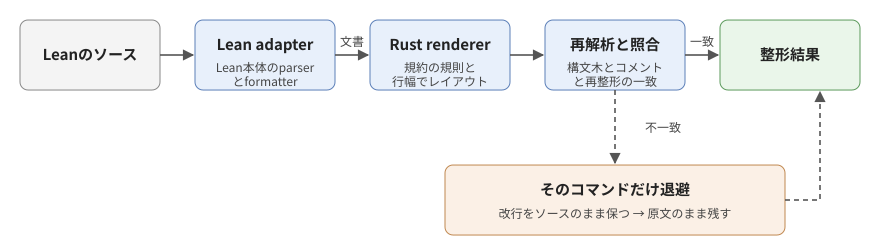
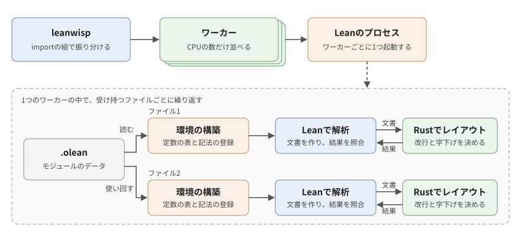
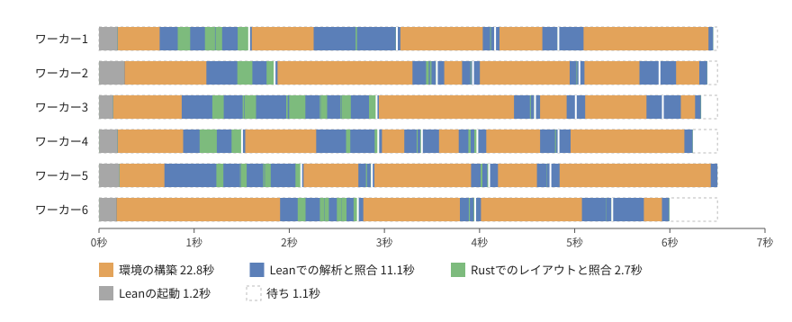

Title: Lean 4をLean本体のparserで整形するleanwispを作った
Date: 2026-11-17 07:00
Tags: lean rust mathlib parser release rust-leanwisp


Lean 4のフォーマッタleanwispを作りました。
Lean本体のparserで読み、Leanのformatterが作る文書を、Leanの標準ライブラリとMathlibのスタイルガイドから決めた形に並べ直します。
整形した結果はもう一度Leanで解析し、構文木とコメントが元と一致すること、再び整形しても変わらないことをコマンドごとに確かめます。
leanwispをMathlibの31ファイルに掛けると、すべてのファイルが整形後もコンパイルでき、Mathlib自身のスタイルのlinterの警告は0のままでした。

リポジトリは[conao3/rust-leanwisp](https://github.com/conao3/rust-leanwisp)で、ライセンスはApache-2.0です。
この記事はLean 4.35.0とleanwisp 0.3.0で動かした結果をもとに書いています。

<div class="github-card" data-repo="conao3/rust-leanwisp"><a href="https://github.com/conao3/rust-leanwisp"><span class="github-card-name"><svg class="github-card-mark" viewBox="0 0 16 16" aria-hidden="true"><path d="M6.766 11.328c-2.063-.25-3.516-1.734-3.516-3.656 0-.781.281-1.625.75-2.188-.203-.515-.172-1.609.063-2.062.625-.078 1.468.25 1.968.703.594-.187 1.219-.281 1.985-.281.765 0 1.39.094 1.953.265.484-.437 1.344-.765 1.969-.687.218.422.25 1.515.046 2.047.5.593.766 1.39.766 2.203 0 1.922-1.453 3.375-3.547 3.64.531.344.89 1.094.89 1.954v1.625c0 .468.391.734.86.547C13.781 14.359 16 11.53 16 8.03 16 3.61 12.406 0 7.984 0 3.563 0 0 3.61 0 8.031a7.88 7.88 0 0 0 5.172 7.422c.422.156.828-.125.828-.547v-1.25c-.219.094-.5.156-.75.156-1.031 0-1.64-.562-2.078-1.609-.172-.422-.36-.672-.719-.719-.187-.015-.25-.093-.25-.187 0-.188.313-.328.625-.328.453 0 .844.281 1.25.86.313.452.64.655 1.031.655s.641-.14 1-.5c.266-.265.47-.5.657-.656"/></svg><span>conao3/<strong>rust-leanwisp</strong></span></span><span class="github-card-description">A parser-aware Lean 4 source formatter with a Rust layout engine</span><span class="github-card-footer"><span class="github-card-language"><span class="github-card-language-color" style="background-color: #dea584"></span>Rust</span><span class="github-card-star"><svg viewBox="0 0 16 16" aria-hidden="true"><path d="M8 .25a.75.75 0 0 1 .673.418l1.882 3.815 4.21.612a.75.75 0 0 1 .416 1.279l-3.046 2.97.719 4.192a.751.751 0 0 1-1.088.791L8 12.347l-3.766 1.98a.75.75 0 0 1-1.088-.79l.72-4.194L.818 6.374a.75.75 0 0 1 .416-1.28l4.21-.611L7.327.668A.75.75 0 0 1 8 .25Z"/></svg><span>Star</span><span class="github-card-star-count" hidden></span></span></span></a></div>


# 整形の例

空白と改行が乱れた次の例を整形します。

```lean
@[simp]
theorem double_eq(n:Nat):2*n=n+n:=by
     omega
structure Point where
  x : Nat
  y : Nat
instance:Add Point where add a b:={x:=a.x+b.x,y:=a.y+b.y}
def sumTo (n : Nat) : Nat := Id.run do
    let mut acc := 0
    for i in [0:n+1] do
        acc := acc + i
    return acc
```

`leanwisp source format-source` に渡すと、次の形になります。

```lean
@[simp] theorem double_eq (n : Nat) : 2 * n = n + n := by omega
structure Point where
  x : Nat
  y : Nat
instance : Add Point where
  add a b := { x := a.x + b.x, y := a.y + b.y }
def sumTo (n : Nat) : Nat := Id.run do
  let mut acc := 0
  for i in [0:n + 1] do
    acc := acc + i
  return acc
```

`:` や演算子の前後に空白を入れ、1行に収まる定理は属性ごと1行にします。
`instance` のフィールドは `where` の次の行に移り、 `do` のブロックは宣言の始まりから2桁の字下げにそろいました。
出力は構文と行幅だけで決まるので、元の改行の入れ方が違っても同じ形になります。


# Lean本体のparserを使う理由

Leanでは、ファイルの中で新しい記法を足せます。
`notation` や `syntax` や `macro` で足した記法は、その後ろのコードですぐに使えます。
`import` したモジュールが足した記法も同じです。
Mathlibのコードの大半はそうした記法で書かれています。
決まった文法を持つ別のparserでは、こうしたコードを正しく読めません。

leanwispはLean本体のparserでコマンドを1つずつ読みます。
記法を足すコマンドだけをelaborateし、続くコマンドをその記法で読めるようにします。
定理の証明や `#eval` は実行しません。

```lean
infixl:65 " +++ " => Nat.add
#eval (3: Nat)+++4
```

1行目の記法を読み込んでから2行目を整形するので、 `#eval (3 : Nat) +++ 4` になります。



整形はLean adapterとRust rendererの2段で行います。
Leanで書いたadapterがLeanの各構文に登録されたformatterを呼んで改行の候補と字下げを持つ文書を作り、Rustのrendererがその文書のレイアウトを行幅に合わせて決めます。


# スタイルガイドから決めた形

Leanのformatterの文書をそのまま並べると、Mathlibで使われている形と違う箇所があります。
たとえば、短い定義でも `:=` の後で必ず改行する文書になっています。
leanwispはLeanの[標準ライブラリのスタイルガイド](https://github.com/leanprover/lean4/blob/master/doc/std/style.md)と[Mathlibのスタイルガイド](https://mathlib.org/contribute/style.html)に合わせて、文書の改行の候補を置き換えてから並べます。

-   1行は100字までにします。
-   宣言のシグネチャが収まらないときは、 `:` を行末に置き、続きの行を4桁字下げします。
-   本体は収まれば `:=` の行に置き、収まらなければ次の行に2桁字下げして置きます。
-   `by` と `do` は行末に置き、ブロックは宣言の始まりから2桁字下げします。
-   `instance ... where` のフィールドは1つずつ次の行以降に置きます。

2つのガイドがどちらの書き方も認めているところは、書き方を1つに決めました。
属性は宣言全体が1行に収まるときは同じ行に、収まらないときは別の行に置きます。
宣言の間の空行は0行か1行ならそのまま残し、2行以上を1行にします。


# 整形で壊さないための検査

Leanは字下げや改行で意味が変わる言語です。
改行を1つ動かしただけで、コードが別の項として読まれたり、読めなくなったりします。

そこでleanwispは整形した結果をもう一度Leanで解析します。
構文木が元と一致すること、コメントの中身と順序が元と一致すること、再び整形しても同じ結果になることを確かめます。

どれかが合わないときは合わないコマンドを特定し、まず元の改行を保ったまま行の中の空白と字下げだけを整えます。
それでも合わなければ、そのコマンドだけ元のまま残します。
ファイルのほかの部分は整形したままです。
Leanにformatterが無い構文も、そのコマンドを元のまま残します。

```lean
syntax "twice! " term : term
macro_rules
  | `(twice! $x) => `($x + $x)
def four:Nat:=twice! 2
```

`macro_rules` の中の `$x` にはLeanのformatterがありません。
そのため `macro_rules` のコマンドは元のまま残り、続く `def four` は `def four : Nat :` twice! 2= に整形されます。
残したコマンドの行番号と理由を表示します。

```text
Twice.lean:2: kept source: Unknown constant `term.pseudo.antiquot`
```


# Mathlibに掛けた結果

[Mathlibの56a0058](https://github.com/leanprover-community/mathlib4/tree/56a005855ea17e0b0958f73ec801ae140b0a1679)から31ファイルを選んで整形しました。
主要な `Basic` のファイルと、10の分野からそれぞれ最小と中央のサイズのファイルを選び、合わせて9,998行です。
整形前と整形後のファイルを、Mathlibのスタイルのlinterを有効にしてコンパイルしました。

<table border="2" cellspacing="0" cellpadding="6" rules="groups" frame="hsides">


<colgroup>
<col  class="org-left" />

<col  class="org-left" />
</colgroup>
<thead>
<tr>
<th scope="col" class="org-left">検査</th>
<th scope="col" class="org-left">結果</th>
</tr>
</thead>
<tbody>
<tr>
<td class="org-left">整形後のコンパイル</td>
<td class="org-left">31/31</td>
</tr>

<tr>
<td class="org-left">もう一度整形して変わらない</td>
<td class="org-left">31/31</td>
</tr>

<tr>
<td class="org-left">スタイルのlinterの警告</td>
<td class="org-left">整形前0、整形後0</td>
</tr>

<tr>
<td class="org-left">変わった行</td>
<td class="org-left">9,998行中3,351行</td>
</tr>

<tr>
<td class="org-left">元のまま残したコマンド</td>
<td class="org-left">7ファイルの10件</td>
</tr>

<tr>
<td class="org-left">整形にかかった時間</td>
<td class="org-left">31ファイルを6コアで6.9秒</td>
</tr>
</tbody>
</table>

変わった行の多くは、ガイドが認める別の書き方からleanwispが決めた形に変えたものです。
たとえば1行に収まるシグネチャを1行にし、短いtacticのブロックを `by` と同じ行にまとめ、2行続いた空行を1行にしています。
元のまま残した10件のうち3件は、Leanにformatterが無い構文でした。
残りの7件は、leanwispの形にすると解析できないか構文木が変わったため、検査で元のまま残しました。

同じ31ファイルを、Lean 4.35.0向けのフォーマッタ[lean-fmt](https://github.com/jcreinhold/lean-fmt)で同じ条件で確かめると33.3秒かかりました。
変わっていないファイルは結果のキャッシュを使うので、leanwispの2回目は0.09秒で終わります。

検査の手順とファイルごとの結果と差分は、リポジトリの[Mathlibの検証記録](https://github.com/conao3/rust-leanwisp/blob/master/docs/mathlib-evaluation.md)にあります。


# 整形の時間の内訳



`--paths` で複数のファイルを渡すと、leanwispはCPUの数だけワーカーを並べます。
同じモジュールを `import` するファイルは同じワーカーに振り分けます。
ワーカーはそれぞれLeanのプロセスを1つ起動し、受け持つファイルを順に整形します。

Leanのプロセスはファイルごとに、まずそのファイルの `import` から環境を作ります。
環境は、 `import` したモジュールの定数の表と、記法やformatterの登録をまとめたものです。
モジュールのデータが入った `.olean` は最初に使うときに読み、同じプロセスの次のファイルでは読み直しません。
環境ができたらLeanが解析して文書を作り、Rustが行幅に合わせてレイアウトを決め、その結果をLeanがもう一度解析して照合します。



この図は、Mathlibの31ファイルを6つのワーカーで整形したときの、ワーカーごとの時間の使い方です。
この回は全体で6.5秒かかりました。
6つのワーカーの時間を合わせた39.0秒のうち、22.8秒が環境の構築です。
Leanでの解析と照合は11.1秒、Rustでのレイアウトと照合は2.7秒、Leanのプロセスの起動は1.2秒でした。
残りの1.1秒は、先に終わったワーカーがほかのワーカーを待っていた時間です。

環境の構築が長いのは、Mathlibのモジュールが大きいからです。
たとえば `NumberTheory/ModularForms/LevelOne.lean` は33万個あまりの定数を `import` します。
このファイルの環境を一から作ると、 `.olean` の読み込みに約0.5秒、定数の表に約0.4秒、記法などの登録に約0.5秒かかります。
Leanの記法は `import` したモジュールが足すので、整形を始める前にこの環境が要ります。


# 使い方

Nixがあれば、リポジトリから直接動かせます。

```sh
nix run github:conao3/rust-leanwisp -- \
  source format-source --file Example.lean --write
```

`check-source` は整形で変わるファイルがあると終了コード254で終わるので、CIで使えます。
`--paths` にディレクトリを渡すと、中の `.lean` ファイルをまとめて整形します。

エディタからは標準入力を整形して標準出力に返すフィルタとして呼べます。

```sh
leanwisp --output text source format-source --source file:///dev/stdin
```

`import` を含むファイルは親のディレクトリからLakeのプロジェクトを探し、そのプロジェクトのモジュールを読み込んで整形します。
読み込むモジュールは先に `lake build` でビルドしておきます。

行幅はプロジェクトの `leanwisp.toml` の `line-width` で変えられます。
整形したくない範囲は `-- leanwisp: off` と `-- leanwisp: on` の行で囲みます。


# 確かめられないこと

構文木が一致することは、elaborateした結果が一致することまでは示しません。
ソースの位置を見て振る舞いを変えるmacroは、整形で意味が変わる可能性があります。
Mathlibで確かめたのは31ファイルで、残りのファイルには掛けていません。
対応しているのはLean 4.35.0です。

