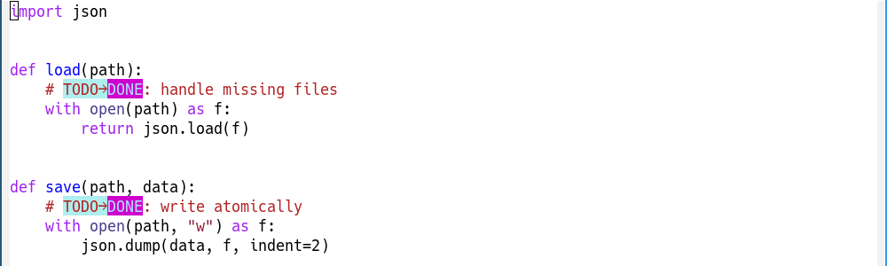
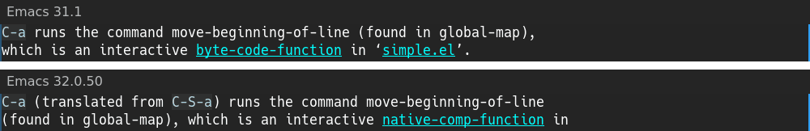
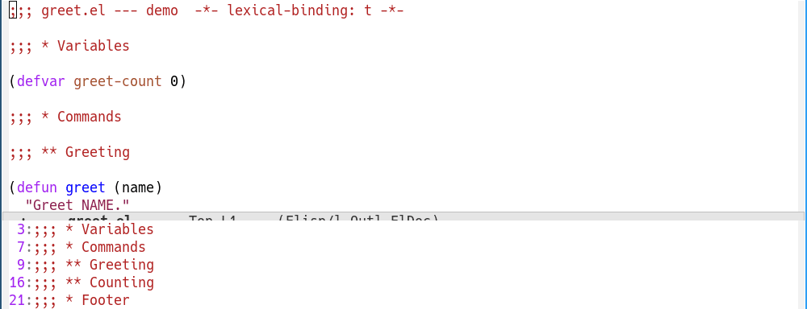
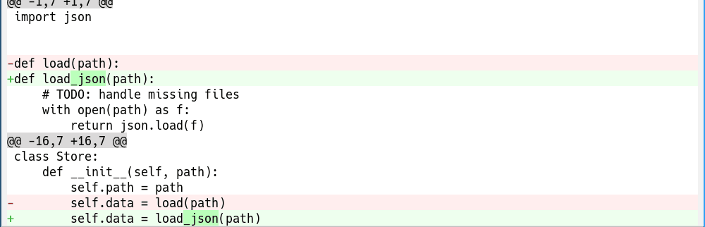

Title: Emacs開発版の新機能から、動かして楽しいものを画面つきで紹介する
Date: 2026-11-27 23:30
Updated: 2026-11-27 23:51
Tags: emacs release-notes


Emacsの開発版 (次のEmacs 32になるmaster) のNEWSから、動かしてすぐに違いが分かる新機能を選び、実際の画面と一緒に紹介します。
正規表現が入力の長さに比例する時間でマッチするようになったことと、置換のプレビューを中心にしました。

開発版のNEWSはmasterの [etc/NEWS](https://github.com/emacs-mirror/emacs/blob/caf462d7415cdd1ba4bcf23df69be3455165accc/etc/NEWS) に書き足されていて、この記事で使った [caf462d](https://github.com/emacs-mirror/emacs/commit/caf462d7415cdd1ba4bcf23df69be3455165accc) (2026-11-26) の時点で871行あります。
Emacs 31.1のNEWSが4,274行なので、まだ2割ほどです。

この記事はmasterに新機能が入るたびに書き足して、Emacs 32.1が出たらタイトルを「Emacs 32の新機能から」に変えます。


# 試した版

masterのEmacsはnix-communityの [emacs-overlay](https://github.com/nix-community/emacs-overlay) の `emacs-git` でビルドしました。

```sh
nix build github:nix-community/emacs-overlay/ff3361a80b6e0f5a51ddf6e43525125d5a3a7f97#emacs-git
```

`emacs --version` は `GNU Emacs 32.0.50` で、 `emacs-repository-version` はcaf462dです。
画面はすべて `emacs -Q` で起動して撮っていて、設定が要るものはその式を添えています。


# 正規表現が入力の長さに比例する時間でマッチする

[正規表現のエンジンが、マッチを線形時間で行うようになりました](https://github.com/emacs-mirror/emacs/blob/caf462d7415cdd1ba4bcf23df69be3455165accc/etc/NEWS#L704)。
これまでの実装は後戻りしながら探すので、組み合わせの多い正規表現では時間が指数的に伸びてEmacsが固まったように見えることがありました。

`a` か `aa` の繰り返しの後に `b` が来る正規表現を `a` だけの文字列に当てて時間を測ってみました。

```emacs-lisp
;;; regex-bench.el  -*- lexical-binding: t -*-
(dolist (n '(24 28 32 36))
  (let* ((s (make-string n ?a))
         (start (float-time)))
    (string-match "\\(?:a\\|aa\\)*b" s)
    (message "%2d chars: %8.3f s" n (- (float-time) start))))
```

```sh
$ emacs --batch -Q -l regex-bench.el    # Emacs 31.1
24 chars:    0.018 s
28 chars:    0.123 s
32 chars:    0.885 s
36 chars:    5.902 s
$ emacs --batch -Q -l regex-bench.el    # Emacs 32.0.50 (caf462d)
24 chars:    0.000 s
28 chars:    0.000 s
32 chars:    0.000 s
36 chars:    0.000 s
```

Emacs 31.1では4文字増えるごとに約7倍かかり、36文字で6秒近く止まりましたが、開発版はどの長さでも1ミリ秒未満で終わりました。
NEWSには例外も書かれていて、後方参照と `\{N,M\}` の繰り返しを使う正規表現は今も指数的な時間がかかることがあります。


# 置換の結果を、打つそばから画面で見る

[query-replace-show-preview](https://github.com/emacs-mirror/emacs/blob/caf462d7415cdd1ba4bcf23df69be3455165accc/etc/NEWS#L209) を設定すると、 `M-%` で置換後の文字列を打っているあいだに、ウィンドウに見えている一致の部分が置換後の姿で表示されます。

```emacs-lisp
(setopt query-replace-show-preview 'both)
```



画面は `M-% TODO RET` のあとで `DONE` まで打ったところで、2つの `TODO` に `TODO→DONE` と出ています。
`both` は置換の前後を並べて見せ、 `replacement-only` は置換後だけを見せます。

置換を始める前に、どこがどう変わるかを本文の上で確かめられます。


# 端末でも `C-S-a` のようなキーを区別する

端末エミュレーターが [Kitty Keyboard Protocol](https://github.com/emacs-mirror/emacs/blob/caf462d7415cdd1ba4bcf23df69be3455165accc/etc/NEWS#L64) に対応していると、 `emacs -nw` がそのプロトコルでキーを受け取ります。
GUIでしか区別できなかったキーの組み合わせを端末でも別のキーとして扱えます。

footで `emacs -nw` を動かし、 `C-h k` のあとに `C-S-a` を押して比べました。



Emacs 31.1には `C-S-a` が `C-a` として届いていて、開発版にはGUIと同じように `C-S-a` のまま届き、 `C-a` に読み替えられています。
`C-S-a` に別のコマンドを割り当てれば端末でも使い分けられます。


# コメントの見出しを、Outlineで畳んで一覧にする

[outline-use-comment-regexp](https://github.com/emacs-mirror/emacs/blob/caf462d7415cdd1ba4bcf23df69be3455165accc/etc/NEWS#L406) を `t` にすると、 `outline-minor-mode` が `;;; *` や `;;; **` のようにコメントで始まる行を見出しとして扱います。
見出しの深さは `*` の数で決まります。

```emacs-lisp
(setopt outline-use-comment-regexp t)
(add-hook 'emacs-lisp-mode-hook #'outline-minor-mode)
```

[outline-find-headings](https://github.com/emacs-mirror/emacs/blob/caf462d7415cdd1ba4bcf23df69be3455165accc/etc/NEWS#L418) はバッファの見出しをすべてXrefのバッファに並べます。



上がEmacs Lispのファイルで、下が `outline-find-headings` で出した見出しの一覧です。
一覧の行を選ぶとその見出しに移ります。


# 識別子の名前の変更を、diffで確かめてから当てる

[refactor](https://github.com/emacs-mirror/emacs/blob/caf462d7415cdd1ba4bcf23df69be3455165accc/etc/NEWS#L667) は、識別子の名前の変更や関数の切り出しのようなリファクタリングを、言語によらず同じコマンドで呼ぶためのライブラリです。
Eglotから切り出されたもので、Eglotが言語サーバーの機能をこのライブラリの操作として渡します。

PythonのファイルでEglotを `pylsp` につなぎ、関数 `load` の上で `M-x refactor-rename RET load_json RET` と打ちました。
`refactor-confirmation` を `diff` にしておくと、変更をすぐには当てずに `*refactor changes*` バッファにdiffで出します。

```emacs-lisp
(setopt refactor-confirmation 'diff)
```



定義の `def load` と呼び出しの `load(path)` が `load_json` に変わり、同じ名前の `json.load(f)` は言語サーバーが別のものと分かっているので残っています。
diffを確かめたら `C-c C-a` で1つずつ、 `C-c RET a` でまとめて当てられます。


# ローマ数字と数を変換する

[number-to-roman と roman-to-number](https://github.com/emacs-mirror/emacs/blob/caf462d7415cdd1ba4bcf23df69be3455165accc/etc/NEWS#L819) がどこからでも呼べる関数になりました。

```emacs-lisp
;;; roman.el  -*- lexical-binding: t -*-
(message "%s" (number-to-roman 2026))
(message "%s" (roman-to-number "XXXII"))
```

```sh
$ emacs --batch -Q -l roman.el
MMXXVI
32
```


# ほかに目についたもの

-   [canvas](https://github.com/emacs-mirror/emacs/blob/caf462d7415cdd1ba4bcf23df69be3455165accc/etc/NEWS#L731) の画像は、画素の配列を書き換えて `canvas-refresh` で描き直す、速い描き直しのための画像です。caf462dのビルドでは、X11とpgtkのどちらでも渡した配列の色が描かれなかったので、直ったら節にします。
-   [uuid](https://github.com/emacs-mirror/emacs/blob/caf462d7415cdd1ba4bcf23df69be3455165accc/etc/NEWS#L660) はUUIDを作ったり読んだりするライブラリです。
-   [Unicode 18.0](https://github.com/emacs-mirror/emacs/blob/caf462d7415cdd1ba4bcf23df69be3455165accc/etc/NEWS#L42) に対応しました。


# Emacs 27から開発版までの新機能

Emacs 27から開発版までのNEWSを、1つの版ごとに同じ形で紹介しています。

-   [Emacs 31の新機能から、動かして楽しいものを7つ画面つきで紹介する](https://s.conao3.com/blog/2026/a0c17f)
-   [Emacs 30の新機能から、動かして楽しいものを7つ画面つきで紹介する](https://s.conao3.com/blog/2026/771a69)
-   [Emacs 29の新機能から、動かして楽しいものを7つ画面つきで紹介する](https://s.conao3.com/blog/2026/43487f)
-   [Emacs 28の新機能から、動かして楽しいものを7つ画面つきで紹介する](https://s.conao3.com/blog/2026/664e4a)
-   [Emacs 27の新機能から、動かして楽しいものを7つ画面つきで紹介する](https://s.conao3.com/blog/2026/92689a)

