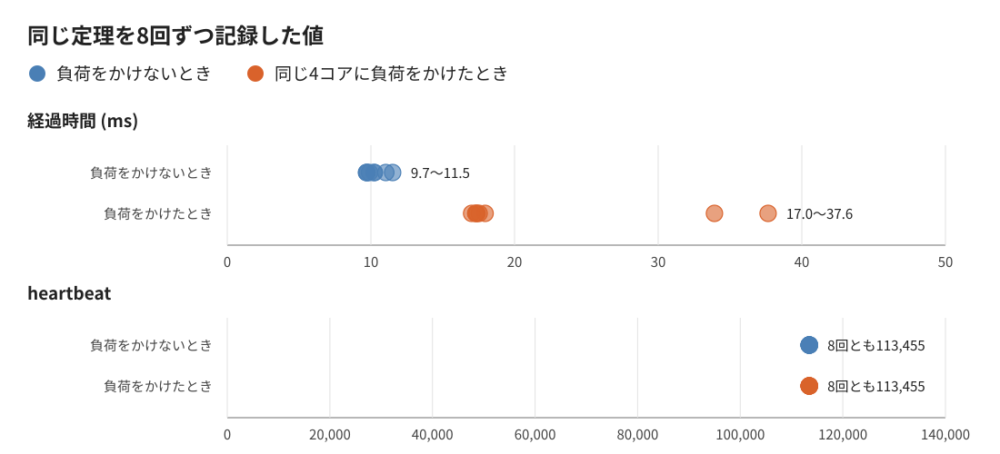
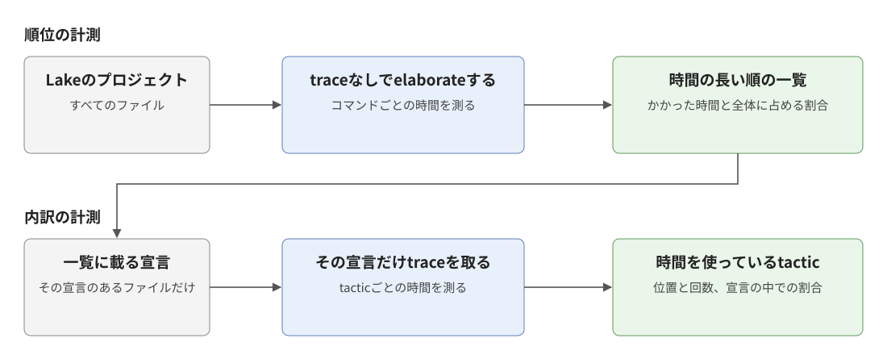

Title: Lean 4で遅くなった宣言を、マシンの負荷で変わらないheartbeatでCIから検出するLeanwakeを作った
Date: 2026-11-17 10:10
Draft: true
Tags: lean rust performance ci formal-verification release rust-leanwake lean-leanfran lean-ritsuryo


Lean 4のプロジェクトで、宣言ごとのelaborationのコストを記録して比べるCLI、Leanwakeを作りました。
変更の前と後でそれぞれ記録を取って比べます。
遅くなった宣言があれば終了コード254で終わります。

コストの単位は、Leanがelaborationの途中で数えているheartbeatです。
同じ定理を、マシンに負荷をかけないときとかけたときに8回ずつ記録しました。
経過時間の平均は11 msから36 msに延び、heartbeatは16回とも113,455でした。
ほかのジョブと計算機を分け合うCIでも、宣言ごとの1%の増加を検出できます。

リポジトリは[conao3/rust-leanwake](https://github.com/conao3/rust-leanwake)で、ライセンスはApache-2.0です。
この記事はLean 4.35.0とLeanwake 0.1.0で動かした結果をもとに書いています。

<div class="github-card" data-repo="conao3/rust-leanwake"><a href="https://github.com/conao3/rust-leanwake"><span class="github-card-name"><svg class="github-card-mark" viewBox="0 0 16 16" aria-hidden="true"><path d="M6.766 11.328c-2.063-.25-3.516-1.734-3.516-3.656 0-.781.281-1.625.75-2.188-.203-.515-.172-1.609.063-2.062.625-.078 1.468.25 1.968.703.594-.187 1.219-.281 1.985-.281.765 0 1.39.094 1.953.265.484-.437 1.344-.765 1.969-.687.218.422.25 1.515.046 2.047.5.593.766 1.39.766 2.203 0 1.922-1.453 3.375-3.547 3.64.531.344.89 1.094.89 1.954v1.625c0 .468.391.734.86.547C13.781 14.359 16 11.53 16 8.03 16 3.61 12.406 0 7.984 0 3.563 0 0 3.61 0 8.031a7.88 7.88 0 0 0 5.172 7.422c.422.156.828-.125.828-.547v-1.25c-.219.094-.5.156-.75.156-1.031 0-1.64-.562-2.078-1.609-.172-.422-.36-.672-.719-.719-.187-.015-.25-.093-.25-.187 0-.188.313-.328.625-.328.453 0 .844.281 1.25.86.313.452.64.655 1.031.655s.641-.14 1-.5c.266-.265.47-.5.657-.656"/></svg><span>conao3/<strong>rust-leanwake</strong></span></span><span class="github-card-description">Record per-declaration elaboration cost of Lake projects and detect regressions between two profiles</span><span class="github-card-footer"><span class="github-card-language"><span class="github-card-language-color" style="background-color: #dea584"></span>Rust</span><span class="github-card-star"><svg viewBox="0 0 16 16" aria-hidden="true"><path d="M8 .25a.75.75 0 0 1 .673.418l1.882 3.815 4.21.612a.75.75 0 0 1 .416 1.279l-3.046 2.97.719 4.192a.751.751 0 0 1-1.088.791L8 12.347l-3.766 1.98a.75.75 0 0 1-1.088-.79l.72-4.194L.818 6.374a.75.75 0 0 1 .416-1.28l4.21-.611L7.327.668A.75.75 0 0 1 8 .25Z"/></svg><span>Star</span><span class="github-card-star-count" hidden></span></span></span></a></div>


# 遅くなった宣言の検出

次の `Demo.lean` を持つLakeのプロジェクトで試します。

```lean
def sumTo : Nat → Nat
  | 0 => 0
  | n + 1 => n + 1 + sumTo n

theorem sumTo_hundred : sumTo 100 = 5050 := by
  decide

theorem length_append_swap (xs ys : List Nat) :
    (xs ++ ys).length = (ys ++ xs).length := by
  simp only [List.length_append, Nat.add_comm]

theorem two_mul_le (a b : Nat) (h : a ≤ b) : 2 * a ≤ 2 * b := by
  omega
```

`record-profile` はプロジェクトのファイルをelaborateし、コマンドごとのheartbeatをJSONに記録します。
`list-commands` は記録をheartbeatの多い順に並べます。

```sh
nix run github:conao3/rust-leanwake -- profile record-profile \
  --project-dir . --output-file base.json
nix run github:conao3/rust-leanwake -- profile list-commands \
  --profile file://base.json --output table | column -t
```

```text
Heartbeats  ElapsedNs  Path       Key                 HasErrors
113455      10222978   Demo.lean  two_mul_le          false
78802       9144612    Demo.lean  sumTo_hundred       false
56178       70466931   Demo.lean  sumTo               false
34153       3484413    Demo.lean  length_append_swap  false
```

次に、 `length_append_swap` の `simp only` を `simp` に変えます。
`simp only` は挙げた補題だけを使い、 `simp` は `@[simp]` の付いた補題も使います。

```diff
-  simp only [List.length_append, Nat.add_comm]
+  simp [Nat.add_comm]
```

変更後の記録を取り、 `compare-profiles` で2つを比べます。

```sh
nix run github:conao3/rust-leanwake -- profile record-profile \
  --project-dir . --output-file head.json
nix run github:conao3/rust-leanwake -- profile compare-profiles \
  --base-profile file://base.json --head-profile file://head.json \
  --output table
```

```text
Regressed: 1  Improved: 0  Unchanged: 3  Added: 0  Removed: 0
Heartbeats: 282588 -> 287947; thresholds: > 1000 heartbeats and > 1%
Status	BaseHeartbeats	HeadHeartbeats	DeltaHeartbeats	Path	Key
regressed	34153	39416	5263	Demo.lean	length_append_swap
```

`length_append_swap` のheartbeatは34,153から39,416に15%増えました。
終了コードは254になり、CIのジョブはここで失敗します。
この定理のelaborationにかかった時間は、変更前が3.5 ms、変更後が4.1 msでした。

コマンドはファイルのパスと宣言の名前の組で突き合わせます。
片方の記録にしかないコマンドは、追加または削除として数えます。
遅くなったと判定するのは、増分が1,000 heartbeatと1%の両方を超えたコマンドです。
しきい値は `--absolute-threshold-heartbeats` と `--relative-threshold-percent` で変えられます。


# heartbeatで測る理由

heartbeatは、Leanがelaborationの途中で数えている小さなメモリ割り当ての回数です。
[maxHeartbeats](https://github.com/leanprover/lean4/blob/v4.35.0/src/Lean/CoreM.lean#L30-L33)の上限と同じカウンタで、上限の1単位は1,000 heartbeatにあたります。



この図は先ほどの `two_mul_le` を2つの条件で8回ずつ記録した値です。
前半の8回はLeanwakeを4つのコアに固定しただけで、後半の8回では同じ4つのコアで計算を続けるプロセスを4つ動かしました。
経過時間は前半が10.3〜12.9 ms、後半が21.1〜56.5 msでした。
heartbeatは16回とも113,455で変わりません。
経過時間で1%の増加を判定するには、測定を繰り返して平均を取ることになります。
heartbeatなら1回の記録で比べられます。

`lean` コマンドと言語サーバーは既定で、elaborationを[複数のスレッド](https://github.com/leanprover/lean4/blob/v4.35.0/src/Lean/CoreM.lean#L35-L46)で進めます。
heartbeatはスレッドごとに数えるので、別のスレッドに回った証明の分はコマンドの値に入りません。
`(List.range 1200).length = 1200` を `decide +kernel` で示す定理は、同期では475,276 heartbeat、既定の非同期では6,084 heartbeatでした。
Leanwakeは `Elab.async` を `false` にして、すべてのコマンドを同期でelaborateします。

実際のプロジェクトでは、同じコミットを2回記録しても、一部のコマンドのheartbeatが一致しません。
法令の期間と税額の計算をLeanで証明している[lean-ritsuryo](https://github.com/conao3/lean-ritsuryo)は、54ファイル、893コマンドで合計6億5,380万heartbeatです。
これを2回記録すると13コマンドに差があり、差の最大は8 heartbeatでした。
[lean-assay](https://github.com/conao3/lean-assay)の全ファイルでは、差の最大が183です。
ほかの宣言を変えたときにも値は少し動き、先ほどの例では、変えていない `two_mul_le` が113,455から113,551になりました。
既定のしきい値の1,000 heartbeatと1%は、これらの差より大きく取っています。
lean-ritsuryoの2回の記録を比べると、893コマンドとも変わらないと判定されます。


# heartbeatの多い宣言と内訳

lean-ritsuryoを記録して、heartbeatの多いコマンドを5つ並べます。

```sh
leanwake profile record-profile --project-dir . --jobs 4 \
  --output-file profile.json
leanwake profile list-commands --profile file://profile.json \
  --limit 5 --output table | column -t
```

```text
Heartbeats  ElapsedNs   Path                              Key                                                   HasErrors
118149453   8771076702  Ritsuryo/Tax/Proofs/Penalty.lean  Ritsuryo.Tax.Penalty.pen1_no_return_tiers             false
110910269   6867599166  Ritsuryo/Tax/Proofs/Income.lean   Ritsuryo.Tax.Income.quickCents_bounds                 false
64381709    6738770487  Ritsuryo/Tax/Inheritance.lean     Ritsuryo.Tax.Inheritance.taxCentsSpec_eq_quickCents   false
35550697    3996662401  Ritsuryo/Tax/Income.lean          Ritsuryo.Tax.Income.incomeTaxCentsSpec_eq_quickCents  false
28404434    7752174727  Ritsuryo/Holiday/Check.lean       Ritsuryo.Holiday.checkAll                             false
```

893コマンドのうち、上位3つの定理が全体のheartbeatの45%を占めています。
記録は4コアで43〜45秒かかりました。
同じ対象の `lake build` は48秒です。

heartbeatがいちばん多い `pen1_no_return_tiers` は、無申告加算税の額についての次の定理です。

```lean
theorem pen1_no_return_tiers (rate tax tax' prior : Nat) (hr : rate = 10 ∨ rate = 15) :
    (tax + prior ≤ 3000000 → noReturnCents rate tax prior = noReturnCentsArt2 rate tax prior) ∧
      (tax ≤ tax' → noReturnCents rate tax prior ≤ noReturnCents rate tax' prior) := by
  unfold noReturnCents noReturnCentsArt2 tieredCents
  rcases hr with rfl | rfl <;> constructor <;> intro h <;> omega
```

`--detail steps` を付けると、コマンドの中の内訳も記録します。
`list-steps` で、この定理の内訳から `omega` の行を取り出します。

```sh
leanwake profile record-profile --project-dir . \
  --paths Ritsuryo/Tax/Proofs/Penalty.lean --detail steps \
  --output-file steps.json
leanwake profile list-steps --profile file://steps.json \
  --path Ritsuryo/Tax/Proofs/Penalty.lean \
  --key Ritsuryo.Tax.Penalty.pen1_no_return_tiers --output table \
  | grep -e Heartbeats -e Tactic.omega | column -t
```

```text
Heartbeats  Depth  Range        Class            Kind
54184655    20     24:59-24:64  Leanwake.tactic  Lean.Parser.Tactic.omega
54100320    20     24:59-24:64  Leanwake.tactic  Lean.Parser.Tactic.omega
25736830    20     24:59-24:64  Leanwake.tactic  Lean.Parser.Tactic.omega
25574245    20     24:59-24:64  Leanwake.tactic  Lean.Parser.Tactic.omega
```

`24:59-24:64` はファイルの24行目にある `omega` の位置です。
`<;>` で分かれた4つのゴールのそれぞれで `omega` が動いています。
2つは約5,400万heartbeat、残りの2つは約2,600万heartbeatで、4つを合わせるとこの定理のheartbeatの99.9%になります。

内訳つきの記録は、traceを取る分だけheartbeatが増えます。
この定理では1億1,815万が1億5,970万になりました。
そこで `compare-profiles` は、内訳の有無が同じ記録どうしだけを比べます。


# 構成



Leanwakeの構成は、Rustで書いたhostとLeanで書いたadapterの2つです。
hostはLakeに尋ねて対象のファイルを列挙し、ファイルごとにadapterのプロセスを起動します。
adapterは `import` を読み込み、コマンドを1つずつelaborateして、その前後でheartbeatのカウンタを読みます。

記録に書き込むのは、Leanのバージョン、同期か非同期か、内訳の有無です。
この条件が違う2つの記録を渡すと、 `compare-profiles` は違う項目を示してエラーで終わります。


# Leanで証明した比較の規則

遅くなったかどうかは、次のLeanの定義で判定しています。
`classify_regressed` などの補題とほかの定理は省きました。

```lean
def grows (base head absolute relative : Nat) : Bool :=
  decide (absolute < head - base ∧ base * relative < (head - base) * 100)

def classify (base head absolute relative : Nat) : Status :=
  if grows base head absolute relative then .regressed
  else if grows head base absolute relative then .improved
  else .unchanged

theorem equal_unchanged (b a r : Nat) : classify b b a r = .unchanged := by
  simp [classify, grows]

theorem regression_monotone {b h h' a r : Nat}
    (hyp : classify b h a r = .regressed) (increase : h ≤ h') :
    classify b h' a r = .regressed := by
  rw [classify_regressed] at hyp ⊢
  simp only [grows, decide_eq_true_eq] at hyp ⊢
  have mul := Nat.mul_le_mul_right 100 (Nat.sub_le_sub_right increase b)
  omega
```

`regression_monotone` は、遅くなったと判定された組は、変更後の値がそれより大きくても遅くなったと判定されることを示しています。
ほかに次の性質を証明しました。

-   変更前と変更後を入れ替えると、遅くなったと速くなったが入れ替わります。
-   しきい値を上げても、遅くなったと判定される組は増えません。
-   突き合わせの結果には、変更前と変更後の各コマンドがちょうど1回ずつ現れます。
-   比較が失敗するのは、遅くなったコマンドが1つ以上あるときだけです。

定理は18件です。
このコードはRustのソースの `leanfran::lean!` の中に書きました。
ビルドのときにLeanが証明を検査し、[leanfran](https://s.conao3.com/blog/2026/23d62c)がRustの関数にします。
hostはJSONを読んでこの関数に渡し、結果を表示します。


# CIでの使い方

pull requestのワークフローで、変更前と変更後のコミットをそれぞれ記録して比べます。

```yaml
name: Elaboration costs
on:
  pull_request:
permissions:
  contents: read
jobs:
  profile:
    runs-on: ubuntu-latest
    steps:
      - uses: actions/checkout@v7.0.1
        with:
          ref: ${{ github.event.pull_request.base.sha }}
          path: base
      - uses: actions/checkout@v7.0.1
        with:
          ref: ${{ github.event.pull_request.head.sha }}
          path: head
      - uses: cachix/install-nix-action@v31.11.5
      - run: nix build github:conao3/rust-leanwake --out-link leanwake
      - run: >-
          ./leanwake/bin/leanwake profile record-profile
          --project-dir base --jobs 2 --output-file base.json
      - run: >-
          ./leanwake/bin/leanwake profile record-profile
          --project-dir head --jobs 2 --output-file head.json
      - run: >-
          ./leanwake/bin/leanwake profile compare-profiles
          --base-profile file://base.json --head-profile file://head.json
          --output table
```

Nixのパッケージには、adapterと対応するLeanとLakeが入っています。
エラーのあるファイルも記録に入り、その場合の `record-profile` は終了コード254で終わります。


# 確かめられないこと

heartbeatは時間の代わりにはなりません。
lean-ritsuryoの `quickCents_bounds` は1億1,091万heartbeatで6.9秒ですが、2,840万heartbeatの `checkAll` はelaborationに7.8秒かかりました。
`checkAll` は `decide +kernel` でカーネルに表を評価させる定理です。

測る単位はトップレベルのコマンドです。
複数の宣言を定義するコマンドは、まとめて1つの値になります。
対応しているのはLean 4.35.0で、Leanのバージョンが違う記録どうしは比べられません。
Mathlibでは測っていません。

宣言ごとのheartbeatを記録して比べるツールには[leanprof](https://github.com/unbalancedparentheses/leanprof)もあります。
Lakeのビルドのジョブごとの時間は[lakeprof](https://github.com/Kha/lakeprof)で測れます。
Lean本体とMathlibは、コミットごとの性能を[Radar](https://github.com/leanprover/radar)で計測しています。

