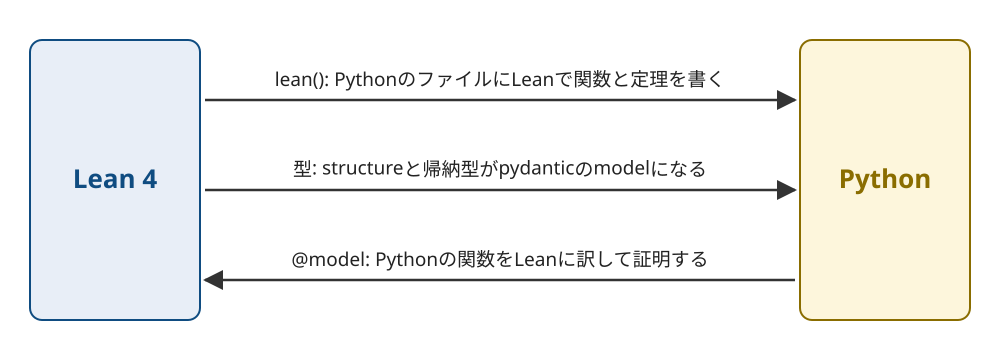

Title: Lean 4で証明した関数をPythonから呼べるlean-pyを作った
Date: 2026-11-11 13:59
Draft: true


Lean 4で書いて証明した関数をPythonから呼べるようにする、lean-pyを作りました。
Leanのstructureと帰納型はpydanticのmodelになり、FastAPIのリクエストの型にもそのまま使えます。
逆向きに、Pythonで書いた関数をLeanに訳して、その性質をLeanで証明することもできます。
リポジトリは[conao3/lean-py](https://github.com/conao3/lean-py)で、ライセンスはApache-2.0です。
PyPIには `lean-python` の名前で公開していて、この記事は0.2.0で動かした結果をもとに書いています。

lean-pyはLeanのコンパイラの中間表現をPythonのソースに変換します。
生成したPythonは `lean-python` のパッケージとpydanticだけで動き、実行するときにLeanは要りません。
[lean-clj](https://s.conao3.com/blog/2026/4e5aa2)と[lean-rs](https://s.conao3.com/blog/2026/b43a06)はLeanの関数をClojureとRustから呼ぶもので、lean-pyは同じ仕組みをPythonに移したものです。

<div class="github-card" data-repo="conao3/lean-py"><a href="https://github.com/conao3/lean-py"><span class="github-card-name"><svg class="github-card-mark" viewBox="0 0 16 16" aria-hidden="true"><path d="M6.766 11.328c-2.063-.25-3.516-1.734-3.516-3.656 0-.781.281-1.625.75-2.188-.203-.515-.172-1.609.063-2.062.625-.078 1.468.25 1.968.703.594-.187 1.219-.281 1.985-.281.765 0 1.39.094 1.953.265.484-.437 1.344-.765 1.969-.687.218.422.25 1.515.046 2.047.5.593.766 1.39.766 2.203 0 1.922-1.453 3.375-3.547 3.64.531.344.89 1.094.89 1.954v1.625c0 .468.391.734.86.547C13.781 14.359 16 11.53 16 8.03 16 3.61 12.406 0 7.984 0 3.563 0 0 3.61 0 8.031a7.88 7.88 0 0 0 5.172 7.422c.422.156.828-.125.828-.547v-1.25c-.219.094-.5.156-.75.156-1.031 0-1.64-.562-2.078-1.609-.172-.422-.36-.672-.719-.719-.187-.015-.25-.093-.25-.187 0-.188.313-.328.625-.328.453 0 .844.281 1.25.86.313.452.64.655 1.031.655s.641-.14 1-.5c.266-.265.47-.5.657-.656"/></svg><span>conao3/<strong>lean-py</strong></span></span><span class="github-card-description">Run Lean 4 as Python: a backend from Lean's IR, Lean blocks in Python files, pydantic models for Lean types, and Python functions verified in Lean</span><span class="github-card-footer"><span class="github-card-language"><span class="github-card-language-color"></span>Python</span><span class="github-card-star"><svg viewBox="0 0 16 16" aria-hidden="true"><path d="M8 .25a.75.75 0 0 1 .673.418l1.882 3.815 4.21.612a.75.75 0 0 1 .416 1.279l-3.046 2.97.719 4.192a.751.751 0 0 1-1.088.791L8 12.347l-3.766 1.98a.75.75 0 0 1-1.088-.79l.72-4.194L.818 6.374a.75.75 0 0 1 .416-1.28l4.21-.611L7.327.668A.75.75 0 0 1 8 .25Z"/></svg><span>Star</span><span class="github-card-star-count" hidden></span></span></span></a></div>


# 3つの使い方

lean-pyの使い方は3つあります。



1.  Pythonのファイルの中にLeanで関数と定理を書き、Pythonから呼ぶ。 `lean(...)` と `lean-py sync` を使う。
2.  Leanのstructureと帰納型を、pydanticのmodelとして受け渡す。自分で書いたpydanticのmodelをLeanから使うこともできる。
3.  Pythonで書いた関数をLeanに訳し、その性質をLeanで証明する。 `@model` と `lean-py check` を使う。

1と2はLeanからPythonへ、3はPythonからLeanへの向きです。


# PythonのファイルにLeanを書く

Pythonのパッケージと、Leanのコードを変換するCLIの `lean-python` を入れます。
CLIはnixで入れられます。

```console
$ uv add lean-python
$ nix profile install github:conao3/lean-py
```

証明を検査するときは、Lean 4.35.0の `lake` も `PATH` に要ります。

`lean(...)` にはLeanのソースを文字列のまま書きます。
パッケージの中のmoduleで呼びます。

```python
# demo/arith.py
from lean_python import lean

arith = lean("arith", r"""
def double (n : Nat) : Nat := n + n

theorem double_eq (n : Nat) : double n = 2 * n := by
  unfold double; omega

structure Range where
  lo : Nat
  hi : Nat
  ok : lo ≤ hi

def Range.width (r : Range) : Nat := r.hi - r.lo
""")
```

`double_eq` は `double` の定義を展開してから `omega` で等式を示しています。
`omega` は自然数と整数の線形算術を解くタクティクです。
`lean-py sync` はパッケージのmoduleを読み込んで `lean(...)` のブロックを集め、 `lake build` で証明を検査します。
検査が通ると、ブロックのLeanのコードをPythonに変換して `demo/_lean/` に書き出します。

```console
$ lean-py sync --package demo
lean-py: 1 blocks of demo checked and generated
```

`lean(...)` は書き出したmoduleを返すので、ブロックの関数をそのままPythonの関数として呼べます。

```python
from demo.arith import arith

print(arith.double(21))
print(arith.double(2**70))
r = arith.Range(lo=3, hi=10)
print(arith.Range.width(r))
print(r.model_dump_json())
```

```text
42
2361183241434822606848
7
{"lo":3,"hi":10}
```

Leanの `Nat` はPythonの `int` になり、 `2**70` のような大きな数もそのまま渡せます。
structureの `Range` はpydanticのmodelになります。

証明が通らなければ、 `lean-py sync` が失敗します。
定理の右辺を `3 * n` に書き換えると、次のエラーになります。

```text
lean-py: /path/to/demo/arith.py:7: error: (lean block arith, Lean 5:17) omega could not prove the goal:
a possible counterexample may satisfy the constraints
  a ≥ 1
where
 a := ↑n
lean-py: lake build failed
```

`arith.py:7` は `omega` を書いた行です。
lean-pyは、Leanが報告した行を、Pythonのファイルの中の行に直して表示します。

`lean-py sync` には `lake` と `lean-python` のCLIが要りますが、書き出した `_lean/` はただのPythonのファイルです。
`_lean/` をリポジトリにcommitしておけば、Leanの入っていない環境でもパッケージは動きます。
実行するときは、 `lean(...)` がブロックのソースのハッシュを `_lean/blocks.json` と比べます。
ブロックを書き換えたまま `lean-py sync` を忘れると、importの時点で止まります。

```text
lean_python.embed.LeanBlockStale: the Lean block 'arith' of demo.arith has changed since `lean-py sync` generated it; run `lean-py sync` (or set LEAN_PYTHON_AUTO_SYNC=1)
```


# Leanの型がpydanticのmodelになる

Leanの型とPythonの型は次のように対応します。

<table border="2" cellspacing="0" cellpadding="6" rules="groups" frame="hsides">


<colgroup>
<col  class="org-left" />

<col  class="org-left" />
</colgroup>
<thead>
<tr>
<th scope="col" class="org-left">Lean</th>
<th scope="col" class="org-left">Python</th>
</tr>
</thead>
<tbody>
<tr>
<td class="org-left"><code>Nat</code></td>
<td class="org-left"><code>Annotated[int, Ge(0)]</code></td>
</tr>

<tr>
<td class="org-left"><code>Int</code></td>
<td class="org-left"><code>int</code></td>
</tr>

<tr>
<td class="org-left"><code>String</code></td>
<td class="org-left"><code>str</code></td>
</tr>

<tr>
<td class="org-left"><code>List α</code> 、 <code>Array α</code></td>
<td class="org-left"><code>list[T]</code></td>
</tr>

<tr>
<td class="org-left"><code>Option α</code></td>
<td class="org-left"><code>T</code> または <code>None</code></td>
</tr>

<tr>
<td class="org-left">structure</td>
<td class="org-left">frozen・strictなpydanticのmodel</td>
</tr>

<tr>
<td class="org-left">引数のない構成子だけの帰納型</td>
<td class="org-left"><code>enum.StrEnum</code></td>
</tr>

<tr>
<td class="org-left">その他の帰納型</td>
<td class="org-left">構成子ごとのmodelと、その親のclass</td>
</tr>

<tr>
<td class="org-left"><code>IO α</code></td>
<td class="org-left"><code>T</code> を返し、 <code>IO.Error</code> を <code>OSError</code> として送出する</td>
</tr>
</tbody>
</table>

structureの `Range` には、 `lo ≤ hi` の証明を持つフィールド `ok` があります。
証明はPythonの値にはなりませんが、lean-pyはこの命題を判定する関数をLeanで作ってPythonに変換し、modelのvalidatorにします。
命題を満たさない値を作ろうとすると、pydanticの `ValidationError` になります。

```text
pydantic_core._pydantic_core.ValidationError: 1 validation error for Range
  Value error, ok: lo ≤ hi does not hold [type=value_error, input_value={'lo': 10, 'hi': 3}, input_type=dict]
```

Leanの関数に渡る値は、すべてこの検査を通ります。
`model_construct` で検査を飛ばして作った値も、Leanに渡す前にもう一度検査します。
そのため、 `ok` を前提にしたLeanの証明は、Pythonから渡した値についても成り立ちます。
`p ≤ 100` のような定数との比較は、pydanticの `Le(100)` にもなり、JSON Schemaに `maximum` として出ます。

modelのJSONはLeanの `deriving ToJson, FromJson` と同じ形にしています。
帰納型は、引数のない構成子が `"dot"` 、引数を持つ構成子が `{"rect": {"width": 1, "height": 2}}` になります。
Leanの `toJson` の出力と同じになることを、テストで確かめています。

自分で書いたpydanticのmodelを、Leanのstructureとして使うこともできます。
`lean(..., models=[LineItem])` と書くと、lean-pyがmodelからLeanのstructureを作り、ブロックから使えるようにします。

```python
class LineItem(BaseModel):
    sku: str = Field(min_length=1)
    qty: int = Field(ge=1)
    unitPrice: int = Field(ge=0)
```

このmodelは次のLeanのstructureになります。

```lean
structure LeanPythonModels.pricing.models.LineItem where
  sku : String
  sku_min_length : 1 ≤ sku.length
  qty : Nat
  qty_ge : 1 ≤ qty
  unitPrice : Nat
```

`Field` の制約は証明を持つフィールドになるので、Leanの証明の中で `1 ≤ qty` を前提として使えます。
下限が0以上の `int` はLeanの `Nat` になります。

次の例は `LineItem` とLeanの帰納型 `Discount` をFastAPIのリクエストの型にしたものです。
サンプルの[pricing-api](https://github.com/conao3/lean-py/tree/master/samples/pricing-api)から抜き出しています。

```python
pricing = lean("pricing", r"""
inductive Discount where
  | none
  | percent (p : Nat) (h : p ≤ 100)
  | fixed (amount : Nat)

def subtotal (items : List LineItem) : Nat :=
  items.foldl (fun acc i => acc + i.qty * i.unitPrice) 0

def total (items : List LineItem) (d : Discount) : Nat :=
  match d with
  | .none => subtotal items
  | .percent p _ => subtotal items - subtotal items * p / 100
  | .fixed a => subtotal items - a

theorem total_le (items : List LineItem) (d : Discount) : total items d ≤ subtotal items := by
  unfold total; split <;> omega
""", models=[LineItem])

app = FastAPI()

@app.post("/total")
def post_total(items: list[LineItem], discount: pricing.Discount) -> int:
    return pricing.total(items, discount)
```

`total_le` は、どの割引でも合計が小計を超えないことを示しています。
単価120のりんご3個と単価200の梨1個の注文を、割引を変えて送った結果は次のとおりです。

```text
"none" 200 560
{"percent": {"p": 25}} 200 420
{"fixed": {"amount": 1000}} 200 0
{"percent": {"p": 150}} 422 Input should be less than or equal to 100
qty 0 422
```

`p` が100を超える割引と、 `qty` が0の注文は、FastAPIが422で返します。
OpenAPIのschemaにも、 `Discount` の3つの構成子と `p` の上限が出ます。


# Pythonの関数をLeanで証明する

3つ目の使い方では、実装をPythonで書き、その性質をLeanで証明します。
仕様はLeanのブロックに書き、Pythonの関数とは `@model` でつなぎます。

```python
from lean_python import lean
from lean_python.verify import model

spec = lean("spec", r"""
def clampSpec (x lo hi : Int) : Int := max lo (min hi x)
def ordered (_x lo hi : Int) : Bool := lo ≤ hi
def inRange (_x lo hi : Int) (r : Int) : Bool := lo ≤ r && r ≤ hi
""")

@model(refines=spec.clampSpec, requires=spec.ordered, ensures={"in_range": spec.inRange})
def clamp(x: int, lo: int, hi: int) -> int:
    if x < lo:
        return lo
    if x > hi:
        return hi
    return x
```

`refines` は、 `clamp` がすべての入力で `clampSpec` と同じ値を返すという主張です。
`requires` は前提で、 `ensures` は結果が満たす条件です。
`@model` は関数をそのまま返すので、 `clamp` は普通のPythonの関数として動きます。

`lean-py check` は関数をLeanの `do` 記法に訳し、主張ごとに証明すべき命題を作ります。
Leanの `do` 記法には、変数の再代入、 `for` 、 `while` 、途中の `return` があるので、Pythonの文がほぼそのまま対応します。

```lean
def LeanPythonModel.«calc».«calc».clamp (x : Int) (lo : Int) (hi : Int) : Int := Id.run do
  if ((decide (x < lo))) then
    return lo
  if ((decide (x > hi))) then
    return hi
  return x
```

`refines` から作る命題は、名前の前半を省くと次のとおりです。

```lean
abbrev clamp.obligation.refines : Prop :=
  ∀ (x : Int) (lo : Int) (hi : Int), ordered x lo hi = true → clamp x lo hi = clampSpec x lo hi
```

Pythonの `int` はLeanの `Int` です。
添字の参照、 `//` 、 `%` のように例外を出す操作を含む関数は、 `Except` を返すLeanの関数になります。
`//` はPythonと同じく負の無限大の向きに丸め、負の添字も扱います。

証明は `pyproject.toml` の隣の `lean/Proofs/` にLeanで書きます。

```lean
import LeanPythonModel.calc.calc

open LeanPythonEmbed.calc.spec.spec

namespace LeanPythonModel.«calc».«calc»

theorem clamp.proof.refines : clamp.obligation.refines := by
  intro x lo hi h
  simp only [ordered, decide_eq_true_eq] at h
  simp only [clamp, clampSpec]
  split <;> (try split) <;> simp_all <;> omega
```

`lean-py check` は主張ごとに証明の状態を表示します。
リポジトリのテストに使っているパッケージ `calc` には、 `clamp` のほかに、リストの先頭を返す `first_or` や、絶対値の和を返す `sum_abs` があります。

```console
$ lean-py check --package calc
lean-py: 1 blocks of calc checked and generated
proved     calc.calc:clamp refines
proved     calc.calc:clamp in_range
proved     calc.calc:first_or refines
proved     calc.calc:sum_abs nonneg
sorry      calc.calc:sum_to refines
missing    calc.calc:sum_to returns_nat
```

`proved` は証明が通ったこと、 `sorry` は証明に `sorry` が残っていること、 `missing` は証明がないことを表します。
定理の主張が命題と食い違っていれば `mismatch` に、証明のファイルがビルドできなければ `failed` になります。
`--require proved` を付けると、すべてが `proved` でないときに失敗するので、CIで使えます。
`sum_abs` は `for` のループを持つ関数で、ループはリストの `foldl` に書き換えて、リストについての帰納法で証明しています。

結果は `lean-python.lock` に、関数のソースのハッシュと一緒に記録されます。
`lean-py status` はLeanを使わずにこのファイルを読み、証明したあとにソースが変わった関数を `stale` と表示します。

証明を書く前に、同じ仕様でテストすることもできます。
`check_model` は引数の型注釈からHypothesisで値を作り、 `requires` を満たす入力について `refines` と `ensures` を確かめます。
仕様の `clampSpec` もLeanから変換したPythonの関数なので、Leanで証明する対象と同じ計算がテストの基準になります。
`hi` で頭打ちにするのを忘れた実装には、反例が見つかります。

```python
@model(refines=spec.clampSpec, requires=spec.ordered)
def bad_clamp(x: int, lo: int, hi: int) -> int:
    return max(lo, x)

check_model(bad_clamp)
```

```text
lean_python.verify.PropertyFailure: bad_clamp(1, 0, 0) = 1, the spec gives 0
```


# 仕組み

lean-pyは、Leanのコンパイラが最後に作る中間表現を読み、関数ごとにPythonの関数を書き出します。
この中間表現には参照カウントの増減と、参照が1つしかないオブジェクトを使い回す指示が入っています。
Pythonの実行時のライブラリも参照カウントを持ち、配列への追加や更新は、参照が1つのときにその場で行います。
そのため、 `Array` に要素を足していくループは、Cにコンパイルしたときと同じく要素数に比例する時間で終わります。

Leanの組み込みの関数は、LeanのCのruntimeの `lean.h` に合わせて、同じ振る舞いをPythonで書いています。
同じLeanのプログラムをCにコンパイルして動かしたときと、Pythonに変換して動かしたときの出力を比べるテストがあり、標準出力と標準エラー出力が1文字の違いもなく一致します。
速さはCにコンパイルしたものより数倍から百倍ほど遅く、計測した値はREADMEに載せています。


# おわりに

LeanでPythonの関数を書けるようにし、Leanの型をpydanticのmodelにし、Pythonの関数をLeanで証明できるようにしました。
使い方を1つずつ試せるサンプルは[samples](https://github.com/conao3/lean-py/tree/master/samples)にあります。

