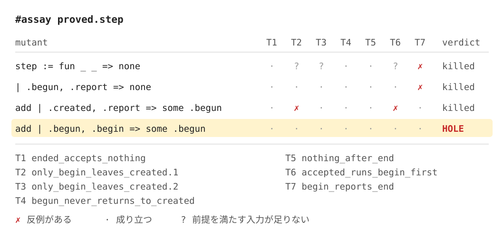

Title: leanassay: mutation testing for Lean 4 theorems, to measure how much they pin down the implementation
Date: 2026-11-27 19:13
Updated: 2026-11-27 19:13
Draft: true
Lang: en
Original: /blog/2026/51d6b7
Tags: lean formal-verification testing release lean-leanassay rust-lsp-touchstone lean-leanfran rust-leanwisp rust-leansail rust-leankeel rust-leanwake rust-ritsuryo rust-ritsulint


I built leanassay, a mutation testing tool for Lean 4 theorems that measures theorem quality: it runs broken versions of your functions against your theorems.
The idea comes from mizchi's Japanese article [おい、 Mutation Test をやれ。テスト品質を、測るために](https://zenn.dev/mizchi/articles/mutation-test-quality) ("Hey, run mutation tests, to measure test quality"), which says that before you trust coverage raised by AI, you should make mutants by rewriting the code and check whether the tests fail.

The same holds for proofs in Lean.
If a broken implementation satisfies the same theorem, the theorem says nothing about the implementation, even when the proof passes.
Now that AI writes proofs for us, I think the question to ask is how much a theorem pins down the implementation, more than whether the proof passes.
In a project that mapped Julia to Lean, [128 of 130 "proved" bounds checks](https://discourse.julialang.org/t/formalizing-julia-in-lean-and-finding-400-bugs-in-base/140243) only assumed that the index was in range.

Lean can run both theorems and implementations, so I brought mutation testing into Lean: the tool breaks the functions that a theorem mentions and runs the theorem to see whether it still holds.
I tried it on the theorems I had proved myself for lsp-touchstone, and every theorem still held for a state machine that broke the spec and for a conversion with the wrong UTF-16 width.
I also ran it on six of my tools that turn Lean functions into Rust, found 56 holes in two of them, and added theorems that close all of them.

The tool, leanassay, is at [conao3/lean-leanassay](https://github.com/conao3/lean-leanassay) under the Apache-2.0 license.
The results in this post come from Lean 4.35.0 and leanassay 0.2.0.

<div class="github-card" data-repo="conao3/lean-leanassay"><a href="https://github.com/conao3/lean-leanassay"><span class="github-card-name"><svg class="github-card-mark" viewBox="0 0 16 16" aria-hidden="true"><path d="M6.766 11.328c-2.063-.25-3.516-1.734-3.516-3.656 0-.781.281-1.625.75-2.188-.203-.515-.172-1.609.063-2.062.625-.078 1.468.25 1.968.703.594-.187 1.219-.281 1.985-.281.765 0 1.39.094 1.953.265.484-.437 1.344-.765 1.969-.687.218.422.25 1.515.046 2.047.5.593.766 1.39.766 2.203 0 1.922-1.453 3.375-3.547 3.64.531.344.89 1.094.89 1.954v1.625c0 .468.391.734.86.547C13.781 14.359 16 11.53 16 8.03 16 3.61 12.406 0 7.984 0 3.563 0 0 3.61 0 8.031a7.88 7.88 0 0 0 5.172 7.422c.422.156.828-.125.828-.547v-1.25c-.219.094-.5.156-.75.156-1.031 0-1.64-.562-2.078-1.609-.172-.422-.36-.672-.719-.719-.187-.015-.25-.093-.25-.187 0-.188.313-.328.625-.328.453 0 .844.281 1.25.86.313.452.64.655 1.031.655s.641-.14 1-.5c.266-.265.47-.5.657-.656"/></svg><span>conao3/<strong>lean-leanassay</strong></span></span><span class="github-card-description">Check whether your Lean theorems pin down your implementation, by running broken implementations against them</span><span class="github-card-footer"><span class="github-card-language"><span class="github-card-language-color"></span>Lean</span><span class="github-card-star"><svg viewBox="0 0 16 16" aria-hidden="true"><path d="M8 .25a.75.75 0 0 1 .673.418l1.882 3.815 4.21.612a.75.75 0 0 1 .416 1.279l-3.046 2.97.719 4.192a.751.751 0 0 1-1.088.791L8 12.347l-3.766 1.98a.75.75 0 0 1-1.088-.79l.72-4.194L.818 6.374a.75.75 0 0 1 .416-1.28l4.21-.611L7.327.668A.75.75 0 0 1 8 .25Z"/></svg><span>Star</span><span class="github-card-star-count" hidden></span></span></span></a></div>


# A broken implementation that passes the proofs

[lsp-touchstone](https://s.conao3.com/blog/2026/45f8b5) is a tool that checks whether LSP messages follow the spec.
It describes in Lean how progress notifications move the state, and before I ran leanassay it had six proved theorems.

```lean
def step : TokenState → ProgressKind → Option TokenState
  | .created, .begin => some .begun
  | .begun, .report => some .begun
  | .begun, .finish => some .ended
  | _, _ => none
```

LSP progress goes through `begin` , some `report` messages, and `end` , in that order and only once.
In the code, `.finish` is the LSP `end` , and I call each line that starts with `|` an arm.
Let's add one arm that takes `begin` in the `begun` state and stays in `begun` .

```lean
| .begun, .begin => some .begun
```

With this arm added, the six theorems still pass with the original proofs.
I had not written any theorem that forbids a second `begin` , and lsp-touchstone uses this `step` to detect violations, so with this arm it would miss a second `begin` .

Every theorem is true and every proof passes, so the problem is in the theorems I did not write.
You cannot find those by rereading the proofs, however many times you do.


# What leanassay does

leanassay makes broken versions of the functions that appear in a theorem, and runs the theorem with each version.
It does not use the proof: it evaluates the theorem's premises and conclusion on concrete inputs, so if it finds an input where the theorem fails, the theorem has killed that mutation, and if the theorem holds on every input, there is a hole.

mizchi's article frames unit tests as the quality check for the implementation and mutation tests as the quality check for the test code, and leanassay puts theorems in place of the tests to measure how much your proved theorems guarantee about the implementation.

It breaks functions in two ways.

-   Replace the whole function with one that is plainly wrong, such as a function that always returns `default` or `none` , one that returns its argument, or one that returns only the first element of a list argument.
-   Change the body a little: swap a comparison or arithmetic operator, shift a number literal by one, swap `take` and `drop` , replace the result of a match arm with another arm's result, add an arm for a combination of constructors that no arm covers, or swap the branches of an `if` .

If a broken version returns the same value as the original on every input it tried, leanassay treats it as not broken and leaves it out of the report, and it reports as holes only the versions whose output changed but still passed the theorems.

In the terms of mizchi's article, a version that a theorem kills is Killed, a hole is Survived, and a version left out of the report is an equivalent mutant.

The inputs come from the generators of [plausible](https://github.com/leanprover-community/plausible), a Lean library that tests properties on random inputs.
The seed is fixed, so every run gives the same result.
When an argument type has few values, leanassay tries every combination, and for a theorem whose premise rarely holds, it tries more inputs until it has enough.


# Usage

Add leanassay to lakefile.toml and pass the function you want to audit to `#assay` .

```lean
import Assay
import LspTouchstone.Progress

#assay proved.step
```

leanassay collects the theorems that mention the function, and the theorems that mention functions that call it.
When a theorem's conclusion is joined with `∧` , it gives each part its own column, and it prints a table of which theorems killed each broken version.



The figure shows four rows from the output table, with shorter names for the mutations.

`✗` means it found an input where the theorem fails, `·` means the theorem held on the inputs it tried, and `?` means it could not check because it found almost no inputs that satisfy the theorem's premise in the broken version.
At least one theorem killed 17 of the 19 mutations, and the two that add an arm taking `begin` in `begun` remained as holes.
For each hole it prints a warning with an input where the output differs from the original, and for this hole it reports that the output differs for the `begun` state with `begin` .

With `set_option assay.failOnHole true` it reports holes as errors, so if you include this file in the build, `lake build` fails while any hole remains.


# Results on lsp-touchstone

I ran it on the three parts of lsp-touchstone that have proofs.

<table border="2" cellspacing="0" cellpadding="6" rules="groups" frame="hsides">


<colgroup>
<col  class="org-left" />

<col  class="org-right" />

<col  class="org-right" />

<col  class="org-right" />
</colgroup>
<thead>
<tr>
<th scope="col" class="org-left">Part</th>
<th scope="col" class="org-right">Mutations</th>
<th scope="col" class="org-right">Killed</th>
<th scope="col" class="org-right">Holes</th>
</tr>
</thead>
<tbody>
<tr>
<td class="org-left">Progress state transitions</td>
<td class="org-right">19</td>
<td class="org-right">17</td>
<td class="org-right">2</td>
</tr>

<tr>
<td class="org-left">Position unit conversion</td>
<td class="org-right">72</td>
<td class="org-right">43</td>
<td class="org-right">15</td>
</tr>

<tr>
<td class="org-left">Document range replacement</td>
<td class="org-right">12</td>
<td class="org-right">12</td>
<td class="org-right">0</td>
</tr>
</tbody>
</table>

Of the other 14 in the position unit conversion, 12 could not be built because the types did not match, 1 returned the same values as the original on the inputs it tried, and 1 could not be checked because too few inputs met the premise.

The position unit conversion uses `unitWidth` to decide how many units one character takes in UTF-8, UTF-16, and UTF-32; for example, `😀` counts as 4 in UTF-8, 2 in UTF-16, and 1 in UTF-32.
But when I changed this width to any other value of at least 1, all four theorems still held.
The theorems only required the width to be at least 1, and did not say which characters count as 2 in UTF-16.
leanassay reported as holes a version that changes the comparison at the UTF-16 width-2 boundary from `<` to `≤` , and a version whose UTF-16 width is always 1.

The other hole was about positions that point inside a character.
The theorem only said "if it judges that a position points inside a character, the position is inside a character", and there was no converse theorem saying "a position inside a character is always judged to be inside a character".
So a version that judged positions inside the second or a later character to be character boundaries or line ends passed every theorem.

Based on these results, I added three theorems to lsp-touchstone.

-   In the `begun` state, it accepts only `report` and `end` .
-   A position inside a character is always judged to be inside a character.
-   The width of one character equals Lean's `Char.utf8Size` in UTF-8; in UTF-16, only characters of 4 bytes in UTF-8 have width 2; in UTF-32, it is 1.

With these theorems, none of the 19 progress mutations or the 72 position mutations remain as holes.
The [commit that adds the theorems](https://github.com/conao3/rust-lsp-touchstone/commit/f77cc2b) and the [audit results](https://github.com/conao3/lean-leanassay/tree/master/AssayTest) from before and after are in the repositories.


# Results on my other tools

Besides lsp-touchstone, I have six tools that use Lean functions turned into Rust with [leanfran](https://github.com/conao3/lean-leanfran).
I put `#assay` on the functions that Rust calls, and made `make check` run the audit.

<table border="2" cellspacing="0" cellpadding="6" rules="groups" frame="hsides">


<colgroup>
<col  class="org-left" />

<col  class="org-right" />

<col  class="org-right" />

<col  class="org-right" />

<col  class="org-right" />
</colgroup>
<thead>
<tr>
<th scope="col" class="org-left">Tool</th>
<th scope="col" class="org-right">Functions</th>
<th scope="col" class="org-right">Mutations</th>
<th scope="col" class="org-right">Killed</th>
<th scope="col" class="org-right">Holes</th>
</tr>
</thead>
<tbody>
<tr>
<td class="org-left"><a href="https://github.com/conao3/rust-leanwisp">leanwisp</a> (Lean formatter)</td>
<td class="org-right">24</td>
<td class="org-right">155</td>
<td class="org-right">140</td>
<td class="org-right">0</td>
</tr>

<tr>
<td class="org-left"><a href="https://github.com/conao3/rust-leansail">leansail</a> (Lean language server)</td>
<td class="org-right">7</td>
<td class="org-right">420</td>
<td class="org-right">385</td>
<td class="org-right">0</td>
</tr>

<tr>
<td class="org-left"><a href="https://github.com/conao3/rust-leankeel">leankeel</a> (Lean linter)</td>
<td class="org-right">7</td>
<td class="org-right">40</td>
<td class="org-right">40</td>
<td class="org-right">0</td>
</tr>

<tr>
<td class="org-left"><a href="https://github.com/conao3/rust-leanwake">leanwake</a> (finds Lean declarations that got slower)</td>
<td class="org-right">3</td>
<td class="org-right">10</td>
<td class="org-right">10</td>
<td class="org-right">0</td>
</tr>

<tr>
<td class="org-left"><a href="https://github.com/conao3/rust-ritsuryo">ritsuryo</a> (statutory periods and tax amounts)</td>
<td class="org-right">5</td>
<td class="org-right">14</td>
<td class="org-right">10</td>
<td class="org-right">0</td>
</tr>

<tr>
<td class="org-left"><a href="https://github.com/conao3/rust-ritsulint">ritsulint</a> (linter for statutes)</td>
<td class="org-right">17</td>
<td class="org-right">203</td>
<td class="org-right">137</td>
<td class="org-right">0</td>
</tr>

<tr>
<td class="org-left">Total</td>
<td class="org-right">63</td>
<td class="org-right">842</td>
<td class="org-right">722</td>
<td class="org-right">0</td>
</tr>
</tbody>
</table>

The mutations that were not killed are versions that could not be built because the types did not match, and versions that returned the same values as the original on the inputs tried.
I also left some functions out of the audit.
In leanwisp, `key` , which builds cache keys, is left out because `fields` , which it builds on, still has two holes, and ritsuryo's `describe` , which returns the list of commands, has no theorems.

Before the audit, leanwisp had 17 holes and leansail had 39, and some functions were not mentioned by any theorem: 6 in ritsuryo, 4 in leanwisp, and 1 in leankeel.

Most holes were in theorems that stated only an upper bound or only one direction.
For example, leanwisp's [softblockIndent](https://github.com/conao3/rust-leanwisp/blob/a1902d928cbcf106f0992bec23f9e7d12cc7017f/src/layout.rs#L54) computes the indent width with `min indent.toNat (base + 2)` , and its theorem only said that the result exceeds neither value, so a version that always returns 0 and a version that turns `+` into `-` both passed.
After I added a [theorem that the result equals one of the two values](https://github.com/conao3/rust-leanwisp/blob/a1902d928cbcf106f0992bec23f9e7d12cc7017f/src/layout.rs#L87-L90), the hole went away.

In leansail, the language server's state transition function [transition](https://github.com/conao3/rust-leansail/blob/67d191376c7025d718c3c0f902d05056a184cc60/src/lifecycle.rs#L13-L24) had 39 holes.
The original theorem was an implication, "if it moves to `running` , the previous state is one of these", and only 3 of 63 inputs met the premise, so many broken versions went unchecked.
I rewrote it as an `↔` and added an `↔` theorem for each target state, and all 39 holes went away.

Every hole was a missing theorem, and I did not have to change any function definition.
mizchi's article recommends using mutation testing as a tool for refactoring rather than running all mutants in CI every time, but I made every tool check in `make check` that there are no holes, so that I notice when a theorem is removed or weakened.
For example, if I remove [initializing\_iff\_initialize](https://github.com/conao3/rust-leansail/blob/67d191376c7025d718c3c0f902d05056a184cc60/src/lifecycle.rs#L45-L47), which I added to leansail, 29 holes appear and the build fails.


# How it differs from tools that check whether the proof breaks

Lean already has a tool that breaks functions to measure how strong theorems are.
[Mutate.lean](https://github.com/jubnzv/Mutate.lean) changes a function body and checks whether the proofs in the file stop passing, and Microsoft CCF used it to [look for holes in its Lean model](https://github.com/microsoft/CCF/pull/8683).

But when you judge by whether the proof breaks, the result depends on how the proof is written.
If I write by hand the version that judges a position inside a character to be a character boundary, `simp` closes the goal in one branch of the case split and the tactics after it have nothing left to do, so the proof of [resolve\_splits](https://github.com/conao3/lean-leanassay/blob/ca31e1d3253382db32c8da631910a0fb5d9e76a6/Examples/LspTouchstone/Position.lean#L78-L98) fails.
By that measure the version counts as killed, and you do not see that the converse theorem is missing.
leanassay runs the theorem's statement itself, so it finds that this version satisfies the theorem, and it also works on theorems whose proof is still `sorry` .

For the progress state transitions, Mutate.lean makes only two well-typed mutations, and it found no holes.
The holes that leanassay found came from the mutation that adds an arm, and Mutate.lean does not make that kind of mutation.


# What it cannot check

leanassay can only check theorems that it can run.
The premise and conclusion must be decidable propositions and the argument types need plausible generators, so it reports theorems about real numbers or infinite sets as theorems it cannot run.

It tries a sample of inputs, so when it finds no hole, that only means it found none on the inputs it tried.
A version that it treats as not broken and leaves out of the report also only returned the same values as the original on the inputs it tried.

