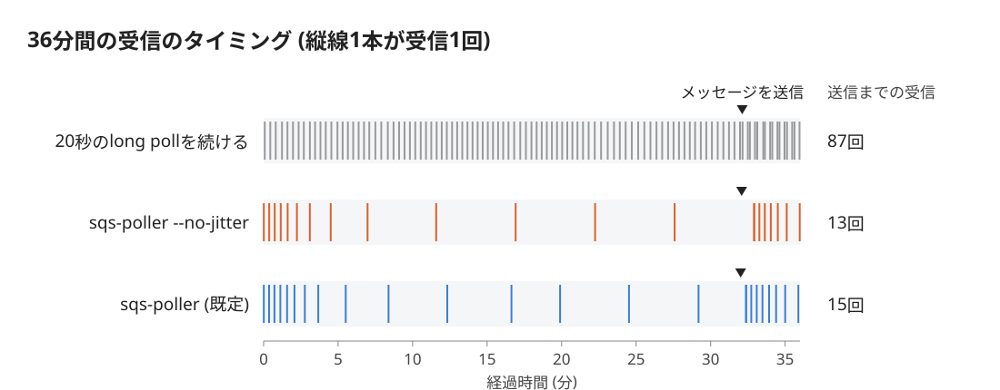

Title: 空のSQSキューへの受信を1日4,320回から約350回に減らすsqs-pollerをRustで作った
Date: 2026-11-28 00:09
Updated: 2026-11-28 00:09
Draft: true
Tags: rust aws sqs release rust-sqs-poller


Amazon SQSのキューが空のあいだは受信の間隔を指数的に延ばし、メッセージが届いたら最短の間隔に戻すポーラー `sqs-poller` をRustで作りました。
20秒のlong pollを休まず回すと、空のキュー1つでも受信は1日4,320回になります。

`sqs-poller` は空の受信のあとに1秒から300秒まで倍々に延びる待ち時間を挟むので、既定の設定では1日約350回で済みます。

リポジトリは [conao3/rust-sqs-poller](https://github.com/conao3/rust-sqs-poller) で、ライセンスはApache-2.0です。
crates.ioに `sqs-poller` の0.1.1を公開していて、CLIとしてもRustのライブラリとしても使えます。

<div class="github-card" data-repo="conao3/rust-sqs-poller"><a href="https://github.com/conao3/rust-sqs-poller"><span class="github-card-name"><svg class="github-card-mark" viewBox="0 0 16 16" aria-hidden="true"><path d="M6.766 11.328c-2.063-.25-3.516-1.734-3.516-3.656 0-.781.281-1.625.75-2.188-.203-.515-.172-1.609.063-2.062.625-.078 1.468.25 1.968.703.594-.187 1.219-.281 1.985-.281.765 0 1.39.094 1.953.265.484-.437 1.344-.765 1.969-.687.218.422.25 1.515.046 2.047.5.593.766 1.39.766 2.203 0 1.922-1.453 3.375-3.547 3.64.531.344.89 1.094.89 1.954v1.625c0 .468.391.734.86.547C13.781 14.359 16 11.53 16 8.03 16 3.61 12.406 0 7.984 0 3.563 0 0 3.61 0 8.031a7.88 7.88 0 0 0 5.172 7.422c.422.156.828-.125.828-.547v-1.25c-.219.094-.5.156-.75.156-1.031 0-1.64-.562-2.078-1.609-.172-.422-.36-.672-.719-.719-.187-.015-.25-.093-.25-.187 0-.188.313-.328.625-.328.453 0 .844.281 1.25.86.313.452.64.655 1.031.655s.641-.14 1-.5c.266-.265.47-.5.657-.656"/></svg><span>conao3/<strong>rust-sqs-poller</strong></span></span><span class="github-card-description">An SQS poller that backs off exponentially while the queue is empty and resets the moment a message arrives</span><span class="github-card-footer"><span class="github-card-language"><span class="github-card-language-color" style="background-color: #dea584"></span>Rust</span><span class="github-card-star"><svg viewBox="0 0 16 16" aria-hidden="true"><path d="M8 .25a.75.75 0 0 1 .673.418l1.882 3.815 4.21.612a.75.75 0 0 1 .416 1.279l-3.046 2.97.719 4.192a.751.751 0 0 1-1.088.791L8 12.347l-3.766 1.98a.75.75 0 0 1-1.088-.79l.72-4.194L.818 6.374a.75.75 0 0 1 .416-1.28l4.21-.611L7.327.668A.75.75 0 0 1 8 .25Z"/></svg><span>Star</span><span class="github-card-star-count" hidden></span></span></span></a></div>


# 使い方

Cargoで入れて、キューのURLを渡して起動します。

```console
$ cargo install sqs-poller
$ sqs-poller --queue-url https://sqs.ap-northeast-1.amazonaws.com/123456789012/jobs
```

受け取ったメッセージは起動のオプションで選んだ1つの渡し先に1件ずつ渡します。
`sqs-poller` は渡し先が受け取ったメッセージだけをキューから消し、受け取らなかったメッセージはキューに残します。

-   標準出力 (既定): メッセージ1件をJSONの1行で書きます。
-   `--endpoint <URL>` : メッセージの本文をPOSTし、ヘッダーの `x-sqs-message-id` にメッセージのIDを入れます。2xxの応答で消します。
-   `--command <コマンド>` : メッセージごとにコマンドを1回起動し、本文を標準入力に、IDを環境変数 `SQS_MESSAGE_ID` に渡します。終了コード0で消します。

`--endpoint` はElastic Beanstalkのworker環境で動く [SQSデーモン](https://docs.aws.amazon.com/elasticbeanstalk/latest/dg/using-features-managing-env-tiers.html#worker-daemon) と同じく、HTTPのPOSTでアプリにメッセージを渡します。

キューに残ったメッセージは可視性タイムアウトが過ぎるとまた受信できるようになり、受信の回数がキューのredrive policyの上限を超えるとデッドレターキューに移ります。
`sqs-poller` は受け取らなかったメッセージを消さないだけなので、いま使っているデッドレターキューの設定がそのまま動きます。

AWSの認証情報とリージョンは環境変数や `~/.aws/config` やIAMロールからAWS SDKの標準の順序で読み、 `--region` と `--profile` で上書きできます。
Ctrl-CかSIGTERMで止めると受信した件数などの集計を標準エラー出力に書いて終わります。


## 手元のSQS互換サーバーで試す

SQSと同じAPIを手元で動かす [ElasticMQ](https://github.com/softwaremill/elasticmq) を使うと、AWSのアカウントなしで `sqs-poller` の動きを確かめられます。
ElasticMQはnixpkgsにあるので、 `nix run` で起動しました。

```console
$ nix run nixpkgs#elasticmq-server-bin
```

別の端末でダミーの認証情報と `AWS_ENDPOINT_URL` を設定し、AWS CLIでキューを作ってメッセージを2件送ります。
`AWS_ENDPOINT_URL` はAWS CLI v2とAWS SDK for Rustがどちらも読む環境変数なので、 `sqs-poller` もElasticMQにつなぎます。

```sh
export AWS_ACCESS_KEY_ID=x AWS_SECRET_ACCESS_KEY=x AWS_REGION=us-east-1
export AWS_ENDPOINT_URL=http://localhost:9324
aws sqs create-queue --queue-name jobs
Q=http://localhost:9324/000000000000/jobs
aws sqs send-message --queue-url $Q --message-body '{"job":"resize","id":1}'
aws sqs send-message --queue-url $Q --message-body '{"job":"resize","id":2}'
```

`sqs-poller` を起動すると2件をJSONの行で書き、Ctrl-Cで止めると集計を出します。

```console
$ sqs-poller --queue-url $Q
{"messageId":"f3af975d-70e5-4648-801e-e2b67d5641e3","body":"{\"job\":\"resize\",\"id\":1}","attributes":{}}
{"messageId":"5c9d1371-6322-4831-823f-fd1e7bfb0fb9","body":"{\"job\":\"resize\",\"id\":2}","attributes":{}}
^Csqs-poller: stopped. received 2, deleted 2, failed 0, empty polls 0, receive errors 0
```

本文に `fail` を含むメッセージのときだけ終了コード1で終わるスクリプトを `--command` に渡すと、失敗したメッセージがキューに残ることを確かめられます。

```sh
#!/bin/sh
body=$(cat)
echo "$(date +%T) $SQS_MESSAGE_ID $body"
case "$body" in
  *fail*) exit 1 ;;
esac
```

このスクリプトを `handle.sh` に保存し、 `ok` と `fail` の2件を送ってから起動しました。
ElasticMQではキューの可視性タイムアウトが既定で30秒なので、 `fail` は30秒後にもう一度届きます。

```console
$ sqs-poller --queue-url $Q --command ./handle.sh
13:32:01 e6db8330-d606-4199-87c6-23c3b1ee1395 ok
13:32:02 1623e4ee-9dcd-4875-8e9b-e5b1565b23ba fail
sqs-poller: handler failed: command exited with exit status: 1
13:32:32 1623e4ee-9dcd-4875-8e9b-e5b1565b23ba fail
sqs-poller: handler failed: command exited with exit status: 1
^Csqs-poller: stopped. received 3, deleted 1, failed 2, empty polls 1, receive errors 0
```


# 待つ間隔の延ばし方

`sqs-poller` は次の順で受信を繰り返します。

1.  キューから受信します。long pollで待つのは最長20秒です。
2.  メッセージが届いたら1件ずつ渡し先に渡し、待たずに次の受信をします。
3.  空だったら待ち時間だけ眠り、待ち時間を2倍にします。待ち時間は1秒、2秒、4秒と延びて、300秒で止まります。
4.  メッセージが届くと、待ち時間は1秒に戻ります。

既定では待ち時間の後半を乱数で決めるequal jitterを使うので、待ち時間が300秒なら150秒から300秒のあいだで眠ります。
同じキューを複数の `sqs-poller` で見張っても起きる時刻がそろわないようにするためで、 `--no-jitter` を付けると待ち時間のとおりに眠ります。

実際の受信の間隔を見るためにElasticMQに3つのキューを作り、それぞれを別のやり方で36分間見張りました。
比べる相手はAWS CLIの `aws sqs receive-message --wait-time-seconds 20` をシェルのループで回し続けるconsumerです。

consumerとElasticMQのあいだに受信の時刻を記録するHTTPのプロキシを挟み、32分の時点で3つのキューにメッセージを1件ずつ送りました。



<table border="2" cellspacing="0" cellpadding="6" rules="groups" frame="hsides">


<colgroup>
<col  class="org-left" />

<col  class="org-left" />
</colgroup>
<thead>
<tr>
<th scope="col" class="org-left">見張り方</th>
<th scope="col" class="org-left">送信までの32分の受信</th>
</tr>
</thead>
<tbody>
<tr>
<td class="org-left">20秒のlong pollを続ける</td>
<td class="org-left">87回</td>
</tr>

<tr>
<td class="org-left"><code>sqs-poller --no-jitter</code></td>
<td class="org-left">13回</td>
</tr>

<tr>
<td class="org-left"><code>sqs-poller</code> (既定)</td>
<td class="org-left">15回</td>
</tr>
</tbody>
</table>

`--no-jitter` では受信のあとに眠る時間が1秒、2秒、4秒と延びて256秒の次に上限の300秒になり、それ以降は20秒のlong pollと合わせて320秒に1回の受信になりました。
メッセージを送ってから受け取るまでは `--no-jitter` で50秒、既定の設定で22秒かかりました。

受け取ったあとは待ち時間が1秒に戻り、また1秒、2秒、4秒と延びていきました。
AWS CLIのループはメッセージを消さないので、送ったあとは可視性タイムアウトの30秒ごとに同じメッセージを受け取り続けました。


# 受信の回数と料金

待ち時間が300秒に達したあとは `--no-jitter` なら20秒のlong pollと300秒の眠りで320秒に1回なので、受信は1日270回になります。
既定の設定では眠りが150秒から300秒、平均225秒になるので、1日約350回です。

20秒のlong pollを続けると1日4,320回になるので、受信の回数は既定の設定で約92%、 `--no-jitter` で約94%減ります。

SQSの料金は [リクエストの回数](https://aws.amazon.com/sqs/pricing/) で決まり、メッセージが無かった受信も1回のリクエストとして数えます。
[long polling](https://docs.aws.amazon.com/AWSSimpleQueueService/latest/SQSDeveloperGuide/sqs-short-and-long-polling.html#sqs-long-polling) は空の応答を減らしますが、1回の受信で待てるのは最長20秒なので、空のキューを見張り続けると1日4,320回の受信になります。

この記事を書いた時点でus-east-1の標準キューのリクエストは100万回あたり0.40ドルで、毎月100万回までは無料です。
20秒のlong pollを続けるconsumerは30日で129,600回受信するので、1つだけなら無料の範囲に収まり、使い切っていても月0.05ドルです。

見張るキューやconsumerが多いときは金額の差が開き、100個のキューを1つずつのconsumerで見張ると30日で1,296万回になって、無料の100万回を引いて月4.78ドルかかります。
`sqs-poller` の既定の設定なら約106万回になり、月0.02ドルほどで済みます。

その代わり `sqs-poller` は眠っているあいだに届いたメッセージを眠りが終わってから受け取るので、上の計測ではこの遅れが50秒と22秒でした。
待ち時間が上限の300秒のときは最大で5分遅れるので、届いてすぐに処理したいキューでは `--max-interval-secs` を小さくしてください。

メッセージが続けて届くあいだは眠らずに受信するので、混んでいるキューの処理の速さは変わりません。


# Rustのライブラリとして使う

`sqs-poller` はRustのライブラリとしても使えて、設定、SQSのクライアント、メッセージを受け取る関数、止めるための `CancellationToken` を `run` に渡します。
関数が `Ok(())` を返したメッセージは消し、 `Err` を返したメッセージはキューに残します。

```toml
[dependencies]
sqs-poller = "0.1"
aws-config = "1"
aws-sdk-sqs = "1"
tokio = { version = "1", features = ["macros", "rt-multi-thread", "signal"] }
tokio-util = "0.7"
```

```rust
use sqs_poller::{run, Config};
use tokio_util::sync::CancellationToken;

#[tokio::main]
async fn main() {
    let aws = aws_config::load_defaults(aws_config::BehaviorVersion::latest()).await;
    let client = aws_sdk_sqs::Client::new(&aws);
    let config = Config::new("http://localhost:9324/000000000000/jobs");

    let shutdown = CancellationToken::new();
    let trigger = shutdown.clone();
    tokio::spawn(async move {
        tokio::signal::ctrl_c().await.unwrap();
        trigger.cancel();
    });

    let stats = run(config, client, |message| async move {
        let body = message.body.unwrap_or_default();
        if body.contains("\"fail\"") {
            return Err(format!("cannot handle {body}").into());
        }
        println!("handled {body}");
        Ok(())
    }, shutdown).await;
    println!("{stats:?}");
}
```

`jobs` のキューを空にしてから `{"job":"resize","id":1}` と `{"job":"fail"}` を送って動かし、Ctrl-Cで止めると `run` が返した集計を出します。

```console
$ cargo run -q --release
handled {"job":"resize","id":1}
^CStats { received: 2, deleted: 1, failed: 1, empty_polls: 1, receive_errors: 0 }
```

`run` は関数を受信した順に1件ずつ呼びます。
受信、削除、関数のエラーは `Config::on_error` に渡したコールバックに届き、受信のエラーのあとは空の受信と同じく待ち時間を延ばしてからやり直します。

待ち時間の計算だけが欲しいときは、 `Backoff` の型を自分の受信のループで単独で使えます。


# おわりに

たいてい空のキューを見張るconsumerを、 `sqs-poller` に置き換えて使ってみてください。

