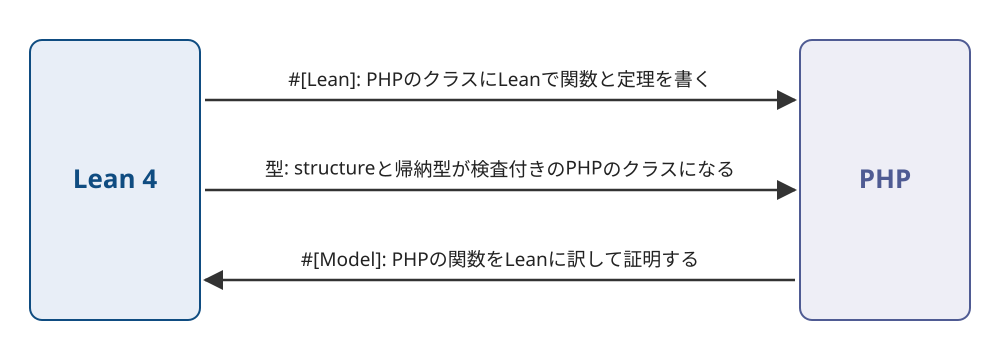

Title: Lean 4で証明した関数をPHPから呼べて、PHPの関数をLeanで証明できるleanfranのPHP版を作った
Date: 2026-11-23 01:00
Updated: 2026-11-23 01:00
Tags: lean php formal-verification code-generation release lean-leanfran


Lean 4で書いて証明した関数をPHPのクラスから呼べるようにするleanfranのPHP版を作りました。
Leanのstructureと帰納型は値を作るときにLeanの条件で検査するPHPのクラスになりますし、逆向きにPHPで書いた関数をLeanに訳してその性質をLeanで証明することもできます。

リポジトリは[conao3/lean-leanfranのlangs/PHP/](https://github.com/conao3/lean-leanfran/tree/v0.7.0/langs/PHP)で、ライセンスはApache-2.0です。
Packagistには[conao3/leanfran](https://packagist.org/packages/conao3/leanfran)の名前で公開していて、この記事は0.7.0で動かした結果をもとに書いています。

leanfranはLeanのコンパイラの中間表現をPHPのソースに変換するもので、生成したPHPはComposerのパッケージだけで動き、実行するときにLeanは要りません。

Rust・Python・TypeScript・Clojureの4つは[leanfranを紹介した記事](https://s.conao3.com/blog/2026/23d62c)で取り上げていて、PHPもそれらと同じリポジトリから同じ版で出しています。

<div class="github-card" data-repo="conao3/lean-leanfran"><a href="https://github.com/conao3/lean-leanfran"><span class="github-card-name"><svg class="github-card-mark" viewBox="0 0 16 16" aria-hidden="true"><path d="M6.766 11.328c-2.063-.25-3.516-1.734-3.516-3.656 0-.781.281-1.625.75-2.188-.203-.515-.172-1.609.063-2.062.625-.078 1.468.25 1.968.703.594-.187 1.219-.281 1.985-.281.765 0 1.39.094 1.953.265.484-.437 1.344-.765 1.969-.687.218.422.25 1.515.046 2.047.5.593.766 1.39.766 2.203 0 1.922-1.453 3.375-3.547 3.64.531.344.89 1.094.89 1.954v1.625c0 .468.391.734.86.547C13.781 14.359 16 11.53 16 8.03 16 3.61 12.406 0 7.984 0 3.563 0 0 3.61 0 8.031a7.88 7.88 0 0 0 5.172 7.422c.422.156.828-.125.828-.547v-1.25c-.219.094-.5.156-.75.156-1.031 0-1.64-.562-2.078-1.609-.172-.422-.36-.672-.719-.719-.187-.015-.25-.093-.25-.187 0-.188.313-.328.625-.328.453 0 .844.281 1.25.86.313.452.64.655 1.031.655s.641-.14 1-.5c.266-.265.47-.5.657-.656"/></svg><span>conao3/<strong>lean-leanfran</strong></span></span><span class="github-card-description">Write and prove functions in Lean 4, run them as Rust, Python, TypeScript and Clojure</span><span class="github-card-footer"><span class="github-card-language"><span class="github-card-language-color"></span>Lean</span><span class="github-card-star"><svg viewBox="0 0 16 16" aria-hidden="true"><path d="M8 .25a.75.75 0 0 1 .673.418l1.882 3.815 4.21.612a.75.75 0 0 1 .416 1.279l-3.046 2.97.719 4.192a.751.751 0 0 1-1.088.791L8 12.347l-3.766 1.98a.75.75 0 0 1-1.088-.79l.72-4.194L.818 6.374a.75.75 0 0 1 .416-1.28l4.21-.611L7.327.668A.75.75 0 0 1 8 .25Z"/></svg><span>Star</span><span class="github-card-star-count" hidden></span></span></span></a></div>


# 3つの使い方

PHPでのleanfranの使い方は3つあります。



1.  PHPのクラスに `#[Lean(...)]` でLeanの関数と定理を書き、 `vendor/bin/leanfran sync` で生成したメソッドをPHPから呼ぶ。
2.  Leanのstructureと帰納型を、検査とJSONの変換が付いたPHPのクラスとして受け渡す。
3.  PHPで書いた関数に `#[Model(...)]` を付けてLeanに訳し、 `vendor/bin/leanfran check` でその性質の証明を検査する。

1と2はLeanからPHPへ、3はPHPからLeanへの向きです。


# PHPのクラスにLeanを書く

Leanのコードを変換するCLIの `leanfran-php` はnixで入れて、アプリケーションにはComposerのパッケージを入れます。

```console
$ nix profile install github:conao3/lean-leanfran/v0.7.0#php
$ composer require conao3/leanfran
```

パッケージは64ビットのPHP 8.4以上と、GMPとTokenizerの拡張で動きます。
生成と証明の検査には、Lean 4.35.0の `lean` と `lake` も `PATH` に要ります。

`composer.json` の `autoload.psr-4` では名前空間の `App` を `src/` に割り当てておき、 `src/Pricing.php` に次のクラスを書きます。

```php
<?php

declare(strict_types=1);

namespace App;

use Conao3\Leanfran\Lean;

#[Lean(<<<'LEAN'
    structure Range where
      lo : Nat
      hi : Nat
      ok : lo ≤ hi

    def width (r : Range) : Nat := r.hi - r.lo

    theorem width_le (r : Range) : width r ≤ r.hi := by
      unfold width
      omega
    LEAN)]
final class Pricing
{
    use Pricing\Functions;
}
```

`#[Lean(...)]` の属性にはLeanのソースをnowdocで書き、クラスの中では生成されるtraitの `Pricing\Functions` をuseします。
`Range` の `ok` は `lo ≤ hi` の証明を持つフィールドで、 `width_le` は幅が上限を超えないという定理です。

呼び出す側の `main.php` では、生成されるクラスの `Range` を作って `Pricing::width` に渡します。

```php
<?php

declare(strict_types=1);

use App\Pricing;
use App\Pricing\Range;

require __DIR__ . '/vendor/autoload.php';

echo Pricing::width(new Range(lo: 2, hi: 5)), PHP_EOL;
```

`vendor/bin/leanfran sync` を実行するとLeanが定理を検査してPHPを生成するので、生成したあとはPHPだけで実行できます。

```console
$ vendor/bin/leanfran sync
leanfran: 1 block checked and generated
$ php main.php
3
```

生成したファイルはクラスの隣の `src/Pricing/` に置かれます。

```console
$ find src -type f | sort
src/Pricing/Functions.php
src/Pricing/Internal/LeanPricing.php
src/Pricing/leanfran.json
src/Pricing.php
src/Pricing/Range.php
```

`Functions.php` が `width` のメソッドを持つtrait、 `Range.php` が型のクラス、 `Internal/LeanPricing.php` がLeanの中間表現から生成した本体です。
`leanfran.json` にはブロックのハッシュと生成したファイルが記録されます。

生成したファイルをリポジトリにcommitしておけば、CIではLeanを入れずに `vendor/bin/leanfran status` で生成物が古くなっていないかを確かめられます。

定理を `width r ≤ r.lo` に書き換えると証明が通らなくなり、生成はそこで止まります。

```console
$ vendor/bin/leanfran sync
src/Pricing.php:19:7: error: (lean block App\Pricing, Lean 10:2) omega could not prove the goal:
a possible counterexample may satisfy the constraints
  b ≥ 0
  a ≥ 0
  a - b ≤ 0
  2*a - b ≤ -1
where
 a := ↑r.lo
 b := ↑r.hi
lake build failed
```

エラーはPHPのファイルの行と列から始まり、そのあとにブロックの中のLeanの行と列が続きます。
生成に失敗したときは前に生成したPHPが残るので、 `php main.php` はこのあとも `3` を出力します。


# Leanの型がPHPのクラスになる

`Range` は `final readonly class` になり、 `lo` と `hi` は公開のプロパティに、証明のフィールドの `ok` はコンストラクタでの検査になります。
次の `range.php` ではJSONから値を作り、条件を満たさない入力をコンストラクタに渡してから、JSON Schemaを出力しています。

```php
<?php

declare(strict_types=1);

use App\Pricing\Range;
use Conao3\Leanfran\ValidationError;

require __DIR__ . '/vendor/autoload.php';

$r = Range::fromJson('{"lo":1,"hi":4}');
echo $r->hi, PHP_EOL;

try {
    new Range(lo: 5, hi: 2);
} catch (ValidationError $e) {
    echo $e->getMessage(), PHP_EOL;
}

echo json_encode(Range::jsonSchema(), JSON_PRETTY_PRINT | JSON_UNESCAPED_SLASHES), PHP_EOL;
```

```console
$ php range.php
4
Range.ok: lo ≤ hi
{
    "$schema": "https://json-schema.org/draft/2020-12/schema",
    "type": "object",
    "properties": {
        "lo": {
            "type": "integer",
            "minimum": 0
        },
        "hi": {
            "type": "integer",
            "minimum": 0
        }
    },
    "required": [
        "lo",
        "hi"
    ],
    "additionalProperties": false
}
```

コンストラクタは `lo ≤ hi` の判定をLeanからコンパイルしたコードで実行するので、 `lo` が `hi` より大きい値は `ValidationError` になります。

JSON Schemaでは2つのフィールドにまたがる `lo ≤ hi` を表せないので、schemaに出るのは `Nat` の下限だけです。
この条件はコンストラクタが検査していて、配列から値を作るときや、[Valinor](https://github.com/conao3/lean-leanfran/blob/v0.7.0/docs/php-guide.md#valinor)のマッパーに生成したクラスを渡したときにも同じ検査が働きます。

`#[Lean(...)]` の `models` にPHPで書いた `readonly` のクラスを渡すとLeanのstructureとして取り込めて、そのクラスのPHPDocに書いた `int<0, 100>` のような範囲は証明のフィールドになります。


# PHPの関数をLeanで証明する

逆向きの例として、値を範囲に収める `clamp` をPHPで書き、 `#[Model(...)]` でLeanの仕様と結びつけます。

```php
<?php

declare(strict_types=1);

namespace App;

use Conao3\Leanfran\Lean;
use Conao3\Leanfran\Model;

#[Lean(<<<'LEAN'
    def clampSpec (x lo hi : Int) : Int := max lo (min hi x)
    def ordered (_x lo hi : Int) : Bool := lo ≤ hi
    def inRange (_x lo hi : Int) (r : Int) : Bool := lo ≤ r && r ≤ hi
    LEAN)]
final class Calc
{
    use Calc\Functions;

    #[Model(refines: 'clampSpec', requires: 'ordered', ensures: ['in_range' => 'inRange'])]
    public static function clamp(int $x, int $lo, int $hi): int
    {
        if ($x < $lo) {
            return $lo;
        }
        if ($x > $hi) {
            return $hi;
        }
        return $x;
    }
}
```

`refines` には実装と同じ値を返すLeanの関数、 `requires` には入力の前提、 `ensures` には戻り値が満たす条件を書きます。
この例では `lo ≤ hi` のときに `clamp` が `clampSpec` と同じ値を返すことと、戻り値が `lo` 以上 `hi` 以下になることが証明の義務になります。

`vendor/bin/leanfran check` はPHPの構文木を読んで関数をLeanの `do` 記法の関数に訳し、 `clamp.obligation.refines` のような名前で義務の命題を作ります。
証明は `composer.json` の隣の `lean/Proofs/` に書き、ここでは[verified-clampのサンプルの証明](https://github.com/conao3/lean-leanfran/blob/v0.7.0/langs/PHP/samples/verified-clamp/lean/Proofs/Calc.lean)をそのまま使っています。

```lean
import LeanPhpModel.App.Calc

open LeanPhpEmbed.App.Calc
namespace LeanPhpModel.App.Calc

theorem clamp.proof.refines : clamp.obligation.refines := by
  intro x lo hi h
  simp only [ordered, decide_eq_true_eq] at h
  simp only [clamp, clampSpec]
  split <;> (try split) <;> simp_all <;> omega

theorem clamp.proof.in_range : clamp.obligation.in_range := by
  intro x lo hi h
  simp only [ordered, decide_eq_true_eq] at h
  simp only [clamp, inRange]
  split <;> (try split) <;> simp_all <;> omega

end LeanPhpModel.App.Calc
```

PHPの構文木を読むのに `nikic/php-parser` を使うので、開発用の依存に入れてから `check` を実行します。

```console
$ composer require -q --dev --no-interaction 'nikic/php-parser:^5.9'
$ vendor/bin/leanfran check --require proved
leanfran: 2 blocks checked and generated
App\Calc\clamp refines: proved
App\Calc\clamp in_range: proved
leanfran: all blocks up to date
```

`--require proved` を付けると、義務が1つでも `proved` でなければ終了コードが1になります。
`proved` は、定理の型が義務と一致していて、 `sorry` や標準の3つ以外の公理に頼っていないことを表します。

PHPの実装とLeanの仕様は、Leanを使わない乱数のテストでも比べられます。

```php
<?php

declare(strict_types=1);

use App\Calc;
use Conao3\Leanfran\Verify;
use Conao3\Leanfran\Verify\PropertyFailure;

require __DIR__ . '/vendor/autoload.php';

try {
    Verify::checkClass(Calc::class);
    echo 'ok', PHP_EOL;
} catch (PropertyFailure $e) {
    echo $e->getMessage(), PHP_EOL;
}
```

```console
$ php verify.php
ok
```

`Verify::checkClass` は、0や整数の上限などの境界の値とシードを固定した乱数で入力を作り、 `requires` を満たす入力を200件集めます。
その入力ごとに、PHPの `clamp` の戻り値を生成した `clampSpec` の値と比べます。

実装の2つめの `if` を、 `$x` が `$hi` 以上のときに `$hi - 1` を返すように書き換えてみます。

```php
if ($x >= $hi) {
    return $hi - 1;
}
```

`check` では2つの証明が通らなくなり、Leanのエラーを標準エラー出力に出したうえで、義務ごとの状態を `failed` にします。

```console
$ vendor/bin/leanfran check --require proved 2>/dev/null
leanfran: 2 blocks checked and generated
App\Calc\clamp refines: failed
App\Calc\clamp in_range: failed
leanfran: all blocks up to date
```

乱数のテストも、3つの引数がすべて0の入力で反例を見つけます。

```console
$ php verify.php
App\Calc\clamp [refines] failed (seed=1, input=[0, 0, 0]): implementation returned -1; spec expected 0
```


# 証明が保証する範囲

Leanの定理が保証するのは、Leanで書いた関数と、PHPから訳したLeanのモデルの性質です。
生成したPHPや元のPHPの実行にもその性質が成り立つには、変換器とランタイムとPHPの演算のモデルが正しい必要があるので、この部分はテストで確かめています。

PHPの整数の演算は64ビットの範囲で検査していて、あふれてfloatになる計算はモデルの上でも失敗になります。
`#[Model(...)]` を付けた関数では、引数のPHPDocに書いた `int<0, 100>` のような範囲は証明の前提にならないので、証明に使う条件は `requires` に書きます。

訳せるのはPHPの一部で、 `foreach` や `match` 、リストの添字、 `readonly` のクラスと `enum` は扱えますが、参照渡し、 `??` 、入出力を含む関数は対象外です。
対応する構文の一覧は[PHPのガイド](https://github.com/conao3/lean-leanfran/blob/v0.7.0/docs/php-guide.md#php-subset)にあります。

生成するPHPのほうは、LeanのCバックエンドで動かした結果と比べるテストで確かめています。

この記事を書いた時点で、PHP 8.4と8.5のそれぞれで、境界の値と乱数で作った数値の演算1,707,520件の結果がCバックエンドとバイト単位で一致しています。
Float32の超越関数などの65件は、浮動小数点数の最小の刻み1つ分の差に収まっています。


# おわりに

この記事の例のほかにも、[PHPのサンプル](https://github.com/conao3/lean-leanfran/tree/v0.7.0/langs/PHP/samples)には価格と個数の上限を前提にして合計のループを証明するverified-cartと、2つのブロックで型を共有するembed-ordersを置いてあります。
Leanの `IO` の関数をPHPのコマンドとして動かすgreet-cliもあります。

導入の手順は[PHPのREADME](https://github.com/conao3/lean-leanfran/blob/master/langs/PHP/README.md)、型の対応やCLIの詳細は[PHPのガイド](https://github.com/conao3/lean-leanfran/blob/v0.7.0/docs/php-guide.md)にあります。

