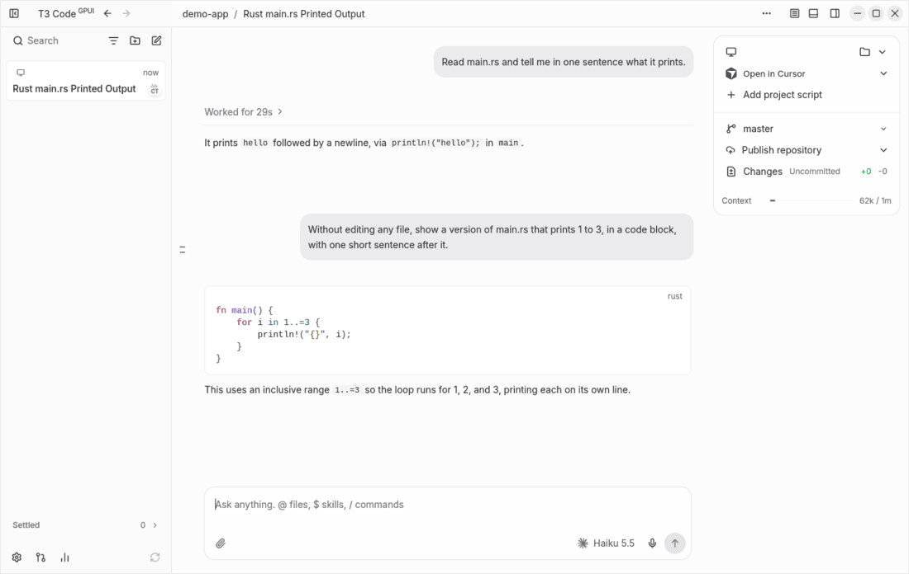

Title: T3 CodeをElectronの代わりにRustとGPUIの窓で使うT3 Code GPUIを作った
Date: 2026-11-27 23:22
Updated: 2026-11-27 23:22
Draft: true
Tags: rust gpui t3-code ai-agent release rust-t3code-gpui


コーディングエージェントを操作するT3 Codeのサーバーに、Electronのデスクトップアプリの代わりにRustとGPUIで描くネイティブの窓からつなぐ非公式のフロントエンド、T3 Code GPUIを作りました。
サーバーの `t3 serve` には手を入れずにWebSocketのプロトコルでつなぎ、スレッドの一覧と返答のタイムラインと送信欄を描きます。

リポジトリは[conao3/rust-t3code-gpui](https://github.com/conao3/rust-t3code-gpui)で、ライセンスはApache-2.0です。
この記事ではcommit `d5cfde1` の0.1.0をLinuxのX11で動かしました。

エージェントの返答が流れている間も描き直しを1秒に4回までにまとめ、伸びていく返答は末尾の塊だけを組み直します。

T3 Code GPUIはT3 Codeの開発元とは関係のない非公式のプロジェクトで、承認も保守も受けていません。

<div class="github-card" data-repo="conao3/rust-t3code-gpui"><a href="https://github.com/conao3/rust-t3code-gpui"><span class="github-card-name"><svg class="github-card-mark" viewBox="0 0 16 16" aria-hidden="true"><path d="M6.766 11.328c-2.063-.25-3.516-1.734-3.516-3.656 0-.781.281-1.625.75-2.188-.203-.515-.172-1.609.063-2.062.625-.078 1.468.25 1.968.703.594-.187 1.219-.281 1.985-.281.765 0 1.39.094 1.953.265.484-.437 1.344-.765 1.969-.687.218.422.25 1.515.046 2.047.5.593.766 1.39.766 2.203 0 1.922-1.453 3.375-3.547 3.64.531.344.89 1.094.89 1.954v1.625c0 .468.391.734.86.547C13.781 14.359 16 11.53 16 8.03 16 3.61 12.406 0 7.984 0 3.563 0 0 3.61 0 8.031a7.88 7.88 0 0 0 5.172 7.422c.422.156.828-.125.828-.547v-1.25c-.219.094-.5.156-.75.156-1.031 0-1.64-.562-2.078-1.609-.172-.422-.36-.672-.719-.719-.187-.015-.25-.093-.25-.187 0-.188.313-.328.625-.328.453 0 .844.281 1.25.86.313.452.64.655 1.031.655s.641-.14 1-.5c.266-.265.47-.5.657-.656"/></svg><span>conao3/<strong>rust-t3code-gpui</strong></span></span><span class="github-card-description">Native GPUI frontend for T3 Code</span><span class="github-card-footer"><span class="github-card-language"><span class="github-card-language-color" style="background-color: #dea584"></span>Rust</span><span class="github-card-star"><svg viewBox="0 0 16 16" aria-hidden="true"><path d="M8 .25a.75.75 0 0 1 .673.418l1.882 3.815 4.21.612a.75.75 0 0 1 .416 1.279l-3.046 2.97.719 4.192a.751.751 0 0 1-1.088.791L8 12.347l-3.766 1.98a.75.75 0 0 1-1.088-.79l.72-4.194L.818 6.374a.75.75 0 0 1 .416-1.28l4.21-.611L7.327.668A.75.75 0 0 1 8 .25Z"/></svg><span>Star</span><span class="github-card-star-count" hidden></span></span></span></a></div>


# T3 Codeとの関係

[T3 Code](https://t3.codes) は、手元でログイン済みのClaude CodeやCodexなどのコーディングエージェントを1つの画面から動かすアプリです。
サーバーの `t3 serve` と、そこにつなぐWebの画面やデスクトップアプリからできています。

デスクトップアプリはElectronで作られているので、T3 Code GPUIではその画面をRustで書き、サーバーは本家のものをそのまま使うことにしました。
画面はZedエディタのUIフレームワークの[GPUI](https://github.com/zed-industries/zed/tree/main/crates/gpui)で描いていて、ボタンや入力欄などの部品には[gpui-kit](https://github.com/longbridge/gpui-kit)を使っています。

下の画像は一時的に立てた `t3 serve` にT3 Code GPUIでつなぎ、新しいスレッドで2回話しかけたところです。
左がスレッドの一覧、中央が返答のタイムラインと送信欄、右がGitのブランチや変更を示すパネルです。
ホスト名などの表示は塗りつぶしています。



本家の画面にある機能は順に移している途中です。


# 入れ方とつなぎ方

Nixのflakeにしてあるので、Linuxでは次のコマンドで窓が開きます。

```console
$ nix run github:conao3/rust-t3code-gpui
```

つなぐサーバーごとにトークンが要るので、サーバーが動いているホストで次のコマンドを実行して発行します。

```console
$ t3 auth session issue --ttl 365d --label t3code-gpui --token-only
```

発行したトークンはサーバーのURLと名前と一緒に `~/.config/t3code-gpui/environments.json` に書きます。
このファイルは自分以外のユーザーが読める権限だとT3 Code GPUIが読み込みを断るので、modeを600にしておきます。

```json
{
  "environments": [
    { "label": "local", "httpBaseUrl": "http://127.0.0.1:39471", "token": "..." }
  ]
}
```

サーバーを複数並べると、サイドバーの上のボタンでサーバーごとにスレッドを絞り込めます。
複数のサーバーにあるプロジェクトでは、新しいスレッドは並びの先頭のサーバーで始まります。
つながるかどうかは `check-environment` で確かめられて、認証が通れば `Authenticated` が `true` になります。

```console
$ t3code-gpui environment check-environment --label local
{
  "Label": "local",
  "EnvironmentId": "d2347fbc-2c6c-4188-b246-ba58ebb3840a",
  "ServerVersion": "0.1.12-nightly.20261122.5111",
  "OrchestrationProtocolVersion": 2,
  "Authenticated": true
}
```


# キー操作

送信欄に書いて `Ctrl+Enter` を押すと送れます。
新しいスレッドの画面で送るとスレッドは裏で始まり、出てきた通知の「Open」かサイドバーから開けます。

<table border="2" cellspacing="0" cellpadding="6" rules="groups" frame="hsides">


<colgroup>
<col  class="org-left" />

<col  class="org-left" />
</colgroup>
<thead>
<tr>
<th scope="col" class="org-left">キー</th>
<th scope="col" class="org-left">操作</th>
</tr>
</thead>
<tbody>
<tr>
<td class="org-left"><code>Ctrl+Enter</code></td>
<td class="org-left">送信欄の文を送る、開いている質問に答える</td>
</tr>

<tr>
<td class="org-left"><code>Ctrl+Shift+O</code></td>
<td class="org-left">新しいスレッドを始める</td>
</tr>

<tr>
<td class="org-left"><code>Alt+O</code></td>
<td class="org-left">終わったスレッドか入力を待つスレッドを順に開く</td>
</tr>

<tr>
<td class="org-left"><code>Alt+P</code> / <code>Alt+N</code></td>
<td class="org-left">前後の自分のメッセージへ移る</td>
</tr>

<tr>
<td class="org-left"><code>Ctrl+Shift+]</code> / <code>Ctrl+Shift+[</code></td>
<td class="org-left">サイドバーの次と前のスレッドを開く</td>
</tr>
</tbody>
</table>

エージェントの返答が終わったスレッドと入力を待ち始めたスレッドは、いま開いているもの以外をデスクトップの通知で知らせます。


# 描き直しを1秒に4回にまとめる

T3 Codeのサーバーは、エージェントが返答を書いている間、その時点の本文を入れた更新を[50ミリ秒ごと](https://github.com/pingdotgg/t3code/blob/b72cb0385cc7f682c05c1976d36fa9c712d995e0/apps/server/src/orchestration-v2/ThreadLiveEventCoalescer.ts#L18)にまとめて送ってきます。
T3 Code GPUIは届いた更新をすぐ手元の状態に入れますが、描き直しは[250ミリ秒](https://github.com/conao3/rust-t3code-gpui/blob/d5cfde166d3b47a036a587e88ef74b29ee783747/crates/t3code-gpui/src/app.rs#L108)に1回にまとめます。
その間に届いた更新は最新のものだけが画面に出ます。

返答の本文は[1,200バイトほどたまるごとにコードブロックの外の空行で区切り](https://github.com/conao3/rust-t3code-gpui/blob/d5cfde166d3b47a036a587e88ef74b29ee783747/crates/t3code-gpui/src/timeline.rs#L203-L224)、区切った塊をタイムラインの別の行にしています。
書き終わった塊は中身が変わらないので、返答が伸びている間に組み直すのは末尾の塊だけになります。

X11では画面の垂直同期を待たずにフレームを出すようにGPUIに手を入れてあり、描画の間もキー入力が遅れません。


# 構成

Cargoのworkspaceに3つのcrateを置いています。

-   `t3-client` : サーバーとの接続、スレッドの一覧とスレッドの状態、切れたときのつなぎ直しを受け持ちます。UIには依存していません。
-   `t3-terminal` : GhosttyのVTのモジュールをWebAssemblyとしてwasmtimeで動かす端末のエンジンです。これもUIには依存していません。
-   `t3code-gpui` : 窓とCLIです。

