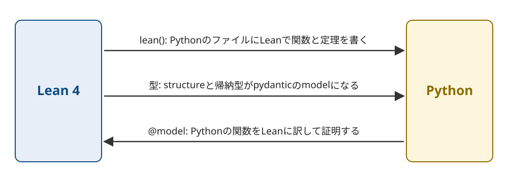

Title: lean-py: call Lean 4 functions from Python, and prove Python functions in Lean
Date: 2026-11-27 18:50
Updated: 2026-11-27 18:50
Lang: en
Original: /blog/2026/dc65bb
Tags: lean python formal-verification code-generation property-based-testing pydantic fastapi release lean-py


I wrote lean-py, which lets you call functions written and proved in Lean 4 from Python.
Lean structures and inductive types become pydantic models, so you can use them as FastAPI request types, and in the other direction, you can translate Python functions into Lean and prove their properties in Lean.

The repository is [conao3/lean-py](https://github.com/conao3/lean-py), under Apache-2.0.
The package is on PyPI as `lean-python`, and this post shows results from version 0.2.0.
lean-py is now the Python backend of [leanfran](https://s.conao3.com/blog/2026/21ebbd), in [langs/Python/ of conao3/lean-leanfran](https://github.com/conao3/lean-leanfran/tree/master/langs/Python), with the package name `leanfran`.

lean-py compiles the intermediate representation of the Lean compiler to Python source, and the generated Python runs on the `lean-python` package and pydantic alone, so you don't need Lean at run time.
[lean-clj](https://s.conao3.com/blog/2026/311be4) and [lean-rs](https://s.conao3.com/blog/2026/1ff994) call Lean functions from Clojure and Rust, and lean-py brings the same mechanism to Python.

<div class="github-card" data-repo="conao3/lean-py"><a href="https://github.com/conao3/lean-py"><span class="github-card-name"><svg class="github-card-mark" viewBox="0 0 16 16" aria-hidden="true"><path d="M6.766 11.328c-2.063-.25-3.516-1.734-3.516-3.656 0-.781.281-1.625.75-2.188-.203-.515-.172-1.609.063-2.062.625-.078 1.468.25 1.968.703.594-.187 1.219-.281 1.985-.281.765 0 1.39.094 1.953.265.484-.437 1.344-.765 1.969-.687.218.422.25 1.515.046 2.047.5.593.766 1.39.766 2.203 0 1.922-1.453 3.375-3.547 3.64.531.344.89 1.094.89 1.954v1.625c0 .468.391.734.86.547C13.781 14.359 16 11.53 16 8.03 16 3.61 12.406 0 7.984 0 3.563 0 0 3.61 0 8.031a7.88 7.88 0 0 0 5.172 7.422c.422.156.828-.125.828-.547v-1.25c-.219.094-.5.156-.75.156-1.031 0-1.64-.562-2.078-1.609-.172-.422-.36-.672-.719-.719-.187-.015-.25-.093-.25-.187 0-.188.313-.328.625-.328.453 0 .844.281 1.25.86.313.452.64.655 1.031.655s.641-.14 1-.5c.266-.265.47-.5.657-.656"/></svg><span>conao3/<strong>lean-py</strong></span></span><span class="github-card-description">Run Lean 4 as Python: a backend from Lean's IR, Lean blocks in Python files, pydantic models for Lean types, and Python functions verified in Lean</span><span class="github-card-footer"><span class="github-card-language"><span class="github-card-language-color"></span>Python</span><span class="github-card-star"><svg viewBox="0 0 16 16" aria-hidden="true"><path d="M8 .25a.75.75 0 0 1 .673.418l1.882 3.815 4.21.612a.75.75 0 0 1 .416 1.279l-3.046 2.97.719 4.192a.751.751 0 0 1-1.088.791L8 12.347l-3.766 1.98a.75.75 0 0 1-1.088-.79l.72-4.194L.818 6.374a.75.75 0 0 1 .416-1.28l4.21-.611L7.327.668A.75.75 0 0 1 8 .25Z"/></svg><span>Star</span><span class="github-card-star-count" hidden></span></span></span></a></div>


# Three ways to use it

lean-py supports three uses.



1.  Write functions and theorems in Lean inside a Python file, and call them from Python. This use takes `lean(...)` and `lean-py sync`.
2.  Pass Lean structures and inductive types around as pydantic models. You can also use pydantic models you wrote yourself from Lean.
3.  Translate a Python function into Lean, and prove its properties in Lean. This use takes `@model` and `lean-py check`.

The first two go from Lean to Python, and the third goes from Python to Lean.


# Write Lean in a Python file

First, install the Python package and `lean-python`, the CLI that converts Lean code.
You can install the CLI with nix.

```console
$ uv add lean-python
$ nix profile install github:conao3/lean-py
```

To check proofs, you also need `lake`, the Lean build tool, from Lean 4.35.0 on your `PATH`.

You write the Lean source as a string in `lean(...)`, and call it in a module of your package.

```python
# demo/arith.py
from lean_python import lean

arith = lean("arith", r"""
def double (n : Nat) : Nat := n + n

theorem double_eq (n : Nat) : double n = 2 * n := by
  unfold double; omega

structure Range where
  lo : Nat
  hi : Nat
  ok : lo ≤ hi

def Range.width (r : Range) : Nat := r.hi - r.lo
""")
```

`double_eq` unfolds the definition of `double` and proves the equation with [omega](https://lean-lang.org/doc/reference/latest/Tactic-Proofs/Tactic-Reference/#omega), a tactic that solves linear arithmetic over natural numbers and integers.
`lean-py sync` imports the modules of the package and collects the `lean(...)` blocks, checks the proofs with `lake build`, and if the check passes, converts the Lean code in the blocks to Python and writes it to `demo/_lean/`.

```console
$ lean-py sync --package demo
lean-py: 1 blocks of demo checked and generated
```

`lean(...)` returns the generated module, so you call the functions in the block as Python functions.

```python
from demo.arith import arith

print(arith.double(21))
print(arith.double(2**70))
r = arith.Range(lo=3, hi=10)
print(arith.Range.width(r))
print(r.model_dump_json())
```

```text
42
2361183241434822606848
7
{"lo":3,"hi":10}
```

Lean's `Nat` becomes a Python `int`, so you can pass a large number such as `2**70` as it is.
The structure `Range` becomes a pydantic model.

A failing proof makes `lean-py sync` fail, so if you change the right-hand side of the theorem to `3 * n`, you get this error.

```text
lean-py: /path/to/demo/arith.py:8: error: (lean block arith, Lean 5:17) omega could not prove the goal:
a possible counterexample may satisfy the constraints
  a ≥ 1
where
 a := ↑n
lean-py: lake build failed
```

`arith.py:8` is the line with `omega`, because lean-py maps the line that Lean reports to the line in the Python file.

`lean-py sync` needs `lake` and the `lean-python` CLI, but the generated `_lean/` holds plain Python files, so if you commit `_lean/` to the repository, the package runs on machines without Lean.
In return, `lean(...)` compares the hash of the block source with `_lean/blocks.json` at run time, so if you change a block and forget to run `lean-py sync`, the import stops with this error.

```text
lean_python.embed.LeanBlockStale: the Lean block 'arith' of demo.arith has changed since `lean-py sync` generated it; run `lean-py sync` (or set LEAN_PYTHON_AUTO_SYNC=1)
```


# Lean types become pydantic models

Lean types map to Python types as follows.

<table border="2" cellspacing="0" cellpadding="6" rules="groups" frame="hsides">


<colgroup>
<col  class="org-left" />

<col  class="org-left" />
</colgroup>
<thead>
<tr>
<th scope="col" class="org-left">Lean</th>
<th scope="col" class="org-left">Python</th>
</tr>
</thead>
<tbody>
<tr>
<td class="org-left"><code>Nat</code></td>
<td class="org-left"><code>Annotated[int, Ge(0)]</code></td>
</tr>

<tr>
<td class="org-left"><code>Int</code></td>
<td class="org-left"><code>int</code></td>
</tr>

<tr>
<td class="org-left"><code>String</code></td>
<td class="org-left"><code>str</code></td>
</tr>

<tr>
<td class="org-left"><code>List α</code>, <code>Array α</code></td>
<td class="org-left"><code>list[T]</code></td>
</tr>

<tr>
<td class="org-left"><code>Option α</code></td>
<td class="org-left"><code>T</code> or <code>None</code></td>
</tr>

<tr>
<td class="org-left">structure</td>
<td class="org-left">frozen, strict pydantic model</td>
</tr>

<tr>
<td class="org-left">inductive with only constructors without arguments</td>
<td class="org-left"><code>enum.StrEnum</code></td>
</tr>

<tr>
<td class="org-left">other inductive types</td>
<td class="org-left">a model for each constructor, and their parent class</td>
</tr>

<tr>
<td class="org-left"><code>IO α</code></td>
<td class="org-left">returns <code>T</code>, and raises <code>IO.Error</code> as <code>OSError</code></td>
</tr>
</tbody>
</table>

The structure `Range` has a field `ok` that holds a proof of `lo ≤ hi`.
A proof doesn't become a Python value, but lean-py builds a Lean function that decides this proposition, converts it to Python, and uses it as a validator of the model, so if you try to create a value that breaks the proposition, pydantic raises `ValidationError`.

```text
pydantic_core._pydantic_core.ValidationError: 1 validation error for Range
  Value error, ok: lo ≤ hi does not hold [type=value_error, input_value={'lo': 10, 'hi': 3}, input_type=dict]
```

Every value passed to a Lean function goes through this check, and lean-py checks a value built with `model_construct`, which skips the check, once more before it passes the value to Lean, so a Lean proof that assumes `ok` holds for values from Python as well.
A comparison with a constant such as `p ≤ 100` also becomes pydantic's `Le(100)`, and appears as `maximum` in the JSON Schema.

The JSON of a model has the same shape as Lean's `deriving ToJson, FromJson`, so for an inductive type, a constructor without arguments is `"dot"`, and a constructor with arguments is `{"rect": {"width": 1, "height": 2}}`.
I check in tests that this JSON matches the output of Lean's `toJson`.

You can also use a pydantic model you wrote as a Lean structure, and when you write `lean(..., models=[LineItem])`, lean-py builds a Lean structure from the model for the block to use.

```python
class LineItem(BaseModel):
    sku: str = Field(min_length=1)
    qty: int = Field(ge=1)
    unitPrice: int = Field(ge=0)
```

This model becomes the following Lean structure.

```lean
structure LeanPythonModels.pricing.models.LineItem where
  sku : String
  sku_min_length : 1 ≤ sku.length
  qty : Nat
  qty_ge : 1 ≤ qty
  unitPrice : Nat
```

The `Field` constraints become fields that hold proofs, so a Lean proof can use `1 ≤ qty` as a premise.
An `int` with a lower bound of 0 or more becomes Lean's `Nat`.

The next example uses `LineItem` and the Lean inductive type `Discount` as FastAPI request types, and comes from the sample [pricing-api](https://github.com/conao3/lean-py/tree/master/samples/pricing-api).

```python
pricing = lean("pricing", r"""
inductive Discount where
  | none
  | percent (p : Nat) (h : p ≤ 100)
  | fixed (amount : Nat)

def subtotal (items : List LineItem) : Nat :=
  items.foldl (fun acc i => acc + i.qty * i.unitPrice) 0

def total (items : List LineItem) (d : Discount) : Nat :=
  match d with
  | .none => subtotal items
  | .percent p _ => subtotal items - subtotal items * p / 100
  | .fixed a => subtotal items - a

theorem total_le (items : List LineItem) (d : Discount) : total items d ≤ subtotal items := by
  unfold total; split <;> omega
""", models=[LineItem])

app = FastAPI()

@app.post("/total")
def post_total(items: list[LineItem], discount: pricing.Discount) -> int:
    return pricing.total(items, discount)
```

`total_le` states that for any discount, the total is at most the subtotal.
Here are the results of sending an order of 3 apples at a unit price of 120 and 1 pear at 200, with different discounts.

```text
"none" 200 560
{"percent": {"p": 25}} 200 420
{"fixed": {"amount": 1000}} 200 0
{"percent": {"p": 150}} 422 Input should be less than or equal to 100
qty 0 422
```

FastAPI returns 422 for the discount with `p` over 100 and for the order with a `qty` of 0, and the OpenAPI schema shows the three constructors of `Discount` and the upper bound of `p`.


# Prove Python functions in Lean

The third use writes the implementation in Python and proves its properties in Lean.
You write the spec in a Lean block, and connect it to the Python function with `@model`.

```python
from lean_python import lean
from lean_python.verify import model

spec = lean("spec", r"""
def clampSpec (x lo hi : Int) : Int := max lo (min hi x)
def ordered (_x lo hi : Int) : Bool := lo ≤ hi
def inRange (_x lo hi : Int) (r : Int) : Bool := lo ≤ r && r ≤ hi
""")

@model(refines=spec.clampSpec, requires=spec.ordered, ensures={"in_range": spec.inRange})
def clamp(x: int, lo: int, hi: int) -> int:
    if x < lo:
        return lo
    if x > hi:
        return hi
    return x
```

`refines` claims that `clamp` returns the same value as `clampSpec` for every input, `requires` is the precondition, and `ensures` is a condition on the result.
`@model` returns the function unchanged, so `clamp` runs as a plain Python function.
The proofs are about the Lean function that lean-py translates from the Python function, and whether that Lean function computes the same thing as running the Python depends on the lean-py translation being correct.
The proofs cover the value that the function returns, and don't show that a `while` loop terminates.

`lean-py check` translates the function into Lean's `do` notation and builds a proposition to prove for each claim, and Lean's `do` notation has reassignment of variables, `for`, `while`, and early `return`, so Python statements map almost one to one.

```lean
def LeanPythonModel.«calc».«calc».clamp (x : Int) (lo : Int) (hi : Int) : Int := Id.run do
  if ((decide (x < lo))) then
    return lo
  if ((decide (x > hi))) then
    return hi
  return x
```

With the first part of the names left out, the proposition built from `refines` is this.

```lean
abbrev clamp.obligation.refines : Prop :=
  ∀ (x : Int) (lo : Int) (hi : Int), ordered x lo hi = true → clamp x lo hi = clampSpec x lo hi
```

Python's `int` becomes Lean's `Int`, and a function with operations that raise exceptions, such as indexing, `//`, and `%`, becomes a Lean function that returns `Except`.
`//` rounds toward negative infinity as in Python, and negative indexes work too.

You write the proofs in Lean in `lean/Proofs/`, next to `pyproject.toml`.

```lean
import LeanPythonModel.calc.calc

open LeanPythonEmbed.calc.spec.spec

namespace LeanPythonModel.«calc».«calc»

theorem clamp.proof.refines : clamp.obligation.refines := by
  intro x lo hi h
  simp only [ordered, decide_eq_true_eq] at h
  simp only [clamp, clampSpec]
  split <;> (try split) <;> simp_all <;> omega
```

When you run `lean-py check`, it shows the state of the proof for each claim.
The package `calc` that the repository tests use has `clamp`, `first_or`, which returns the head of a list, and `sum_abs`, which returns the sum of absolute values.

```console
$ lean-py check --package calc
lean-py: 1 blocks of calc checked and generated
proved     calc.calc:clamp refines
proved     calc.calc:clamp in_range
proved     calc.calc:first_or refines
proved     calc.calc:sum_abs nonneg
sorry      calc.calc:sum_to refines
missing    calc.calc:sum_to returns_nat
```

`proved` means the proof passed, `sorry` means the proof still contains `sorry`, and `missing` means there is no proof, and the state is `mismatch` when the statement of the theorem doesn't match the proposition, and `failed` when the proof file doesn't build.
With `--require proved`, the command fails unless every claim is `proved`, so you can use it in CI.

`sum_abs` is a function with a `for` loop, and its proof rewrites the loop as a `foldl` over the list and proceeds by induction on the list.

lean-py records the results in `lean-python.lock` with the hashes of the function sources, and `lean-py status` reads this file without Lean and marks a function whose source changed after the proof as `stale`.

You can also test against the same spec before you write proofs.
`check_model` generates values with Hypothesis from the type annotations of the arguments, and checks `refines` and `ensures` on inputs that satisfy `requires`.

The spec `clampSpec` is also a Python function converted from Lean, so the tests use the same calculation as the one you prove in Lean, and they find a counterexample for an implementation that forgets to cap the value at `hi`.

```python
@model(refines=spec.clampSpec, requires=spec.ordered)
def bad_clamp(x: int, lo: int, hi: int) -> int:
    return max(lo, x)

check_model(bad_clamp)
```

```text
lean_python.verify.PropertyFailure: bad_clamp(1, 0, 0) = 1, the spec gives 0
```


# How it works

lean-py reads the last intermediate representation that the Lean compiler produces, and writes a Python function for each function.
This intermediate representation includes increments and decrements of reference counts, and instructions to reuse an object that has only one reference.

I gave the Python runtime library reference counts too, so appending to and updating an array happen in place when the array has one reference, and a loop that appends elements to an `Array` runs in time proportional to the number of elements, as it does when compiled to C.

I wrote the Lean built-in functions in Python to behave the same as in [lean.h](https://github.com/leanprover/lean4/blob/v4.35.0/src/include/lean/lean.h) of the Lean C runtime.
A test runs the same Lean program compiled to C and converted to Python, and the standard output and standard error of the two match to the character.

It runs from several times to a hundred times slower than the C build, and the measurements are in [Performance in the README](https://github.com/conao3/lean-py/tree/v0.2.0#performance).


# Wrapping up

I made it possible to write Python functions in Lean, to turn Lean types into pydantic models, and to prove Python functions in Lean.
[samples](https://github.com/conao3/lean-py/tree/master/samples) has samples that let you try the uses one at a time.

