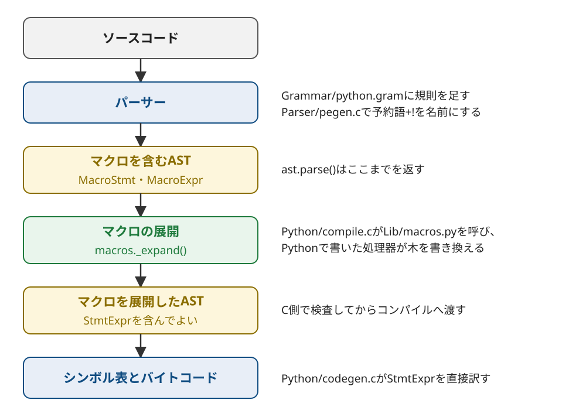

Title: CPython 3.15.2にPEP 638の構文マクロを実装した
Date: 2026-11-09 18:34
Draft: true


[PEP 638](https://peps.python.org/pep-0638/)はPythonに構文マクロを足す提案です。
`name!` の形で書いたマクロを、コンパイルするときにPythonで書いた関数が展開し、ASTを書き換えます。
このPEPをCPython 3.15.2に実装しました。
パーサーに規則を足し、コンパイルの手前でASTをPythonの関数に渡す段を1つ入れると、CPython本体でマクロが動きます。

リポジトリは[conao3/cpython-pep638](https://github.com/conao3/cpython-pep638)です。
python/cpythonの `v3.15.2` のタグの上に、実装のcommitを積んでいます。
CPythonの派生物なので、ライセンスはCPythonと同じPSF License Version 2です。
CPythonのプロジェクトとは関係のない実験です。

<div class="github-card" data-repo="conao3/cpython-pep638"><a href="https://github.com/conao3/cpython-pep638"><span class="github-card-name"><svg class="github-card-mark" viewBox="0 0 16 16" aria-hidden="true"><path d="M6.766 11.328c-2.063-.25-3.516-1.734-3.516-3.656 0-.781.281-1.625.75-2.188-.203-.515-.172-1.609.063-2.062.625-.078 1.468.25 1.968.703.594-.187 1.219-.281 1.985-.281.765 0 1.39.094 1.953.265.484-.437 1.344-.765 1.969-.687.218.422.25 1.515.046 2.047.5.593.766 1.39.766 2.203 0 1.922-1.453 3.375-3.547 3.64.531.344.89 1.094.89 1.954v1.625c0 .468.391.734.86.547C13.781 14.359 16 11.53 16 8.03 16 3.61 12.406 0 7.984 0 3.563 0 0 3.61 0 8.031a7.88 7.88 0 0 0 5.172 7.422c.422.156.828-.125.828-.547v-1.25c-.219.094-.5.156-.75.156-1.031 0-1.64-.562-2.078-1.609-.172-.422-.36-.672-.719-.719-.187-.015-.25-.093-.25-.187 0-.188.313-.328.625-.328.453 0 .844.281 1.25.86.313.452.64.655 1.031.655s.641-.14 1-.5c.266-.265.47-.5.657-.656"/></svg><span>conao3/<strong>cpython-pep638</strong></span></span><span class="github-card-description">CPython 3.15.2 with PEP 638 syntactic macros</span><span class="github-card-footer"><span class="github-card-language"><span class="github-card-language-color"></span>Python</span><span class="github-card-star"><svg viewBox="0 0 16 16" aria-hidden="true"><path d="M8 .25a.75.75 0 0 1 .673.418l1.882 3.815 4.21.612a.75.75 0 0 1 .416 1.279l-3.046 2.97.719 4.192a.751.751 0 0 1-1.088.791L8 12.347l-3.766 1.98a.75.75 0 0 1-1.088-.79l.72-4.194L.818 6.374a.75.75 0 0 1 .416-1.28l4.21-.611L7.327.668A.75.75 0 0 1 8 .25Z"/></svg><span>Star</span><span class="github-card-star-count" hidden></span></span></span></a></div>


# マクロを書いて使う

マクロの処理器はPythonの関数で、 `macros` モジュールのデコレーターで印を付けます。
処理器はマクロのASTを受け取り、置き換えるASTを返します。

```python
# mymacros.py
import ast
import macros

@macros.macro_processor(macros.STMT_MACRO, 1, "finally")
def try_(node, finally_):
    return ast.Try(body=node.body, handlers=[], orelse=[],
                   finalbody=finally_.body)

@macros.macro_processor(macros.EXPR_MACRO, 1)
def quote(node):
    return ast.Constant(ast.unparse(node.args[0]))
```

`try_` は文のマクロで、後ろに続く `finally!:` の節を2つめの引数で受け取ります。
`quote` は式のマクロで、引数の式をソースの文字列に変えます。

マクロを使う側は `from!` で処理器を読み込みます。

```python
# main.py
from! mymacros import try_
from! mymacros import quote

def read(log):
    try_!:
        return quote!(a + b * c)
    finally!:
        log.append("closed")

log = []
print(read(log), log)
```

このリポジトリでビルドした `python` で実行します。

```console
$ ./python main.py
a + b * c ['closed']
```

`quote!(a + b * c)` は文字列の `'a + b * c'` になり、 `try_!` は `try` と `finally` の文になりました。
`a` も `b` も定義していませんが、式は文字列に置き換わって評価されないので、エラーになりません。


# マクロの構文

マクロの名前は識別子の直後に空白を空けずに `!` を書いたものです。
`from!` や `finally!` のように、予約語の後ろに `!` を書いたものもマクロの名前になります。

文のマクロは次の形です。

```text
name! [引数] [import NAME] [as NAME] [: ブロック]
```

式のマクロは `name!(引数)` の形です。
行の先頭では文の形が優先されます。
f文字列の中の `f"{x!r}"` の `!` は、変換の指定として読みます。

処理器の種類は3つあります。

-   **`STMT_MACRO`:** 文のマクロ。インデントしたブロックを `body` で受け取る。
-   **`SIBLING_MACRO`:** ブロックを持たない文のマクロ。同じブロックの次の文を `body` で受け取る。
-   **`EXPR_MACRO`:** 式のマクロ。

読み込んでいないマクロを使うと、コンパイルのときに `SyntaxError` になります。

```console
$ cat undefined.py
print(quote!(a + b))
$ ./python undefined.py
  File "/path/to/undefined.py", line 1
    print(quote!(a + b))
          ^^^^^^^^^^^^^
SyntaxError: macro quote! is not defined
```


# マクロを展開する段

CPythonはソースをパースしてASTを作り、ASTからシンボル表とバイトコードを作ります。
マクロの展開はASTからバイトコードを作る直前に入れました。



パーサーはマクロを `ast.MacroStmt` と `ast.MacroExpr` のノードとして木に残します。
コンパイラはCで木をたどってマクロがあるかを調べます。
マクロがあれば、木をPythonのオブジェクトに変えて `macros._expand()` に渡します。
`macros._expand()` は外側のマクロから順に処理器を呼び、処理器が返した木もまた展開します。
展開が終わった木はCの構造体に戻し、検査してからシンボル表とバイトコードの生成へ渡します。

展開はコンパイルのたびに行うので、 `import` ・ `exec()` ・ `compile()` のどれでもマクロが動きます。
`ast.parse()` は展開する前の木を返すので、マクロのノードをそのまま調べられます。

```console
$ ./python -c 'import ast; print(ast.dump(ast.parse("quote!(a)").body[0]))'
MacroStmt(name='quote', args=[Name(id='a')])
```

`quote!(a)` は行の先頭にあるので、文のマクロとして読まれています。

予約語の扱いはパーサーの前の段で決めています。
CPythonのパーサーは `finally` を予約語のトークンとして受け取るので、そのままでは `finally!` を名前として読めません。
直後の文字が `!` のときは予約語の判定をせず、名前のトークンのままにしています。
`x!=y` のように `!=` が続くときは、比較の演算子として読みます。


# 式の中で文を実行するStmtExpr

式のマクロには、値を計算する前に文を実行したいものがあります。
PEPはそのためのノードとして `stmt_expr` を定めていて、この実装では `ast.StmtExpr(stmt, value)` です。
`stmt` を実行してから `value` を評価し、その値を式の値にします。

次の `debug!` は、式とその値を表示してから値を返すマクロです。

```python
# mymacros.py に足す
@macros.macro_processor(macros.EXPR_MACRO, 1)
def debug(node):
    tmp = f"$$debug_{node.lineno}_{node.col_offset}"
    label = ast.unparse(node.args[0]) + " ="
    show = ast.If(ast.Constant(True), [
        ast.Assign([ast.Name(tmp, ast.Store())], node.args[0]),
        ast.Expr(ast.Call(ast.Name("print", ast.Load()),
                          [ast.Constant(label), ast.Name(tmp, ast.Load())],
                          [])),
    ], [])
    return ast.StmtExpr(show, ast.Name(tmp, ast.Load()))
```

`debug.py` の3行目の `debug!` では `$$debug_3_11` になります。
このような変数名は、PEPが衝突を避けるために勧める書き方です。
ソースには書けない名前なので、利用者の変数と重なりません。

```python
# debug.py
from! mymacros import debug

squares = [debug!(x * x) for x in range(3)]
print(squares)
print(True or debug!(1 / 0))
```

```console
$ ./python debug.py
x * x = 0
x * x = 1
x * x = 4
[0, 1, 4]
True
```

内包表記の中でも、 `or` の右側でも、 `debug!` はその位置で評価されます。
`True or ...` の右側は評価されないので、 `1 / 0` で止まりません。
`StmtExpr` はコンパイラが直接バイトコードに訳すので、マクロを置いた位置で、Pythonの評価の順序どおりに実行されます。

`stmt` の中の `break` ・ `continue` ・ `return` が `StmtExpr` の外へ抜けると、式の途中で制御が飛び、スタックに積んだ値が残ります。
このような木はコンパイルのときに `SyntaxError` にしています。

```python
# escape.py
import ast

tree = ast.parse("for x in y:\n    f(E)\n")
call = tree.body[0].body[0].value
call.args[0] = ast.StmtExpr(ast.Break(), ast.Constant(None))
ast.fix_missing_locations(tree)
compile(tree, "<ast>", "exec")
```

```console
$ ./python escape.py
Traceback (most recent call last):
  File "/path/to/escape.py", line 7, in <module>
    compile(tree, "<ast>", "exec")
    ~~~~~~~^^^^^^^^^^^^^^^^^^^^^^^
  File "<ast>", line 2
SyntaxError: 'break', 'continue' and 'return' cannot leave a statement expression
```


# PEPと違うところ

PEPの文面と、この実装には次の違いがあります。

-   ASTのクラス名はCPythonの命名に合わせて `MacroStmt` ・ `MacroExpr` ・ `StmtExpr` にした。
-   文のマクロのブロックはPythonの文として読む。PEPの `bijection!` の例にある `"red" = 1` のような行は構文エラーになる。
-   `tokenize` はマクロの名前を `NAME` と `!` の2つのトークンとして返す。
-   処理器の `version` は検査するが、処理器を変えてもキャッシュしたバイトコードは作り直さない。


# 試す

ビルドの手順はCPythonと同じです。
Nixでは `nix develop nixpkgs#python315` でビルドに要るものが揃います。

```console
$ git clone https://github.com/conao3/cpython-pep638
$ cd cpython-pep638
$ ./configure --with-pydebug
$ make -j
$ ./python -m test test_macros
```

`test_macros` の32のテストはすべて通ります。
CPythonのテスト全体では、子プロセスの実行ファイルの名前を調べる `test_profiling` の1つがNixの環境で失敗し、ほかは通ります。
どこに何を足したかはリポジトリのREADMEにまとめています。

