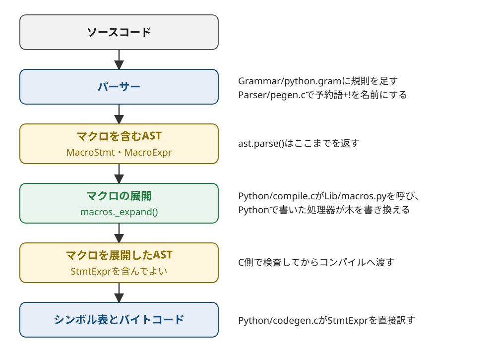

Title: CPython 3.15.2にPEP 638の構文マクロを実装した
Date: 2026-11-16 10:34
Updated: 2026-11-16 10:34
Tags: python cpython pep macro ast compiler release cpython-pep638


[PEP 638](https://peps.python.org/pep-0638/)はPythonに構文マクロを足す提案で、 `name!` の形で書いたマクロを、コンパイルするときにPythonで書いた関数が展開してASTを書き換えます。

このPEPをCPython 3.15.2に実装してみました。
パーサーに規則を足して、コンパイルの手前でASTをPythonの関数に渡すレイヤーを1つ入れると、CPython本体でマクロが動くようになります。

リポジトリは[conao3/cpython-pep638](https://github.com/conao3/cpython-pep638)で、python/cpythonの[v3.15.2](https://github.com/python/cpython/tree/v3.15.2)のタグの上に実装のcommitを積んでいます。
CPythonの派生物なのでライセンスはCPythonと同じPSF License Version 2ですが、CPythonのプロジェクトとは関係のない実験です。

<div class="github-card" data-repo="conao3/cpython-pep638"><a href="https://github.com/conao3/cpython-pep638"><span class="github-card-name"><svg class="github-card-mark" viewBox="0 0 16 16" aria-hidden="true"><path d="M6.766 11.328c-2.063-.25-3.516-1.734-3.516-3.656 0-.781.281-1.625.75-2.188-.203-.515-.172-1.609.063-2.062.625-.078 1.468.25 1.968.703.594-.187 1.219-.281 1.985-.281.765 0 1.39.094 1.953.265.484-.437 1.344-.765 1.969-.687.218.422.25 1.515.046 2.047.5.593.766 1.39.766 2.203 0 1.922-1.453 3.375-3.547 3.64.531.344.89 1.094.89 1.954v1.625c0 .468.391.734.86.547C13.781 14.359 16 11.53 16 8.03 16 3.61 12.406 0 7.984 0 3.563 0 0 3.61 0 8.031a7.88 7.88 0 0 0 5.172 7.422c.422.156.828-.125.828-.547v-1.25c-.219.094-.5.156-.75.156-1.031 0-1.64-.562-2.078-1.609-.172-.422-.36-.672-.719-.719-.187-.015-.25-.093-.25-.187 0-.188.313-.328.625-.328.453 0 .844.281 1.25.86.313.452.64.655 1.031.655s.641-.14 1-.5c.266-.265.47-.5.657-.656"/></svg><span>conao3/<strong>cpython-pep638</strong></span></span><span class="github-card-description">CPython 3.15.2 with PEP 638 syntactic macros</span><span class="github-card-footer"><span class="github-card-language"><span class="github-card-language-color"></span>Python</span><span class="github-card-star"><svg viewBox="0 0 16 16" aria-hidden="true"><path d="M8 .25a.75.75 0 0 1 .673.418l1.882 3.815 4.21.612a.75.75 0 0 1 .416 1.279l-3.046 2.97.719 4.192a.751.751 0 0 1-1.088.791L8 12.347l-3.766 1.98a.75.75 0 0 1-1.088-.79l.72-4.194L.818 6.374a.75.75 0 0 1 .416-1.28l4.21-.611L7.327.668A.75.75 0 0 1 8 .25Z"/></svg><span>Star</span><span class="github-card-star-count" hidden></span></span></span></a></div>


# マクロを書いて使う

マクロの処理器は `macros` モジュールのデコレーターで印を付けたPythonの関数で、マクロのASTを受け取って、置き換えるASTを返します。

```python
# mymacros.py
import ast
import macros

@macros.macro_processor(macros.STMT_MACRO, 1, "finally")
def try_(node, finally_):
    return ast.Try(body=node.body, handlers=[], orelse=[],
                   finalbody=finally_.body)

@macros.macro_processor(macros.EXPR_MACRO, 1)
def quote(node):
    return ast.Constant(ast.unparse(node.args[0]))
```

`try_` は後ろに続く `finally!:` の節を2つめの引数で受け取る文のマクロで、 `quote` は引数の式をソースの文字列に変える式のマクロです。

マクロを使う側では、 `from!` で処理器を読み込みます。

```python
# main.py
from! mymacros import try_
from! mymacros import quote

def read(log):
    try_!:
        return quote!(a + b * c)
    finally!:
        log.append("closed")

log = []
print(read(log), log)
```

これをこのリポジトリでビルドした `python` で実行してみます。

```console
$ ./python main.py
a + b * c ['closed']
```

`quote!(a + b * c)` は文字列の `'a + b * c'` になり、 `try_!` は `try` と `finally` の文になりました。
`a` も `b` も定義していないのですが、式は文字列に置き換わって評価されないので、エラーにはなりません。


# マクロの構文

マクロの名前は識別子の直後に空白を空けずに `!` を書いたもので、 `from!` や `finally!` のように予約語の後ろに `!` を書いたものもマクロの名前になります。

[文のマクロ](https://peps.python.org/pep-0638/#statement-form)は次の形です。

```text
name! [引数] [import NAME] [as NAME] [: ブロック]
```

式のマクロは `name!(引数)` の形ですが、[行の先頭では文の形が優先されます](https://peps.python.org/pep-0638/#resolving-ambiguity)。
なお、f文字列の中の `f"{x!r}"` の `!` は変換の指定として読んでいます。

[処理器の種類](https://peps.python.org/pep-0638/#defining-macro-processors)は3つあります。

-   **`STMT_MACRO`:** 文のマクロ。インデントしたブロックを `body` で受け取る。
-   **`SIBLING_MACRO`:** ブロックを持たない文のマクロ。同じブロックの次の文を `body` で受け取る。
-   **`EXPR_MACRO`:** 式のマクロ。

読み込んでいないマクロを使うと、コンパイルのときに `SyntaxError` になります。

```console
$ cat undefined.py
print(quote!(a + b))
$ ./python undefined.py
  File "/path/to/undefined.py", line 1
    print(quote!(a + b))
          ^^^^^^^^^^^^^
SyntaxError: macro quote! is not defined
```


# マクロを展開するレイヤー

CPythonはソースをパースしてASTを作り、ASTからシンボル表とバイトコードを作るので、マクロの展開はASTからバイトコードを作る直前に入れることにしました。



パーサーはマクロを `ast.MacroStmt` と `ast.MacroExpr` のノードとして木に残し、コンパイラはCで木をたどってマクロがあるかを調べます。
マクロがあれば木をPythonのオブジェクトに変えて `macros._expand()` に渡し、 `macros._expand()` が外側のマクロから順に処理器を呼んで、処理器が返した木もまた展開します。

展開が終わった木はCの構造体に戻し、検査してからシンボル表とバイトコードの生成へ渡しています。

展開はコンパイルのたびに行うので、 `import` ・ `exec()` ・ `compile()` のどれでもマクロが動きますが、 `ast.parse()` は展開する前の木を返すので、マクロのノードをそのまま調べられます。

```console
$ ./python -c 'import ast; print(ast.dump(ast.parse("quote!(a)").body[0]))'
MacroStmt(name='quote', args=[Name(id='a')])
```

`quote!(a)` は行の先頭にあるので、文のマクロとして読まれています。

予約語の扱いは、パーサーの前のレイヤーで決めています。
CPythonのパーサーは `finally` を予約語のトークンとして受け取るので、そのままでは `finally!` を名前として読めないので、直後の文字が `!` のときは予約語の判定をせずに名前のトークンのままにしました。

ただし `x!=y` のように `!=` が続くときは、比較の演算子として読みます。


# 式の中で文を実行するStmtExpr

式のマクロには、値を計算する前に文を実行したいものがあります。
[PEP](https://peps.python.org/pep-0638/#ast-extensions)はそのためのノードとして `stmt_expr` を定めていて、この実装では `stmt` を実行してから `value` を評価し、その値を式の値にする `ast.StmtExpr(stmt, value)` にしています。

> A new AST node called `stmt_expr` will be added, combining a statement and an expression. This new ast node will be a subtype of `expr`, but include a statement to allow side effects. It will be compiled to bytecode by compiling the statement, then compiling the value.

試しに、式とその値を表示してから値を返す `debug!` を書いてみます。

```python
# mymacros.py に足す
@macros.macro_processor(macros.EXPR_MACRO, 1)
def debug(node):
    tmp = f"$$debug_{node.lineno}_{node.col_offset}"
    label = ast.unparse(node.args[0]) + " ="
    show = ast.If(ast.Constant(True), [
        ast.Assign([ast.Name(tmp, ast.Store())], node.args[0]),
        ast.Expr(ast.Call(ast.Name("print", ast.Load()),
                          [ast.Constant(label), ast.Name(tmp, ast.Load())],
                          [])),
    ], [])
    return ast.StmtExpr(show, ast.Name(tmp, ast.Load()))
```

`debug.py` の3行目の `debug!` では、変数名は `$$debug_3_11` になります。
これは[PEPが衝突を避けるために勧めている書き方](https://peps.python.org/pep-0638/#hygiene-and-debugging)で、ソースには書けない名前なので利用者の変数とは重なりません。

> -   All generated variable names should start with a `$`
> -   Purely artificial variable names should start `$$mname` where `mname` is the name of the macro.
> -   Variables derived from real variables should start `$vname` where `vname` is the name of the variable.
> -   All variable names should include the line number and the column offset, separated by an underscore.

```python
# debug.py
from! mymacros import debug

squares = [debug!(x * x) for x in range(3)]
print(squares)
print(True or debug!(1 / 0))
```

```console
$ ./python debug.py
x * x = 0
x * x = 1
x * x = 4
[0, 1, 4]
True
```

内包表記の中でも `or` の右側でも、 `debug!` はその位置で評価されていて、 `True or ...` の右側は評価されないので `1 / 0` で止まることもありません。
`StmtExpr` はコンパイラが直接バイトコードに訳すので、マクロを置いた位置で、Pythonの評価の順序どおりに実行されます。

`stmt` の中の `break` ・ `continue` ・ `return` が `StmtExpr` の外へ抜けると、式の途中で制御が飛んでスタックに積んだ値が残ってしまうので、このような木はコンパイルのときに `SyntaxError` にしています。

```python
# escape.py
import ast

tree = ast.parse("for x in y:\n    f(E)\n")
call = tree.body[0].body[0].value
call.args[0] = ast.StmtExpr(ast.Break(), ast.Constant(None))
ast.fix_missing_locations(tree)
compile(tree, "<ast>", "exec")
```

```console
$ ./python escape.py
Traceback (most recent call last):
  File "/path/to/escape.py", line 7, in <module>
    compile(tree, "<ast>", "exec")
    ~~~~~~~^^^^^^^^^^^^^^^^^^^^^^^
  File "<ast>", line 2
SyntaxError: 'break', 'continue' and 'return' cannot leave a statement expression
```


# PEPと違うところ

PEPの文面とこの実装には、次の違いがあります。

-   ASTのクラス名はCPythonの命名に合わせて `MacroStmt` ・ `MacroExpr` ・ `StmtExpr` にした。
-   文のマクロのブロックはPythonの文として読む。PEPの[bijection!の例](https://peps.python.org/pep-0638/#compile-time-checked-data-structures)にある `"red" = 1` のような行は構文エラーになる。
-   [PEP](https://peps.python.org/pep-0638/#lexical-analysis)はマクロの名前を `MACRO_NAME` という1つのトークンにすると定めているが、 `tokenize` は `NAME` と `!` の2つのトークンとして返す。
-   [PEP](https://peps.python.org/pep-0638/#defining-macro-processors)は処理器の `version` を、キャッシュしたバイトコードを正しく作り直すための番号と定めている。この実装は `version` が整数であることを検査するが、処理器を変えてもキャッシュしたバイトコードは作り直さない。

PEPの `bijection!` の例は次のとおりです。

```python
bijection! color_to_code, code_to_color:
    "red" = 1
    "blue" = 2
    "green" = 3
```


# 試す

ビルドの手順はCPythonと同じで、Nixなら `nix develop nixpkgs#python315` でビルドに要るものが揃います。

```console
$ git clone https://github.com/conao3/cpython-pep638
$ cd cpython-pep638
$ ./configure --with-pydebug
$ make -j
$ ./python -m test test_macros
```

`test_macros` の32のテストはすべて通り、CPythonのテスト全体でも、子プロセスの実行ファイルの名前を調べる `test_profiling` の1つがNixの環境で失敗するほかは通っています。

どこに何を足したかは、リポジトリの[READMEのWhere the implementation lives](https://github.com/conao3/cpython-pep638#where-the-implementation-lives)にまとめてあります。

