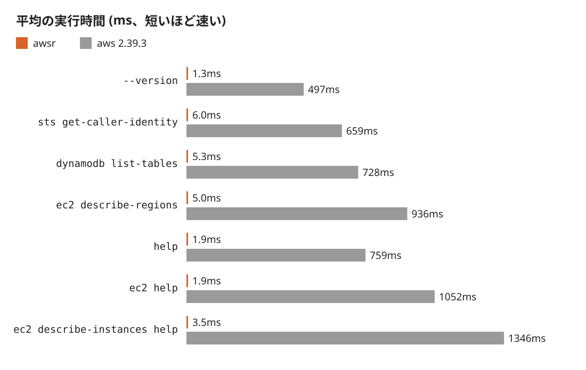
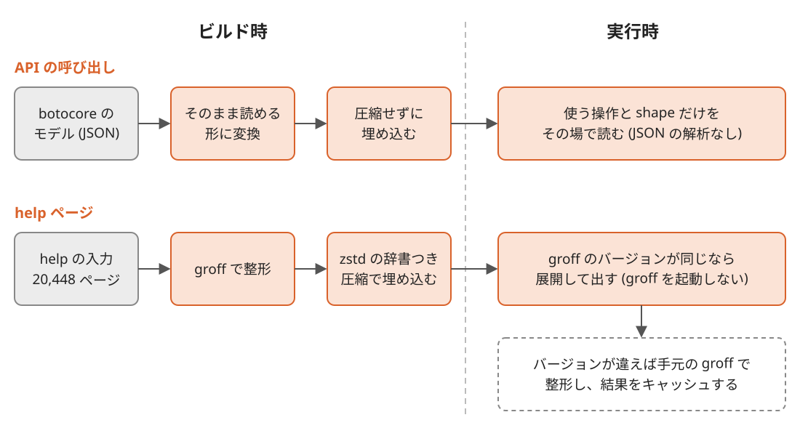

Title: AWS CLI v2と出力が同じで最大550倍速いawsrをRustで作った
Date: 2026-11-05


AWS CLI v2 のコマンドラインをそのまま受け付け、本家とバイト単位で同じ出力を返す CLI `awsr` を Rust で作りました。
リポジトリは [conao3/rust-awscli](https://github.com/conao3/rust-awscli) で、ライセンスは Apache-2.0 です。
`awsr sts get-caller-identity` は 6.0ms で終わり、同じ PC で本家の `aws` (2.39.3) は 659ms かかります。
110 倍の差です。
help ページは 380〜550 倍速く出ます。
`awsr` は AWS の公式の製品ではありません。

<div class="github-card" data-repo="conao3/rust-awscli"><a href="https://github.com/conao3/rust-awscli"><span class="github-card-name"><svg class="github-card-mark" viewBox="0 0 16 16" aria-hidden="true"><path d="M6.766 11.328c-2.063-.25-3.516-1.734-3.516-3.656 0-.781.281-1.625.75-2.188-.203-.515-.172-1.609.063-2.062.625-.078 1.468.25 1.968.703.594-.187 1.219-.281 1.985-.281.765 0 1.39.094 1.953.265.484-.437 1.344-.765 1.969-.687.218.422.25 1.515.046 2.047.5.593.766 1.39.766 2.203 0 1.922-1.453 3.375-3.547 3.64.531.344.89 1.094.89 1.954v1.625c0 .468.391.734.86.547C13.781 14.359 16 11.53 16 8.03 16 3.61 12.406 0 7.984 0 3.563 0 0 3.61 0 8.031a7.88 7.88 0 0 0 5.172 7.422c.422.156.828-.125.828-.547v-1.25c-.219.094-.5.156-.75.156-1.031 0-1.64-.562-2.078-1.609-.172-.422-.36-.672-.719-.719-.187-.015-.25-.093-.25-.187 0-.188.313-.328.625-.328.453 0 .844.281 1.25.86.313.452.64.655 1.031.655s.641-.14 1-.5c.266-.265.47-.5.657-.656"/></svg><span>conao3/<strong>rust-awscli</strong></span></span><span class="github-card-description">A fast, output-compatible Rust reimplementation of the AWS CLI v2</span><span class="github-card-footer"><span class="github-card-language"><span class="github-card-language-color" style="background-color: #dea584"></span>Rust</span><span class="github-card-star"><svg viewBox="0 0 16 16" aria-hidden="true"><path d="M8 .25a.75.75 0 0 1 .673.418l1.882 3.815 4.21.612a.75.75 0 0 1 .416 1.279l-3.046 2.97.719 4.192a.751.751 0 0 1-1.088.791L8 12.347l-3.766 1.98a.75.75 0 0 1-1.088-.79l.72-4.194L.818 6.374a.75.75 0 0 1 .416-1.28l4.21-.611L7.327.668A.75.75 0 0 1 8 .25Z"/></svg><span>Star</span><span class="github-card-star-count" hidden></span></span></span></a></div>


# 使い方

`aws` を `awsr` に置き換えて使います。

```console
$ awsr sts get-caller-identity
$ awsr dynamodb list-tables --output table
$ awsr ec2 describe-instances \
    --query 'Reservations[].Instances[].InstanceId' --output text
```

設定ファイル (`~/.aws/config` と `~/.aws/credentials` )、SSO のトークンのキャッシュ、環境変数は本家と同じものを読みます。
json、text、table の出力も `--query` の結果も本家と同じバイト列になるので、 `aws` を呼んでいるシェルスクリプトの出力は変わりません。

`awsr` は本家の 2.39.3 が同梱する botocore のモデルを取り込んでいて、そこにある全サービスの全操作を `awsr <サービス> <操作>` の形で呼べます。
`s3 cp` や `s3 sync` などの高レベルのコマンド、 `configure` 、 `sso login` も本家から移植しました。


# 速さ

手元の PC (Intel Core Ultra 5 225U) で、 `hyperfine -N` を使って平均の実行時間を測りました。
API を呼ぶコマンドはローカルのスタブのサーバーに `--endpoint-url` で向け、静的な認証情報で動かしています。
`awsr` は nix の flake のパッケージ (静的リンク)、本家は公式の Linux 向けのインストーラで入れた 2.39.3 です。



<table border="2" cellspacing="0" cellpadding="6" rules="groups" frame="hsides">


<colgroup>
<col  class="org-left" />

<col  class="org-left" />

<col  class="org-left" />

<col  class="org-left" />
</colgroup>
<thead>
<tr>
<th scope="col" class="org-left">コマンド</th>
<th scope="col" class="org-left">awsr</th>
<th scope="col" class="org-left">aws 2.39.3</th>
<th scope="col" class="org-left">比</th>
</tr>
</thead>
<tbody>
<tr>
<td class="org-left"><code>--version</code></td>
<td class="org-left">1.3ms</td>
<td class="org-left">497ms</td>
<td class="org-left">380 倍</td>
</tr>

<tr>
<td class="org-left"><code>sts get-caller-identity</code></td>
<td class="org-left">6.0ms</td>
<td class="org-left">659ms</td>
<td class="org-left">110 倍</td>
</tr>

<tr>
<td class="org-left"><code>dynamodb list-tables</code></td>
<td class="org-left">5.3ms</td>
<td class="org-left">728ms</td>
<td class="org-left">140 倍</td>
</tr>

<tr>
<td class="org-left"><code>ec2 describe-regions</code></td>
<td class="org-left">5.0ms</td>
<td class="org-left">936ms</td>
<td class="org-left">190 倍</td>
</tr>

<tr>
<td class="org-left"><code>help</code></td>
<td class="org-left">1.9ms</td>
<td class="org-left">759ms</td>
<td class="org-left">400 倍</td>
</tr>

<tr>
<td class="org-left"><code>ec2 help</code></td>
<td class="org-left">1.9ms</td>
<td class="org-left">1052ms</td>
<td class="org-left">550 倍</td>
</tr>

<tr>
<td class="org-left"><code>ec2 describe-instances help</code></td>
<td class="org-left">3.5ms</td>
<td class="org-left">1346ms</td>
<td class="org-left">380 倍</td>
</tr>
</tbody>
</table>

比べる下限として、同じ PC で C の hello world を動かすと、動的リンクで 1.1ms、静的リンクで 0.7ms かかります。
API を呼ぶコマンドの残りの数 ms は、プロセスの起動、エンドポイントのルールの評価、HTTP の送受信にかかっています。

本家は Python で書かれていて、呼ぶたびにインタプリタを起動し、多くのモジュールを import し、plugin を登録し、サービスのモデルの JSON を読み込みます。
`aws` をループで何百回も呼ぶスクリプトや CI では、この 0.5〜1 秒が呼ぶ回数だけ積み重なります。


# 起動を速くする仕組み

`awsr` は、本家が実行のたびに行う準備 (API の呼び出しではモデルの解析、help ではページの整形) をビルド時に済ませておきます。




## モデルを解析済みの形で埋め込む

botocore は各サービスの API を JSON のモデル (`service-2.json` など) で表していて、本家は呼ぶたびにこれを読み込んで解析します。
モデルが最大の ec2 は、JSON で 3.5MB あります。

`awsr` はビルド時にモデルを、オフセットでたどれる木と、重複を除いた文字列の表からなる形式に変換し、圧縮せずにバイナリへ埋め込みます。
オブジェクトのキーには並べ替えた索引を付け、二分探索で引きます。
実行時は JSON の解析も展開もせず、呼んだ操作が使う shape だけを読むので、ec2 の操作も sts の操作と同じくらいの時間で終わります。

サービスごとの Rust のコードは生成しません。
公式の AWS SDK for Rust はサービスごとに型付きのコードを生成していて、aws-sdk-ec2 だけでビルドに 150〜250 秒かかります ([awslabs/aws-sdk-rust#113](https://github.com/awslabs/aws-sdk-rust/issues/113))。
`awsr` はモデルを実行時に解釈するので、Rust のコンパイルの量はサービスの数によって変わりません。

ほかにも起動を速くするために、次のようにしています。

-   引数の解析とエンドポイントのルールの評価では、正規表現をコンパイルせずに照合します。
-   tokio のランタイムは最初のリクエストを送るときに作ります。 `--version` と help では作りません。
-   配布するバイナリは glibc を静的リンクし、起動時に動的ローダーを動かしません。
-   メモリの割り当てには glibc の malloc を使います。mimalloc に替えたビルドは、どのコマンドも 1.4〜2.3 倍遅くなりました。


## help ページを groff で整形して埋め込む

本家の `aws help` は、モデルと文書から reStructuredText を組み立て、docutils で man 形式に変換し、groff で整形してページャに渡します。
`awsr` はこの文書の組み立てと docutils の変換を Rust に移植しましたが、整形には本家と同じく手元の groff を使います。
groff を毎回起動すると、 `ec2 help` に 107ms かかります。

そこで、配布するバイナリにはビルド時に groff で整形した全 20,448 ページを埋め込んでいます。
整形したページは合計 732MB (最大は `quicksight update-template` の 36MB) あります。
これを、16 ページに 1 ページを標本にして学習した zstd の辞書を使ってレベル 19 で圧縮すると、35.8MB になります。
埋め込みのページを含めて、flake のパッケージのバイナリは 150MiB です。

groff の出力は groff のバージョンによって変わります。
`awsr` は `PATH` にある groff のバージョン (`groff -v` の 1 行目) を整形に使ったバージョンと比べ、同じで `GROFF` で始まる環境変数もなければ、埋め込みのページを展開して出します。
`groff -v` の結果は groff の実行ファイルごとにキャッシュするので、groff を起動するのはその PC で最初の 1 回だけです (このときの `ec2 help` は 3.8ms)。
GitHub Releases のバイナリは Ubuntu の groff 1.23.0 で、flake のパッケージは nixpkgs の groff で整形しています。
バージョンが違うときは本家と同じく手元の groff で整形し、結果を `~/.cache/awsr/help` に保存して、2 回目からはそれを出します。


# 本家と出力が一致することの確かめ方


## 差分テスト

出力を本家と一致させるには、Python の値の書式まで合わせる必要があります。
たとえば、浮動小数点数は Python の `repr` と同じ書式 (`1e-05` や `1.0`) で出し、text の出力の真偽値は `True` と `False` にします。
table の出力の文字幅は、本家が同梱する Python の `unicodedata.east_asian_width` に従って数えます。

このような規則を移植した結果を確かめるために、差分テストの道具 `awsr-difftest` を作りました。
`awsr-difftest` は同じコマンドラインで `awsr` と本家を動かし、stdout、stderr、終了コード、ストリーミングで書き出したファイル、スタブのサーバーが受けたリクエストを比べます。
本家は公式のインストーラ (2.39.3) を nix で取り込み、同梱の Python まで含めてバージョンを固定しています。

スタブのサーバーは操作の出力の shape からシード付きの乱数で応答を作ります。
値には、出力の規則が分かれるもの (`1.50` 、 `1e2` 、 `-0` 、多倍長の整数、 `NaN` 、オフセットの異なるタイムスタンプ、全角文字など) を必ず混ぜます。
署名の値のように実行のたびに変わるヘッダーは、比べる対象から外しています。

全サービスの全操作を、シード 4 つと json、text、table の 3 つの出力形式で回すと 233,880 件になり、233,040 件が本家と一致し、一致しない件はありません。
残りの 840 件はスタブのサーバーでは比べられない操作です (CLI のコマンドにならない 552 件、本物のエンドポイントに向かう 144 件、 `session-manager-plugin` を起動する 24 件、イベントストリームの 12 件など)。
除いた理由は [difftest/exclusions.txt](https://github.com/conao3/rust-awscli/blob/master/difftest/exclusions.txt) に書いてあります。
本家の実行結果はキャッシュしておき、キャッシュがあれば全件を 2〜5 分で回せます。


## help の全ページ比較

help は `scripts/compare-help.sh` で本家と比べます。
本家の help のコマンドラインを全部 (20,482 個) 並べて `awsr` と本家で実行し、stdout、stderr、終了コードをバイト単位で比べます。
ビルド時に整形したページを埋め込んだ `awsr` で比べると、20,482 個のすべてが本家と一致しました。


# 配布

GitHub Releases に Linux (x86\_64、x86\_64 の musl、aarch64) と macOS (x86\_64、aarch64) のバイナリを置いています。
nix と Cargo でも入れられます。

```console
$ nix profile install github:conao3/rust-awscli
$ cargo install awsr
```

`cargo install` ではビルド時に help ページを整形しないので、help は最初に開いたときに手元の groff で整形します。


## crates.io の 10MB の上限

crates.io に上げる .crate は 1 つあたり 10MB までです。
`awsr` が埋め込むモデルは zstd で圧縮しても計 11.4MB あり、1 つの crate には収まりません。
crates.io に上限の引き上げを頼みましたが、認められませんでした。

そこで、モデルをファイルとそのディレクトリだけを持つ 3 つのデータ crate に分けました。

<table border="2" cellspacing="0" cellpadding="6" rules="groups" frame="hsides">


<colgroup>
<col  class="org-left" />

<col  class="org-left" />

<col  class="org-left" />
</colgroup>
<thead>
<tr>
<th scope="col" class="org-left">crate</th>
<th scope="col" class="org-left">中身</th>
<th scope="col" class="org-left">大きさ</th>
</tr>
</thead>
<tbody>
<tr>
<td class="org-left"><code>awsr-models</code></td>
<td class="org-left">CLI のデータ、エンドポイント、例、help の入力など</td>
<td class="org-left">2.1MiB</td>
</tr>

<tr>
<td class="org-left"><code>awsr-models-services-a-l</code></td>
<td class="org-left">頭文字が a〜l のサービスのモデル</td>
<td class="org-left">5.2MiB</td>
</tr>

<tr>
<td class="org-left"><code>awsr-models-services-m-z</code></td>
<td class="org-left">頭文字が m〜z のサービスのモデル</td>
<td class="org-left">3.7MiB</td>
</tr>

<tr>
<td class="org-left"><code>awsr</code></td>
<td class="org-left">本体</td>
<td class="org-left">3.1MiB</td>
</tr>
</tbody>
</table>

`awsr` は 3 つのデータ crate を build-dependency に取り、 `build.rs` が各 crate のディレクトリのファイルを読んで埋め込みます。
データ crate のバージョンは本家のバージョン (2.39.3) にそろえ、本家のバージョンを上げたときだけ新しいバージョンを出します。
分けたあとも埋め込むデータは分ける前とバイト単位で同じなので、速さも変わりません。
7 つのコマンドを分ける前のバイナリと並べて測ると差は ±0.3ms 以内で、測る順番を入れ替えると速い側も入れ替わりました。


## trusted publishing で公開する

crates.io への公開は、GitHub Actions の trusted publishing (OIDC) で行っています。
`Publish` の workflow で [rust-lang/crates-io-auth-action](https://github.com/rust-lang/crates-io-auth-action) が一時的なトークンを取るので、crates.io の API トークンをリポジトリの secret に置かずに済みます。
workflow は 3 つのデータ crate、 `awsr` の順に、crates.io にまだないバージョンだけを `cargo publish` します。

リリースは `Release` の workflow を手で起動するだけです。
`Release` は `Cargo.toml` のバージョンを上げて commit とタグを push し、5 つのターゲットのバイナリを作って GitHub のリリースに付け、最後に `Publish` を起動します。
crates.io の各バージョンのページには、公開した GitHub Actions の run が記録されます。


# おわりに

`aws` を何度も呼ぶスクリプトや CI で、 `aws` を `awsr` に置き換えて使ってください。

