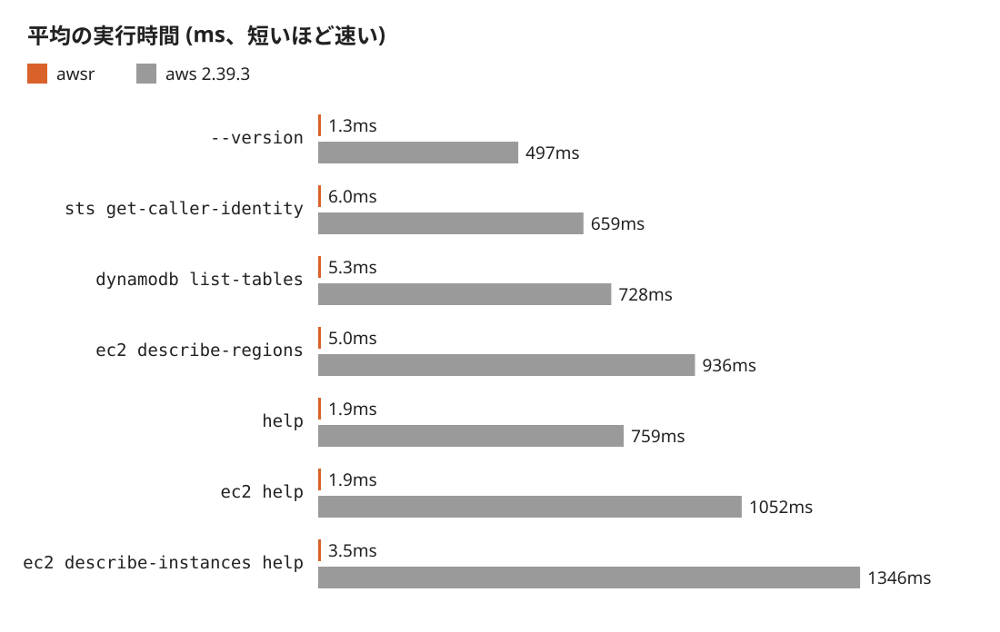
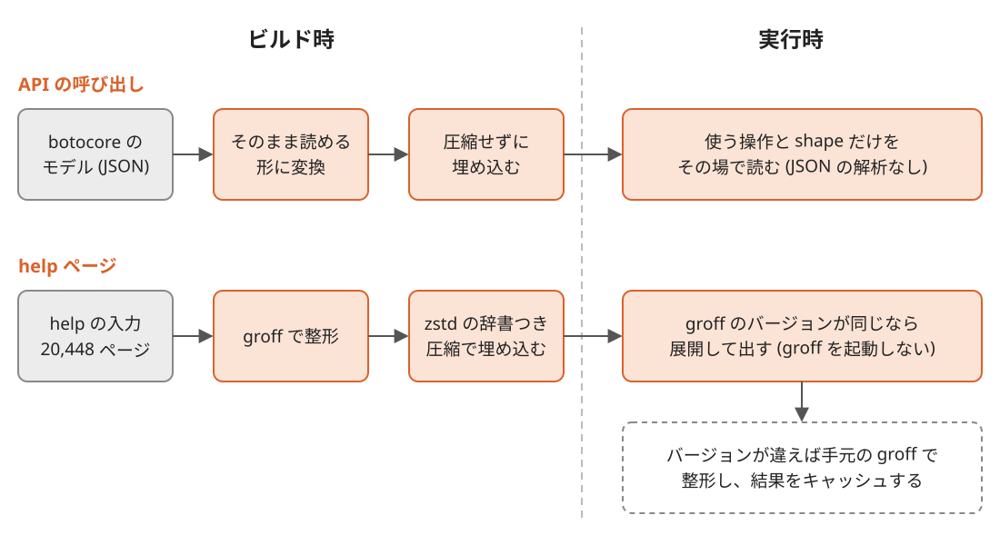

Title: AWS CLI v2と出力が同じで最大550倍速いawsrをRustで作った
Date: 2026-11-05 18:21
Updated: 2026-11-05 18:21
Tags: rust aws aws-cli cargo performance differential-testing release rust-awscli


AWS CLI v2のコマンドラインをそのまま受け付け、本家とバイト単位で同じ出力を返すCLI `awsr` をRustで作りました。
リポジトリは[conao3/rust-awscli](https://github.com/conao3/rust-awscli)で、ライセンスはApache-2.0です。

`awsr sts get-caller-identity` は6.0msで終わり、同じPCで本家の `aws` 2.39.3は659msかかるので、110倍の差になります。
helpページなら380〜550倍速く出ます。

なお、 `awsr` はAWSの公式の製品ではありません。

<div class="github-card" data-repo="conao3/rust-awscli"><a href="https://github.com/conao3/rust-awscli"><span class="github-card-name"><svg class="github-card-mark" viewBox="0 0 16 16" aria-hidden="true"><path d="M6.766 11.328c-2.063-.25-3.516-1.734-3.516-3.656 0-.781.281-1.625.75-2.188-.203-.515-.172-1.609.063-2.062.625-.078 1.468.25 1.968.703.594-.187 1.219-.281 1.985-.281.765 0 1.39.094 1.953.265.484-.437 1.344-.765 1.969-.687.218.422.25 1.515.046 2.047.5.593.766 1.39.766 2.203 0 1.922-1.453 3.375-3.547 3.64.531.344.89 1.094.89 1.954v1.625c0 .468.391.734.86.547C13.781 14.359 16 11.53 16 8.03 16 3.61 12.406 0 7.984 0 3.563 0 0 3.61 0 8.031a7.88 7.88 0 0 0 5.172 7.422c.422.156.828-.125.828-.547v-1.25c-.219.094-.5.156-.75.156-1.031 0-1.64-.562-2.078-1.609-.172-.422-.36-.672-.719-.719-.187-.015-.25-.093-.25-.187 0-.188.313-.328.625-.328.453 0 .844.281 1.25.86.313.452.64.655 1.031.655s.641-.14 1-.5c.266-.265.47-.5.657-.656"/></svg><span>conao3/<strong>rust-awscli</strong></span></span><span class="github-card-description">A fast, output-compatible Rust reimplementation of the AWS CLI v2</span><span class="github-card-footer"><span class="github-card-language"><span class="github-card-language-color" style="background-color: #dea584"></span>Rust</span><span class="github-card-star"><svg viewBox="0 0 16 16" aria-hidden="true"><path d="M8 .25a.75.75 0 0 1 .673.418l1.882 3.815 4.21.612a.75.75 0 0 1 .416 1.279l-3.046 2.97.719 4.192a.751.751 0 0 1-1.088.791L8 12.347l-3.766 1.98a.75.75 0 0 1-1.088-.79l.72-4.194L.818 6.374a.75.75 0 0 1 .416-1.28l4.21-.611L7.327.668A.75.75 0 0 1 8 .25Z"/></svg><span>Star</span><span class="github-card-star-count" hidden></span></span></span></a></div>


# 使い方

`aws` を `awsr` に置き換えて使います。

```console
$ awsr sts get-caller-identity
$ awsr dynamodb list-tables --output table
$ awsr ec2 describe-instances \
    --query 'Reservations[].Instances[].InstanceId' --output text
```

設定ファイルの `~/.aws/config` と `~/.aws/credentials` 、SSOのトークンのキャッシュ、環境変数は本家と同じものを読みます。
json、text、tableの出力も `--query` の結果も本家と同じバイト列になるので、シェルスクリプトの `aws` を `awsr` に置き換えても出力は変わりません。
なお0.2.5からは、 `--version` 、usageの行、エラーメッセージの頭の `awsr: [ERROR]:` 、helpページのコマンド行は `awsr` の名前で出すので、この4つは本家と異なります。

本家は、AWSのPython向けSDKの土台であるbotocoreを同梱していて、botocoreは各サービスのAPI (操作、引数、応答の形) を[JSONのモデル](https://github.com/aws/aws-cli/tree/2.39.3/awscli/botocore/data)として持っています。
`awsr` はこの記事を書いた時点で本家の2.39.3からbotocoreのモデルを取り込んでいて、モデルにある全サービスの全操作を `awsr <サービス> <操作>` の形で呼べます。
取り込むバージョンは[本家のリリースに毎日追従](https://s.conao3.com/blog/2026/7fe084)させています。
`s3 cp` や `s3 sync` などの高レベルのコマンド、 `configure` 、 `sso login` も本家から移植しました。


# 速さ

Intel Core Ultra 5 225Uの手元のPCで、 `hyperfine -N` を使って平均の実行時間を測りました。
APIを呼ぶコマンドは `--endpoint-url` でローカルのスタブサーバーに向けて静的な認証情報で動かしました。

`awsr` はnixのflakeの静的リンクのパッケージで、本家は公式のLinux向けインストーラで入れた2.39.3です。



<table border="2" cellspacing="0" cellpadding="6" rules="groups" frame="hsides">


<colgroup>
<col  class="org-left" />

<col  class="org-left" />

<col  class="org-left" />

<col  class="org-left" />
</colgroup>
<thead>
<tr>
<th scope="col" class="org-left">コマンド</th>
<th scope="col" class="org-left">awsr</th>
<th scope="col" class="org-left">aws 2.39.3</th>
<th scope="col" class="org-left">比</th>
</tr>
</thead>
<tbody>
<tr>
<td class="org-left"><code>--version</code></td>
<td class="org-left">1.3ms</td>
<td class="org-left">497ms</td>
<td class="org-left">380倍</td>
</tr>

<tr>
<td class="org-left"><code>sts get-caller-identity</code></td>
<td class="org-left">6.0ms</td>
<td class="org-left">659ms</td>
<td class="org-left">110倍</td>
</tr>

<tr>
<td class="org-left"><code>dynamodb list-tables</code></td>
<td class="org-left">5.3ms</td>
<td class="org-left">728ms</td>
<td class="org-left">140倍</td>
</tr>

<tr>
<td class="org-left"><code>ec2 describe-regions</code></td>
<td class="org-left">5.0ms</td>
<td class="org-left">936ms</td>
<td class="org-left">190倍</td>
</tr>

<tr>
<td class="org-left"><code>help</code></td>
<td class="org-left">1.9ms</td>
<td class="org-left">759ms</td>
<td class="org-left">400倍</td>
</tr>

<tr>
<td class="org-left"><code>ec2 help</code></td>
<td class="org-left">1.9ms</td>
<td class="org-left">1052ms</td>
<td class="org-left">550倍</td>
</tr>

<tr>
<td class="org-left"><code>ec2 describe-instances help</code></td>
<td class="org-left">3.5ms</td>
<td class="org-left">1346ms</td>
<td class="org-left">380倍</td>
</tr>
</tbody>
</table>

本家はPythonで書かれていて、呼ぶたびにインタプリタを起動し、多くのモジュールをimportし、pluginを登録し、サービスのモデルのJSONを読み込んでいます。
`aws` をループで何百回も呼ぶスクリプトやCIでは、この0.5〜1秒が回数分だけ積み重なってしまいます。

比べる下限として同じPCでCのhello worldを動かしてみると、動的リンクで1.1ms、静的リンクで0.7msでした。
APIを呼ぶコマンドの残りの数msは、プロセスの起動、エンドポイントのルールの評価、HTTPの送受信にかかっています。


# 起動を速くする仕組み

`awsr` では、本家が実行のたびに行う準備をビルド時に済ませておき、モデルは解析済みの形にして、helpページは整形して、バイナリに埋め込んでいます。




## モデルを解析済みの形で埋め込む

botocoreは各サービスのAPIを `service-2.json` などのJSONのモデルで表していて、本家は呼ぶたびにこれを読み込んで解析します。
モデルが最大のec2は、JSONで3.5MBあります。

そこで `awsr` はビルド時にモデルを、オフセットでたどれる木と、重複を除いた文字列の表からなる形式に変換して、圧縮せずにバイナリへ埋め込むことにしました。
オブジェクトのキーには並べ替えた索引を付けて二分探索で引くので、実行時はJSONの解析も展開もせずに、呼んだ操作が使うshapeだけを読めます。

そのため、ec2の操作もstsの操作と同じくらいの時間で終わります。

サービスごとのRustのコードは生成していません。
公式のAWS SDK for Rustはサービスごとに型付きのコードを生成していて、[awslabs/aws-sdk-rust#113](https://github.com/awslabs/aws-sdk-rust/issues/113)で報告されているとおりaws-sdk-ec2だけでビルドに[150](https://github.com/awslabs/aws-sdk-rust/issues/113#issuecomment-2112976928)〜[250秒](https://github.com/awslabs/aws-sdk-rust/issues/113#issuecomment-2578341465)かかります。

`awsr` はモデルを実行時に解釈するので、Rustのコンパイルの量はサービスの数によって変わりません。


## helpページをgroffで整形して埋め込む

本家の `aws help` は、モデルと文書からreStructuredTextを組み立て、docutilsでman形式に変換し、groffで整形してページャに渡します。
`awsr` はreStructuredTextの組み立てとdocutilsの変換をRustに移植したものの、整形には本家と同じく手元のgroffを使っていて、groffを毎回起動すると `ec2 help` に107msかかってしまいます。

そこで、配布するバイナリにはビルド時にgroffで整形した全20,448ページを埋め込むことにしました。
整形したページは合計732MBあり、最大の `quicksight update-template` は36MBです。

これをzstdの辞書を使ってレベル19で圧縮すると35.8MBになります。
辞書は16ページに1ページを標本にして学習させました。

埋め込みのページを含めて、flakeのパッケージのバイナリは150MiBです。

ただしgroffの出力はバージョンによって変わるので、埋め込むページは、GitHub ReleasesのバイナリではUbuntuのgroff 1.23.0で、flakeのパッケージではnixpkgsのgroffで整形しています。

`awsr` は `PATH` にあるgroffの `groff -v` の1行目を見て整形に使ったgroffとバージョンを比べ、同じで `GROFF` で始まる環境変数もなければ、埋め込みのページを展開して出します。
違うときは本家と同じく手元のgroffで整形して結果を `~/.cache/awsr/help` に保存し、2回目からはそれを出します。

`groff -v` の結果はgroffの実行ファイルごとにキャッシュするので、groffを起動するのはそのPCで最初の1回だけで、この1回でも `ec2 help` は3.8msで終わります。

ほかにも、起動を速くするために次のようにしています。

-   引数の解析とエンドポイントのルールの評価では、正規表現をコンパイルせずに照合します。
-   tokioのランタイムは `--version` やhelpでは作らず、最初のリクエストを送るときに作ります。
-   配布するバイナリはglibcを静的リンクし、起動時に動的ローダーを動かしません。
-   メモリの割り当てにはglibcのmallocを使い、mimallocに替えるとどのコマンドも1.4〜2.3倍遅くなりました。


# 本家と出力が一致することの確かめ方


## 差分テスト

出力を本家と一致させるには、Pythonの値の書式まで合わせる必要があります。
たとえば浮動小数点数は `1e-05` や `1.0` のようにPythonの `repr` と同じ書式で出し、textの出力の真偽値は `True` と `False` にし、tableの出力の文字幅は、本家が同梱するPythonの `unicodedata.east_asian_width` に従って数えます。

このような規則を移植した結果を確かめるために、差分テストの道具 `awsr-difftest` を作りました。
`awsr-difftest` は同じコマンドラインで `awsr` と本家を動かして、stdout、stderr、終了コード、ストリーミングで書き出したファイル、スタブサーバーが受けたリクエストを比べます。

本家は公式のインストーラの2.39.3をnixで取り込んで、同梱のPythonまで含めてバージョンを固定しています。

スタブサーバーは操作の出力のshapeからシード付きの乱数で応答を作り、その応答には `1.50` 、 `1e2` 、 `-0` 、多倍長の整数、 `NaN` 、オフセットの異なるタイムスタンプ、全角文字など、書式の規則が分かれる値を必ず混ぜています。
署名の値のように実行のたびに変わるヘッダーは、比べる対象から外しました。

全サービスの全操作を、シード4つとjson、text、tableの3つの出力形式で回すと233,880件になります。

このうち840件はスタブサーバーでは比べられない操作で、CLIのコマンドにならない552件、本物のエンドポイントに向かう144件、 `session-manager-plugin` を起動する24件、イベントストリームの12件などです。
除いた理由は[difftest/exclusions.txt](https://github.com/conao3/rust-awscli/blob/master/difftest/exclusions.txt)に書いてあります。

残りの233,040件は、すべて本家と一致しました。
本家の実行結果はキャッシュしておくので、キャッシュがあれば全件を2〜5分で回せます。


## helpの全ページ比較

helpは[scripts/compare-help.sh](https://github.com/conao3/rust-awscli/blob/master/scripts/compare-help.sh)で本家と比べていて、本家のhelpの全20,482個のコマンドラインを `awsr` と本家で実行し、stdout、stderr、終了コードをバイト単位で比べます。
ビルド時に整形したページを埋め込んだ `awsr` で比べると、20,482個のすべてが本家と一致しました。
0.2.5からはhelpページのコマンド行が `awsr` になったので、名前を `aws` に戻してからバイト単位で比べ、名前の長さで折り返しが動いたページは折り返しを除いて比べています。


# 配布

GitHub Releasesに、Linuxのx86\_64、x86\_64のmusl、aarch64と、macOSのx86\_64、aarch64のバイナリを置いていて、nixとCargoでも入れられます。

```console
$ nix profile install github:conao3/rust-awscli
$ cargo install awsr
```

`cargo install` ではビルド時にhelpページを整形しないので、helpは最初に開いたときに手元のgroffで整形します。


## crates.ioの10MBの上限

crates.ioに上げる.crateファイルは[1つあたり10MBまで](https://doc.rust-lang.org/cargo/reference/publishing.html#packaging-a-crate)なのですが、 `awsr` が埋め込むモデルはzstdで圧縮しても計11.4MBあり、1つのcrateには収まりません。
crates.ioに上限の引き上げを頼んでみたものの、認められませんでした。

そこで、モデルを、ファイルとそのディレクトリだけを収めた3つのデータcrateに分けることにしました。

<table border="2" cellspacing="0" cellpadding="6" rules="groups" frame="hsides">


<colgroup>
<col  class="org-left" />

<col  class="org-left" />

<col  class="org-left" />
</colgroup>
<thead>
<tr>
<th scope="col" class="org-left">crate</th>
<th scope="col" class="org-left">中身</th>
<th scope="col" class="org-left">大きさ</th>
</tr>
</thead>
<tbody>
<tr>
<td class="org-left"><code>awsr-models</code></td>
<td class="org-left">CLIのデータ、エンドポイント、例、helpの入力など</td>
<td class="org-left">2.1MiB</td>
</tr>

<tr>
<td class="org-left"><code>awsr-models-services-a-l</code></td>
<td class="org-left">頭文字がa〜lのサービスのモデル</td>
<td class="org-left">5.2MiB</td>
</tr>

<tr>
<td class="org-left"><code>awsr-models-services-m-z</code></td>
<td class="org-left">頭文字がm〜zのサービスのモデル</td>
<td class="org-left">3.7MiB</td>
</tr>

<tr>
<td class="org-left"><code>awsr</code></td>
<td class="org-left">本体</td>
<td class="org-left">3.1MiB</td>
</tr>
</tbody>
</table>

`awsr` は3つのデータcrateをbuild-dependencyに取り、 `build.rs` が各crateのディレクトリからファイルを読んで埋め込みます。
データcrateのバージョンは本家の2.39.3にそろえていて、本家のバージョンを上げたときだけ新しいバージョンを出します。

分けても埋め込むデータは分ける前とバイト単位で同じなので、速さも変わりません。
7つのコマンドを分ける前のバイナリと並べて測っても差は±0.3ms以内で、測る順番を入れ替えると速い側も入れ替わりました。


## trusted publishingで公開する

crates.ioへは、OIDCを使うGitHub Actionsのtrusted publishingで公開しています。
`Publish` のworkflowでは[rust-lang/crates-io-auth-action](https://github.com/rust-lang/crates-io-auth-action)が一時的なトークンを取るので、crates.ioのAPIトークンをリポジトリのsecretに置かずに済みます。

`Publish` は3つのデータcrate、 `awsr` の順に、crates.ioにまだないバージョンだけを `cargo publish` します。
crates.ioの各バージョンのページには、公開したGitHub Actionsのrunが記録されます。

リリースは `Release` のworkflowを手で起動するだけです。
`Release` は `Cargo.toml` のバージョンを上げてcommitとタグをpushし、5つのターゲットのバイナリを作ってGitHubのリリースに付けたあと、最後に `Publish` を起動します。


# おわりに

`aws` を何度も呼ぶスクリプトやCIで、 `aws` を `awsr` に置き換えて使ってみてください。

